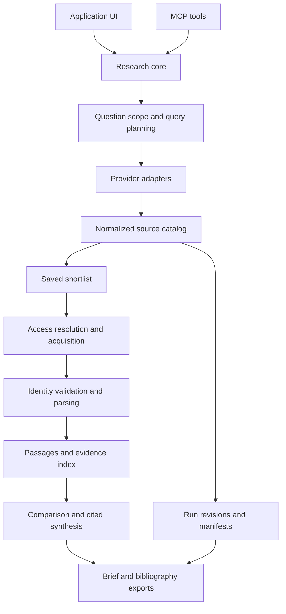

# Research Scout — Incremental Development Planning Findings

**Prepared:** October 26, 2026  
**Role:** Incremental architecture, roadmap, dataset scope, and handoff-readiness review  
**Status:** Planning findings; no application implementation or live credentialed API validation  
**Companion:** [Consolidated development handoff](research-scout-development-handoff.md)

## 1. Context and scope

The user wants an incrementally developed Research Scout application for finding scholarly papers, obtaining accessible documents, extracting knowledge with citations, and later incorporating web search, YouTube, and datasets. The inspiration is a four-provider MCP workflow using OpenAlex, Semantic Scholar, Unpaywall, and PubMed, with an LLM orchestrating research.

This document preserves this planning agent's consolidated findings, including the initial roadmap, review of the IntuitionLabs article and Awesome Public Datasets directory, and readiness review of the main handoff. It is intended to be usable by Codex in a later development session without the original chat.

The user requested a stepwise development approach and downloadable handoff material. The implementation choices below are recommendations, rather than newly imposed user requirements. No supplied repository or package was installed or executed for this work. No provider account, entitlement, API key, subscription, or functioning upstream MCP server is assumed.

The current roadmap is reconciled with the main handoff: **increments 0–4 form the paper-evidence MVP**. Increment 1 is the first independently useful slice. Web, YouTube, datasets, advanced analytics, and broader synthesis follow as additive capabilities.

## 2. Recommended architecture

Build one research core with provider adapters. The app API and MCP tools should call the same domain services, normalization logic, storage, and evidence rules.



An adapter may use a direct API, a Python library, or a verified upstream MCP server. Transport should not determine the domain model. A local MCP process still depends on upstream access, network availability, quotas, and any applicable model costs.

Proposed initial components:

- A Python service; FastAPI, Pydantic, and httpx are candidates to validate against the target repository.
- SQLite with migrations for metadata and FTS5 for a lexical passage-search baseline.
- Application-controlled local files, with checksums and an asset manifest.
- Persisted ingestion jobs with a bounded worker.
- A thin local UI for search, shortlist, source inspection, comparison, and export.
- A configurable extraction/synthesis model interface.
- A local STDIO MCP surface as capabilities stabilize.

Adopt embeddings after measuring the lexical baseline. Introduce a managed database, remote MCP transport, dedicated queue, or multi-user deployment when actual concurrency or operational requirements justify them. Local application execution does not imply that documents stay local when sent to hosted models.

## 3. Provider taxonomy and boundaries

Providers should be selected for capabilities and incremental value, rather than calling every service for every question.

| Capability | Initial or early candidates | Important boundary |
|---|---|---|
| Broad scholarly discovery | OpenAlex | Distinguish a relevance-ranked shortlist from an enumerated corpus or aggregate query. |
| DOI/bibliographic enrichment | Crossref; registry-aware DataCite singleton fallback | A miss from one registry does not prove that a DOI is invalid. |
| Complementary paper relevance | Semantic Scholar | Provider summaries and snippets remain distinct from independently retrieved article text. |
| Biomedical discovery | PubMed | Bibliographic records and abstracts do not guarantee article full text. |
| Preprint discovery | arXiv | Preserve versions, publication relationships, and actual licenses. |
| OA location resolution | Existing catalog links and Unpaywall | Unpaywall locates accessible versions; acquisition and parsing are separate components. |
| Original document acquisition | Suitable repository/content APIs and evaluated acquisition adapters | Validate identity, version, and main article versus supplement. |
| Web knowledge | One appropriately licensed search integration and destination reader | Search snippets and retrieved page content are different evidence states. |
| Video discovery | YouTube Data API | Metadata access does not establish transcript access. |
| Dataset discovery | Selected reviewed directory entries and DataCite | Dataset relevance, availability, version, and analytical suitability require separate handling. |
| Identity/citation enrichment | ORCID, ROR, OpenCitations when useful | Reuse identifiers already supplied; add dedicated lookups only for a demonstrated workflow. |
| Institutional literature | Optional entitled adapters | A wrapper or code license does not grant access to upstream subscription content. |

Google Search grounding should remain a separate user-facing grounded-answer feature. Its published terms restrict programmatic collection of returned links for crawling or indexing; it should not feed the general acquisition queue. [Google grounding terms](https://ai.google.dev/gemini-api/terms)

## 4. Incremental build sequence

Each increment should finish with a runnable demonstration and a short record of changes, validation, limitations, configuration, and the next useful slice. Do not require every later provider before demonstrating early value.

| Increment | Build | Exit criteria |
|---|---|---|
| **0. Contract, fixtures, skeleton** | Research request, project/run/catalog schemas; service skeleton; migrations; configuration; provider interfaces; small reviewed question/source set. | Create, persist, reopen, and inspect a research run. Credentials stay outside fixtures and tracked files. Expected discovery and citation behavior is documented. |
| **1. OpenAlex discovery and Crossref validation** | Search, filters, pagination, details, saved shortlist, executed-query log, selected DOI enrichment, registry-aware fallback, field provenance, bibliography export, lightweight export revision. | A topic becomes an attributed saved shortlist and usable bibliography. Missing records and metadata conflicts remain visible. Paging and repeat calls respect budgets. |
| **2. Complementary scholarly coverage** | Semantic Scholar adapter and cross-provider mappings; PubMed and/or arXiv where evaluation topics justify them; clearly labeled abstracts, snippets, and provider summaries. | Additional providers show measurable relevance or coverage value. Duplicates and version relationships survive normalization. A missing key or failed secondary provider produces a partial result. |
| **3. Full-text acquisition** | Access locations, Unpaywall fallback, suitable repository/content retrieval, controlled acquisition-adapter trial, identity checks, checksums, manifests, job lifecycle and failure categories. | Every selected item has an explicit outcome. Unrelated files, supplements, and abstract-only responses are not accepted as the intended full article. Retry, cancellation, restart recovery, and idempotency work. |
| **4. Evidence reader and cited comparison** | XML/PDF parsing, verified locators, passage storage/search, structured extraction, selected-source Q&A and definition/method/findings comparison, evidence table and cited brief. | Each substantive evaluated claim has inspectable evidence or an explicit unsupported/uncertain label. Abstract-only limitations, missing evidence, and conflicting findings are visible. The paper-evidence MVP demo succeeds. |
| **5. Landscape and citation navigation** | Explicit corpus/query scope, year/venue/country aggregation, citation traversal, counting rules, snapshot labels, query-manifest export. | Counts reconcile with the chosen provider/corpus and counting rules. Truncation remains visible. Citation metrics retain provider and observation date. |
| **6. Web knowledge** | One search adapter, permitted URL reading, user-supplied URL ingestion, main-content extraction, source dates, distinct search-snippet and retrieved-page evidence. | A web-supported claim links to the content actually read. Blocked or unsupported content has an explicit outcome. Applicable attribution and retention rules are implemented. |
| **7. YouTube knowledge** | Public search/details, video shortlist, authorized/user-provided timestamped transcript import, passage retrieval, time-linked citations. | Metadata-only and transcript-backed states are distinct. Caption listing is not represented as transcript text. Quotas and refresh requirements are enforced. Optional model video analysis is labeled and evaluated separately. |
| **8. Dataset discovery, then controlled ingestion** | Reviewed directory entries and DataCite records; applicability cards; dataset shortlist; then one selected repository and manageable format, such as CSV. | Explain fit or mismatch to the question. Preserve dataset version, checksum, schema/data dictionary, source relationships, and observed versus asserted metadata. Analysis remains a separately validated capability. |
| **9. Broader synthesis and product expansion** | Multi-source evidence matrices, contradictions, scoped-gap reports, policy briefs, richer revision UI, backup/export, expanded operational coverage, optional institutional/domain integrations. | Outputs survive source review and describe coverage limitations. Partial failures remain understandable. Empirical findings come from actual analyses. Hosted/multi-user operation is added only when required. |

Increment 4 provides bounded comparison over selected papers. Increment 9 extends that behavior to wider research workflows; it does not postpone all synthesis until the end. Likewise, minimum reliability ships with the first acquisition jobs in increment 3; increment 9 expands it.

## 5. Research request and canonical demonstration

A request should capture the question, discipline, audience, dates, language, geography/population, included document/source types, inclusion/exclusion criteria, exploration versus defined-corpus mode, output type, and request/document/model limits.

Canonical MVP question: **How do higher education studies define institutional AI readiness?**

1. Search for candidate papers using recorded queries and filters.
2. Inspect bibliographic identities and save a bounded shortlist.
3. Retrieve accessible versions and record sources that remain unread in full.
4. Extract each source's definition, with exact supporting passages.
5. Compare constructs, populations, methods, and limitations.
6. Let the user inspect page/section evidence.
7. Export the evidence matrix, bibliography, and search manifest.

For the biomedical example, classify actual study design and population. Do not infer that a paper is a clinical trial, or that an intervention caused an outcome, from its title or topical relevance.

## 6. Entity, version, and provenance model

| Entity | Required purpose |
|---|---|
| ResearchProject | Question family, saved library, scope, and settings. |
| ResearchRun | Request, query plan, executed calls, budgets, selected sources, status. |
| SourceSelection | Run/work/version membership, shortlist state, rank, inclusion/exclusion decision and reason, timestamps. |
| ResearchRunRevision | Immutable manifest of request/query scope, selections, asset and passage references, and generation configuration used for an output. |
| Work | Internal research-resource identity and type; paper, dataset, software, or another supported resource. |
| PublicationVersion | Preprint, accepted, published, revised, or dataset-release version; relationships and dates. |
| ProviderRecord / MetadataAssertion | What a provider reported, when, under which schema; field-level provenance and selected-value rationale. |
| SourceLocation | Landing/document URL, host, access status, version, and license evidence. |
| Asset | Particular file/page/transcript with checksum, source, retrieval time, storage reference, and retention requirements. |
| Passage | Text plus asset/version, section/page/paragraph/table/timestamp, extraction method, and parser version. |
| Claim | Extracted or synthesized statement, supporting/contradicting passages, scope, and review status. |
| Relationship | Explicit or inferred links such as version-of, cites, dataset-for, supplement-to, software-for, and authored-by; provenance and confidence. |
| Job | Type, state, attempts, progress, errors, cancellation state, idempotency key. |
| Export | Format, run revision, cited claims, evidence dependencies, and source manifest. |

Normalize identifiers by scheme and preserve DOI, PMID, PMCID, arXiv, OpenAlex, and Semantic Scholar identifiers independently. Use trusted identifiers and explicit relationships before fuzzy titles. A fuzzy match proposes a relationship for review; it is not automatic identity proof.

Do not count versions of the same study as independent evidence. Do not merge distinct studies without a supported relationship. Repeated metadata across indexes is not independent corroboration.

Create lightweight revisions before the first bibliography/comparison export. A revision should identify the selections, assets, passages, and generation configuration actually used. Later metadata refreshes create new observations and, when inputs change, a new revision. Mark affected stored outputs stale as needed. An immutable manifest does not permit indefinite retention of restricted content.

For evidence provenance retain provider/record, executed query/call reference, original and retrieved URL, retrieval/source dates, asset checksum/version, access and license evidence, content origin, locator, extraction/model version, and review status. Separate source-authored text from provider summaries and model transformations.

## 7. Shortlist, paging, and tool contracts

Minimum domain functions:

```text
search_papers
get_work
set_shortlist_selection
validate_metadata
resolve_open_access
fetch_document
get_job
search_evidence
compare_sources
get_research_run
export_brief
```

Add landscape, web, video, transcript, and dataset functions as their increments become usable. Proposed app routes include creating runs, searching within a run, creating/updating shortlist membership, starting acquisition, inspecting jobs, searching evidence, comparing selected sources, and exporting results. MCP tools should reuse these domain operations.

Return structured items, request/run IDs, partial errors, provenance, usage, and explicit truncation. Unknown cost is null rather than zero.

The application's opaque `next_cursor` must represent per-provider cursor/page state, query/filter identity, ordering, and deduplication progress. It can reference persisted search-session state. It must not simply pass through one upstream cursor while pretending to paginate a combined result set.

Expose provider completion, `truncated`, and `stop_reason`. A candidate ceiling is appropriate for exploration. A landscape count needs a provider-supported aggregate with matching scope, or complete enumeration under documented counting rules. Never present a truncated top-k result list as the research population.

Deterministic code enforces budgets, request limits, and data handling. The model chooses among available capabilities; it does not authorize additional source rights or bypass application controls. Keep STDIO stdout protocol-clean, return asset references instead of entire corpora, and keep file destinations application-controlled.

## 8. Dataset directory and DataCite findings

The [IntuitionLabs survey](https://intuitionlabs.ai/articles/research-paper-apis-scientific-literature) usefully separates metadata, repository/access, citation, identity, and commercial services. Its principal additions to this plan are Crossref early and DataCite for linked research resources later. Treat the article as a provider shortlist rather than a copyable API specification: some Crossref examples use incorrect paths. The official singleton route is `/works/{doi}`. [Crossref documentation](https://www.crossref.org/documentation/retrieve-metadata/rest-api/)

The survey's blanket CC-BY characterization of arXiv also needs correction. arXiv supports several article licenses and version-specific choices; retain actual license evidence. [arXiv licenses](https://info.arxiv.org/help/license/index.html)

[Awesome Public Datasets](https://github.com/awesomedata/awesome-public-datasets/blob/master/README.rst) is a categorized directory generated from `apd-core`, with per-entry metadata links and OK/FIXME markers. Use reviewed entries to seed a catalog. The listing does not establish a uniform API, working download, common license, current data, or analytical suitability for every resource. The Education and Healthcare categories are relevant starting points for the example questions.

Do not bulk-ingest linked datasets as part of the paper MVP. First provide metadata cards and a shortlist. A dataset Work should have `resource_type=dataset`, related versions/assets, and an optional DatasetProfile. Keep catalog assertions separate from fields observed during profiling. Record discovered, retrieved, and profiled states independently.

Dataset applicability includes publisher, dates, population/geography, variables, units, formats, access, license, and version. Missingness, row counts, actual schema, and computed summaries may remain unknown until retrieval. A dataset about higher education may provide context without measuring institutional AI readiness.

DataCite's documented DOI lookup is `https://api.datacite.org/dois/{id}`. Prefer registered relationships for paper–dataset links; label text-inferred links separately. An early registry-aware DOI fallback does not imply that the complete dataset-discovery lane must ship in increment 1. [DataCite documentation](https://support.datacite.org/docs/api-get-doi)

## 9. Evaluation and acceptance

Start with a small human-reviewed reference set. The main handoff proposes approximately 15–25 questions as a manageable initial scale; this is a project suggestion, not a validated benchmark size. Include education/policy, biomedical, technical/preprint, known-identifier, unavailable-full-text, versioned, and contradictory-source examples.

| Area | Review or measure |
|---|---|
| Discovery | Human relevance at k, known-source recall, incremental coverage of each provider. |
| Identity | Wrong merges, missed duplicates, and version relationships. |
| Acquisition | Correct full-text success over eligible sources, with categorized failures. |
| Parsing | Body/section/table fidelity and locator correctness on inspected examples. |
| Retrieval | Whether known support passages appear in the retrieved results. |
| Extraction | Correct fields, units, context, and supporting passages. |
| Synthesis | Whether passages support claims, and whether contradictory or missing evidence is represented. |
| Landscape | Reproducible query scope, completeness, and counting rules. |
| Datasets | Correct resource type, applicability, registered/inferred links, version and schema provenance. |
| Operations | Requests, retries, latency, partial failures, tokens, storage, and observed costs. |

Set quantitative targets after measuring a baseline. Test behavioral risks rather than tests that merely repeat the implementation.

Required examples include rate limiting with Retry-After, budget exhaustion, a failed secondary provider, invalid identifiers versus provider misses, unrelated PDFs, supplements, abstract-only XML, scanned PDFs, conflicting dates, dataset/software DOIs entered as papers, broken dataset links, unsuitable populations/dates, metadata-only videos asked spoken-content questions, instructions embedded in source text, interrupted ingestion, and stale evidence dependencies.

Every substantive evaluated generated claim needs inspectable support or an explicit unsupported/uncertain label. Never fabricate identifiers, citations, study methods, or empirical findings. Source retrieval alone does not create an experiment or clinical trial.

Use deterministic unit/contract tests, retainable fixtures, a bounded opt-in live smoke suite, and human-reviewed retrieval/synthesis checks. Do not require live network access for every test.

## 10. Scope traps and decisions still open

Avoid these implementation traps:

- Treating a free local MCP process as unlimited free access to every upstream service.
- Implementing every provider in a survey before validating the first slice.
- Treating provider snippets, abstracts, or generated summaries as complete full-text evidence.
- Treating a high citation count as source quality or merging citation counts across providers.
- Presenting a relevance-ranked page or capped search as exhaustive landscape statistics.
- Treating preprint and published versions as independent studies.
- Assuming every public YouTube video has downloadable captions through the official API.
- Treating dataset topical similarity as evidence that it measures the target construct.
- Generating statistical results to fill a paper section without an actual analysis.
- Coupling all provider logic to a particular UI, model vendor, or community MCP server.

The target discipline, model, web provider, paid budget, downloader adoption, and eventual hosting remain refinement choices. Proposed defaults are local single-user operation, configurable generation, lexical retrieval first, no assumed paid subscription, and domain-specific integrations selected by evaluation. These choices should not block repository inspection or the first independent slice.

For paper writing, use IMRAD when appropriate to the field and output. In a review, Methods describes search/selection and Results describes synthesis. In empirical work, Methods and Results require the actual study or analysis. Analytical and argumentative outputs may need different outlines.

## 11. Review outcomes incorporated into the main handoff

The planning-readiness review identified and the latest main handoff now represents:

1. Explicit saved-shortlist mutations and SourceSelection records.
2. Lightweight immutable run revisions before initial exports.
3. Dataset Work mapping and separate metadata versus profiling states.
4. Opaque federated pagination, deduplication progress, and truncation flags.
5. Minimum reliability in acquisition, with later expansion rather than delayed introduction.
6. Bounded selected-source comparison in increment 4 versus broader synthesis in increment 9.
7. Explicit prevention of double-counting versions or merging unsupported identities.

No application behavior has been validated by these document reviews. The next development session should inspect the actual repository and applicable instructions before implementing increment 0 or continuing existing code.

## 12. Source register and evidence status

Read during this planning work:

- [IntuitionLabs scholarly API survey](https://intuitionlabs.ai/articles/research-paper-apis-scientific-literature) — provider taxonomy and candidate additions; secondary overview with implementation examples requiring verification.
- [Awesome Public Datasets README](https://github.com/awesomedata/awesome-public-datasets/blob/master/README.rst) — directory structure, categories, entry metadata links, and maintenance markers. Selected underlying YAML requests did not return content during review; no schema claim depends on their contents.
- [Crossref REST API](https://www.crossref.org/documentation/retrieve-metadata/rest-api/) — registry metadata and documented routes.
- [DataCite singleton lookup](https://support.datacite.org/docs/api-get-doi) — DOI metadata lookup route.
- [arXiv licenses](https://info.arxiv.org/help/license/index.html) — multiple article licenses and version-specific licensing.
- [Main Research Scout handoff](research-scout-development-handoff.md) — reviewed for milestone consistency and development readiness, then re-read to reconcile this artifact.

Additional provider boundaries inherited from the shared research context, with official implementation references:

- [OpenAlex API](https://help.openalex.org/api/)
- [Semantic Scholar API](https://api.semanticscholar.org/api-docs/)
- [Unpaywall response format](https://unpaywall.org/data-format)
- [PMC retrieval guidance](https://pmc.ncbi.nlm.nih.gov/tools/textmining/)
- [YouTube search](https://developers.google.com/youtube/data/reference/rest/v3/search/list)
- [YouTube caption download](https://developers.google.com/youtube/data/reference/rest/v3/captions/download)
- [Google grounding terms](https://ai.google.dev/gemini-api/terms)
- [Gemini File Search](https://ai.google.dev/gemini-api/docs/file-search)

Provider quotas, pricing, schemas, content rights, preview features, and MCP implementations require current verification when their increment is implemented. This artifact deliberately makes no unlimited-free, exhaustive-coverage, or automatic-full-text guarantee.
