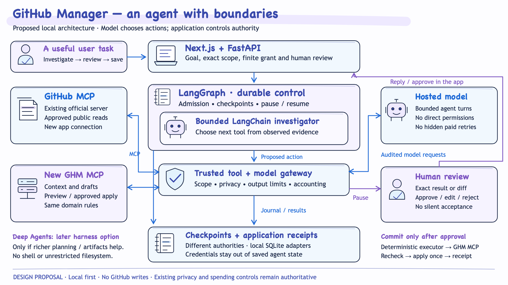

# Research Scout — proposal and research foundation

**Standalone project · 25 October 2026 · documentation only**

Research Scout will help someone describe a problem, investigate relevant resources, understand how they might contribute to a solution, and keep a source-backed research result. The initial research covers **public software repositories and optional public-data sources**. The broader cross-modality ambition in the repository's root README remains a future scope discussion.

This folder brings together the relevant work previously developed inside GitHub Manager. **No application has been installed or implemented in this repository.** The existing GitHub Manager project remains unchanged. This copy transfers research, design material, illustrations, prototype findings and generated example documents; it does not transfer credentials, databases, account data, API grants or runtime services.

## Start here

| Document | What it covers | How to use it |
| --- | --- | --- |
| [Standalone scope and next decisions](scope-and-next-steps.md) | The user problem, initial inputs/outputs, separation from GitHub Manager and incremental planning questions | Current orientation for the new project; future implementation still needs approval |
| [Research Scout product direction](design/product-direction.md) | The original Research Scout and small Evidence Investigator use cases | Selected source research; unrelated product proposals were omitted |
| [Original design overview](design/overview.md) | Why a tool-using agent helps, autonomy boundaries and technical alternatives | Historical design rationale, with GitHub Manager context explicitly labeled |
| [Architecture and control flow](design/architecture.md) | State, tools, MCP boundaries, human handoff, recovery and accounting | Reusable design patterns; original app-specific contracts are not standalone requirements |
| [Original incremental plan](design/incremental-plan.md) | Compatibility proofs, a small task, expansion and hardening | Planning reference; its phases have not been executed in this repository |
| [Evaluation approach](design/evaluation-plan.md) | Component, trajectory and user-outcome checks; human review and cost accounting | A base for a new Research Scout evaluation plan |
| [Original design review](design/design-review.md) | Tradeoffs, gaps and open integration decisions | Historical review, not a new implementation approval |

## Technical and source research

- [Framework options](research/framework-options.md): LangChain, LangGraph, Deep Agents, bounded loops, memory, checkpoints and tradeoffs.
- [MCP integration research](research/mcp-integration.md): official GitHub MCP, a separate application MCP server, OAuth, protocol compatibility and tool authorization.
- [Public data and licenses](research/public-data-and-licenses.md): AWS Open Data, Kaggle, Enigma, data.gov, Hugging Face and World Bank; source access, costs and dataset-specific terms.
- [Original illustrations](diagrams/README.md): editable SVG and PNG architecture/lifecycle illustrations in the established visual style.

These are copied research snapshots from **23 October 2026**. Their upstream links and version-specific findings were preserved. They have not been freshly researched or revalidated for this standalone project.

## What the earlier prototype taught us

The [prototype findings](prototype-findings/README.md) preserve the behavior demonstrated inside GitHub Manager: a separate research library, public-only evidence acquisition, a fixed curated baseline, a bounded live agent, human review, reports and a narration script.

Useful focused references:

- [Implementation approach and tradeoffs](prototype-findings/implementation.md)
- [Task, evidence and storage contracts](prototype-findings/backend-storage.md)
- [Framework runtime and finite-budget controls](prototype-findings/framework-runtime.md)
- [Implemented task-scoped MCP boundary](prototype-findings/mcp-integration.md)
- [Input, review and navigation experience](prototype-findings/ui-research.md)
- [Validation results and limitations](prototype-findings/validation.md)
- [Actual sentiment-analysis research example](prototype-findings/examples/sentiment-analysis/README.md): generated report, approach document and narration script.

**Evidence boundary:** the prototype's reported tests and successful live run belong to GitHub Manager. They are useful prior evidence, not passing tests or a running application in Research Scout. Its remote GitHub MCP OAuth compatibility remained unverified. The old reports' remaining-call counts and dollar amounts are dated historical observations; no spending permission carries into this repository.

## Illustrations

*Original GitHub Manager agent-design illustration, copied without alteration. It explains reusable ideas; it is not a deployment diagram or finalized branding for this standalone project. The [diagram notes](diagrams/README.md) also link the investigation lifecycle.*

## Copy record

[Provenance and selection notes](provenance.md) explain what was included and excluded. [COPY-MANIFEST.json](COPY-MANIFEST.json) records each copied file, its original path, content hashes and any adaptation.

All work in this step stays under `proposal/`. The repository's existing root README, `docs/` folder and Git configuration were preserved. No dependencies, application code, environment files or private runtime data were copied, and no new model calls, GitHub writes or deployment took place.
