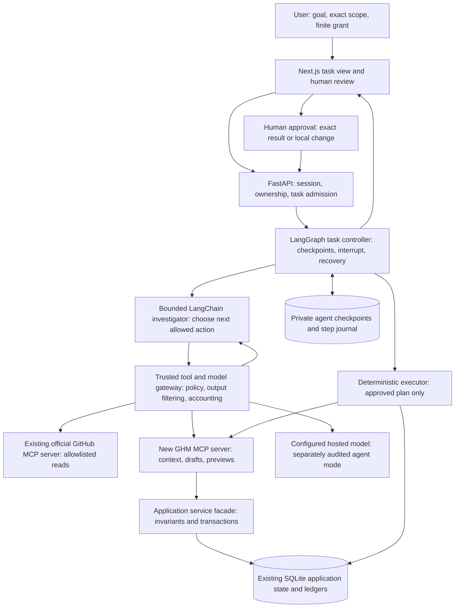
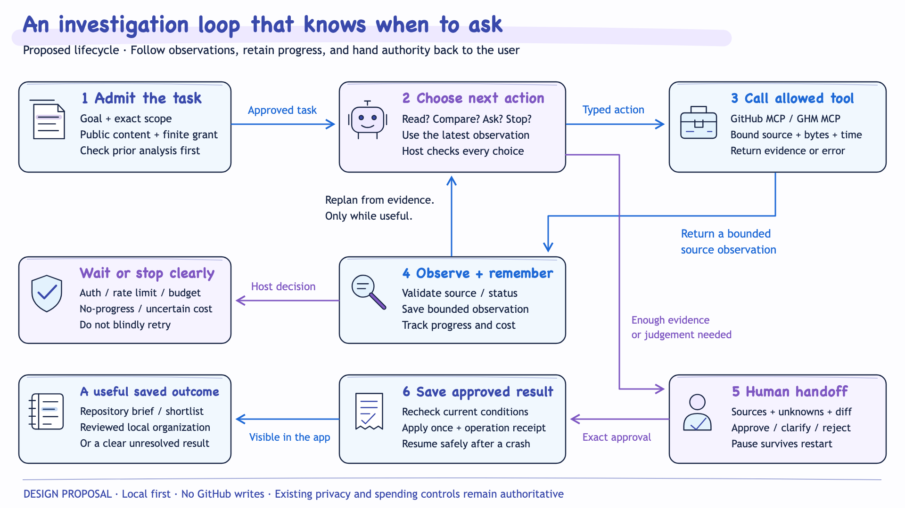
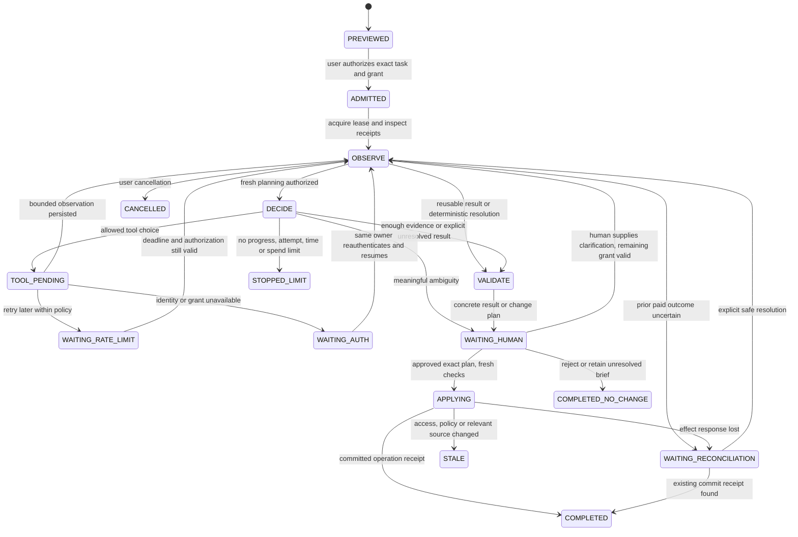

# Agent architecture, control flow and contracts

> **Historical source material — copied 25 October 2026.** This document originated in the GitHub Manager Research Scout work of 23 October 2026. Implementation statements, paths, commands, localhost addresses, test counts and budgets describe that original prototype or proposal, not an implementation in this repository. No code, credentials, data stores or spending authorization are transferred. See the [standalone project scope](../README.md) before using this material.


**Proposed local design · 23 October 2026.** All new names, API routes, tool contracts, state fields and storage tables below are design specifications, not existing interfaces. Source-backed current behavior is separated in the code audit (original GitHub Manager source: `agentic-design/research/codebase-use-cases.md`).

## 1. Component responsibilities



The return edge from Gateway to Agent represents **sanitized observations**, not unrestricted raw tool output. Browser identity and approval arrive through the application API. The browser does not receive GitHub/MCP/provider credentials or call the internal MCP server directly. Deep Agents may later replace the inner investigator harness for a selected profile; it does not replace the trusted gateway or domain services.

Use asynchronous graph/MCP I/O in the background worker. A mounted loopback MCP call must not synchronously block the same FastAPI event loop needed to serve it. The browser receives task status, not an HTTP request held open for the entire agent lifetime.

The illustrated [architecture](../diagrams/01-agent-architecture.png) is a more approachable view of the same boundaries. These are logical modules in the local app plus the chosen GitHub MCP connection; they are not a requirement for separate microservices.

## 2. The task state machine



*Illustrative proposed lifecycle. Model-directed choices occur inside the bounded loop; authentication, review and commit gates remain deterministic. [Editable SVG](../diagrams/02-task-lifecycle.svg).*



Terminal failures also include `FAILED`; an insufficient-evidence conclusion can be a successful `COMPLETED_NO_CHANGE`, not a reason to run indefinitely. Cancellation, stale/reset detection and limit checks apply at **every** active boundary, not just the arrows shown for readability. A waiting state is persisted and the worker lease released. It does not hold an HTTP request open while a person signs in or reviews.

## 3. What the model can choose

The investigator receives the goal, admitted task profile, bounded evidence and approved tool descriptions. It can select the next allowed read, ask a precise question, stage a supported result, or end unresolved. It returns a brief public rationale tied to evidence. Hidden chain-of-thought is neither requested nor stored.

A proposed typed disposition is:

```json
{
  "disposition": "READ_MORE",
  "action": "gh_read_pinned_file",
  "arguments": {
    "repository_ref": "<server-issued allowed repository reference>",
    "source_ref": "<server-issued source/path reference>"
  },
  "reason": "The current excerpt does not establish whether this capability is primary.",
  "evidence_refs": ["<validated existing source reference>"]
}
```

This is an **illustrative proposed application schema**, not an actual MCP payload or captured model result. Native tool calls can be normalized to the same action envelope. Identity, remaining grant, arbitrary URLs, filesystem paths and approval secrets are never accepted from the model as authority.

## 4. Two MCP connections and a common gateway

### GitHub MCP: external facts

Use the official hosted GitHub MCP server if the chosen registered OAuth integration works. Independently authenticate the connection and match its durable numeric GitHub identity to the task's owner. The current app uses an OAuth App; do not silently migrate to a GitHub App or PAT.

The local official stdio server with a separately disclosed OAuth flow is an alternative if hosted compatibility fails. A live MCP integration gate remains blocked until one real supported path works. A REST/cached fallback can keep a product usable, but must not be presented as proof of working GitHub MCP.

Map discovered upstream tools to a **small frozen host catalog**. For example, the application action `gh_search_public` could wrap an approved server repository-search tool. `gh_read_pinned_file` could wrap an approved file-content read. The actual server names, schemas, protocol era and read-only configuration must be recorded during the spike; these action names are app-level proposals.

Every repository must be explicitly public-verified before source text enters a model context. Resolve owner/name to stable identity, bind the file read to an immutable commit/blob where supported, and record repository, requested and resolved paths, SHA, acquisition time and truncation. Block arbitrary redirects, external MCP endpoints, submodule traversal, executable content and non-allowlisted files. If the server cannot supply trustworthy immutable provenance, label the read unpinned and block provenance-dependent commits until an approved verification path exists.

The A2 read manifest contains the exact README and at most two named supporting text-file references established at task preview. The agent chooses among those references; it cannot invent a new path. A3-S adds public search through a separately approved profile/catalog, then converts bounded discovered candidates to public-verified references. Discovery scope is distinct from a frozen selected-repository cohort.

### GHM MCP: local knowledge and drafts

Mount a new application MCP ASGI endpoint in FastAPI, or run an isolated stdio facade as an alternative. Mounting does not inherit route-level `Depends` authorization: compose lifespan and explicit MCP auth/policy checks. The preferred initial candidate is a private first-party loopback connection, not an internet-facing MCP service.

For that private first-party deployment, use a short-lived app-issued capability bound to **owner, workspace/collection, task, audience, allowed actions, expiry and auth version**. Keep it in trusted runtime context. This is a deliberately restricted internal capability scheme, **not** a claim of a generic OAuth-compatible MCP service. External clients require a separately designed standards-compliant OAuth/discovery/consent boundary. The resource must never accept arbitrary third-party tokens or pass its inbound bearer to GitHub.

The [MCP research](../research/mcp-integration.md) details current spec/SDK behavior, OAuth requirements and two-connection compatibility. HTTP/stdio connection state is distinct from application session state and LangGraph checkpoint state.

### Proposed normalized action catalog

| Action | Permitted arguments | Bounded result/effect | Available to model? |
| --- | --- | --- | --- |
| `gh_search_public` | Brief-derived query, approved role, bounded cursor | Public metadata candidates and coverage warning; not automatic inventory membership | Scout profile only |
| `gh_read_pinned_file` | Allowed repository/source refs, approved section or range | Verified public passage, source version, acquisition status, truncation | Investigation profiles |
| `ghm_get_repository_context` | Server-bound task plus allowed repository ref | Current profile, evidence status, relevant memberships/receipts, capability summary | Yes; private model-input policy still applies |
| `ghm_search_registry` | Bounded query, kind, cursor | Active canonical IDs/definitions and revision; search scores are not assignment decisions | Curator/label-investigation profiles |
| `ghm_read_evidence` | Existing scoped source ref and bounded section | Cited source passage; no arbitrary file read | Yes |
| `ghm_save_proposal` | Typed brief/shortlist/mapping proposal, evidence refs, idempotency key | Validated **draft**, with agent provenance; no accepted mapping | Yes, scoped draft-write capability |
| `ghm_preview_change_plan` | Draft ID and exact proposed operations | Immutable expiring plan ID/hash, diff, conflicts and required review | Yes; not an approval |
| `ghm_get_plan_status` | Owner-bound plan ID | State/receipt, without approval capability | Yes, read only |
| `ghm_apply_approved_plan` | Approved plan ID and stable operation key | One transaction or prior receipt; validated local effect only | **No: deterministic executor only** |

Admission/start/cancel, approval, allowance changes, reset and arbitrary taxonomy CRUD are not model tools. The new MCP facade should invoke an extracted shared application service, because some current review handlers are nested inside `create_local_app()` and cannot safely become “HTTP calls to internal endpoints with a copied cookie.”

The first accepted-effect enum is `SAVE_REVIEWED_BRIEF` or `APPLY_EXISTING_ID_MAPPING`. The first stores a reviewed generated interpretation with source references and a content hash; it does not mark a repository classified or create canonical labels. The second adds only the exact reviewed existing-ID mapping through domain rules. An operation receipt distinguishes the two. `SAVE_REVIEWED_SHORTLIST` is a later A3-S contract for the separate research collection. Rejecting an entire brief/task is not a blanket rejection of every candidate label; a specific label rejection uses the existing explicit manual-decision/tombstone semantics.

### Result handling

Normalize successful and failed tools before the next model turn. A proposed result contains typed status, small data, evidence references, source version, freshness/coverage/truncation warnings, and sanitized error code/retry metadata. Upstream resource links are not automatically fetched. Treat README instructions, tool-returned text and agent-written notes as data; never allow them to expand policy or add tools.

The same filter must protect prompts, checkpoints, traces and exports. Keeping private content out of prompts while persisting it in a trace is not an adequate privacy boundary. The task preview separately identifies the user-supplied goal and approved registry context sent to the model; public-source policy does not make a user's preferences or taxonomy publicly shareable. Tokens, cookies, headers and hidden private repository names must not appear in tool errors.

## 5. State, persistence and authority

Use separate local files under the already ignored private storage root, for example `docs/validation/private/agentic/`. That location is **proposed**; no agent state was created there by this design.

| Record | Proposed minimum fields | Authority/lifecycle |
| --- | --- | --- |
| Agent task | Task ID, authenticated owner/collection, task profile, goal, exact scope, source policy, grant ref, state, created/updated timestamps, cancellation, lease | Created by trusted admission service; model cannot rewrite scope or grant |
| Checkpoint | Owner-scoped thread ID, task/step IDs, bounded messages, artifact refs, pending interrupt | Local file-backed LangGraph saver; trusted context reconstructed on resume |
| Step journal | Stable step/operation key, action, canonical argument hash, source version, attempt number, status, result ref/hash, sanitized error | Durable evidence of dispatch/observation; permits safe replay decisions |
| Evidence artifact | Repo ID, requested/resolved path, commit/blob/content hash, acquisition outcome/time, policy tag, selected passages and coordinate frame | Source data; quoted text retained separately from model interpretations |
| Proposal | Typed result, evidence refs, model/prompt/tool-catalog versions, expected relevant fences, unresolved questions | Machine proposal only; not canonical memory |
| Approval | Actor, task/draft/plan hash, exact operations and scope, source versions, relevant fence/decision preconditions, expiry, consumed flag | Browser CSRF-protected human decision; cannot come from model/tool text |
| Operation receipt | Task/plan/operation key, atomic outcome, applied diff or saved artifact ref, timestamp | Application transaction authority for retry/resume |
| Cost/analysis receipt | Existing ledgers/receipts plus agent-mode attempt provenance and approved limits | Preserve existing no-repeat and uncertainty semantics; do not reset counters |

Use opaque owner-scoped thread identifiers; knowing a `thread_id` never grants access. The checkpointer is not a second canonical registry or an authorization database. All resource references are resolved through the current principal before use.

Suggested local tables are `agent_tasks`, `agent_steps`, `agent_approvals` and `agent_operation_receipts`, with unique owner/task/operation identities and indexes for task status, due retry and lease recovery. Domain effects and their operation receipts must be recorded in the **application transaction**; checkpoint storage can be separate. A SQLite checkpoint file has local concurrency limits; it is a development adapter, not a multi-replica cloud design.

## 6. Crash recovery and the two-database gap

Do not promise exactly-once model execution or assume a checkpointer makes external effects atomic.

1. Persist a step intent with a stable operation identity before dispatch.
2. Authorize/reserve an external attempt immediately before sending it.
3. Persist the observation/attempt outcome and cost settlement when known.
4. For a local accepted change, atomically consume approval, apply the domain effect and write the operation receipt.
5. Advance the graph checkpoint after the authoritative result is durable.
6. On resume, read the journal/receipt before any replay. If the commit happened but checkpoint advancement did not, return the recorded result instead of applying again.

For a read, replay can use a compatible stored observation. A new unpinned read may return changed data and must be treated as a new source snapshot. For a model request whose response was lost, retain an `OUTCOME_UNKNOWN` record and conservative hold; do not generate again merely because the graph resumed. For an apply timeout, query the operation receipt before retrying with the same identity.

Human `interrupt()` must occur in a dedicated node with no preceding non-idempotent operation. Resuming a LangGraph interrupt can replay node code; broad exception handling must not swallow its control signal, and pending interrupt order must remain stable. See the official [interrupt/replay guidance](https://docs.langchain.com/oss/python/langgraph/interrupts). Framework time travel must not be exposed as an unrestricted production “rerun effects” action.

## 7. Error handling and stopping rules

| Observation | Trusted response | Agent's remaining choice |
| --- | --- | --- |
| GitHub 401/expired app or MCP grant | `WAITING_AUTH`; revoke runtime capability, release lease; same-owner explicit resume after sign-in | Explain the blocker; no alternate account or hidden credential fallback |
| GitHub 403/404 | Distinguish known rate metadata from permission/missing-source status; ambiguous cases remain unavailable | Use permitted cached public evidence with a freshness warning or hand off |
| GitHub 429/rate limit | Persist due time from real headers when available; bounded backoff and total attempts | Defer or choose another already approved source; no invented reset time |
| Missing/oversized README | Typed acquisition outcome, not a false “no README” conclusion | Inspect one allowed supporting source or end with explicit uncertainty |
| Schema-invalid action | Reject before tool dispatch; at most a bounded repair within remaining grant | Correct arguments or stop; cannot add unknown fields/tools |
| Reset, policy change, lost public status or changed relevant evidence | Fence/deny before next model send, proposal save or accepted effect | Stop/repreview; no automatic fresh inference |
| Manual decision about the target concept | Protect assignment/rejection; do not overwrite | Present a conflict for explicit manual remediation |
| Unrelated manual membership changed | Revalidate using the existing label-specific review semantics; record the current snapshot | Continue if the approved meaning/diff is unchanged; otherwise new review |
| Provider timeout/5xx with uncertain charge | Keep conservative reservation; `WAITING_RECONCILIATION` | No automatic paid retry |
| Repeated identical query/read or no useful evidence twice | Cache hit or `STOPPED_LIMIT` according to policy | Conclude unresolved; no infinite “try harder” loop |
| Source asks for credentials, tool changes or exfiltration | Treat as untrusted text, reject the action; log sanitized policy violation | Use other permitted evidence or stop |

The executor, not the model, enforces stop conditions. A model confidence score is not a calibrated probability or sufficient authorization to commit.

## 8. Budgets and tokenomics

The current classifier's per-repository generation estimate is insufficient for an agent: planner turns, repairs and delegates also consume money. Proposed task preview must reserve a **whole-loop upper bound** and share the existing cumulative ledgers. No approval for paid agent execution is inferred from approval to write this proposal.

Illustrative first-slice limits to review at A0:

| Limit | Proposed initial bound | Counting rule |
| --- | --- | --- |
| Scope | One public repository; later at most three | Exact admitted cohort; Scout discovery has its own bounded candidate set |
| Planner model attempts | At most 4 | Includes failed/repair/retry attempts, not four successful turns plus retries |
| Optional classification/final synthesis attempt | At most 1 | Counts even if provider rejects it; no semantic retry loop |
| Provider HTTP attempts | At most 12 total | Includes token-count requests, generation requests and any transport retries; SDK retries disabled |
| Tool actions | At most 12 | Each dispatched MCP tool counts; cached observations record a cache hit |
| GitHub HTTP attempts | At most 20 total | Includes pagination and retries hidden beneath a single logical MCP action where observable; if not observable, enforce conservative server-level bounds or fail the accounting gate |
| Source reading | README plus at most two allowed supporting text files | Proposed total raw acquisition ceiling 256 KiB/repo; model-visible passages have stricter token/byte caps |
| Active task time | At most 120 seconds before a persisted stop/wait | Human/auth/rate-limit waits excluded but visible; each external call has its own timeout |
| No-progress actions | At most 2 | Host checks repeated arguments/source hashes and evidence coverage |
| Initial live pilot spend | Propose at most $1 total, subject to explicit approval and remaining existing ceiling | New grant cannot replenish or bypass the historical cumulative $5 experiment ceiling |

These are engineering starting points, not achieved latency/cost metrics. Four planner attempts may not be enough for a particular task; the correct behavior is a useful partial result or a new reviewed grant, not silently raising limits. Agent-specific token ceilings and model pricing require a dated, validated configuration before live admission. Keep the current classifier/taxonomy ceilings intact.

Cost admission for each next attempt is conceptually:

`recorded input-token charge + maximum output-token charge + applicable provider/tool charges <= task remaining grant AND application remaining ceiling`.

Count the system prompt, tool schemas, source text, accumulated bounded messages and structured-output schema. Reserve **before** sending. Settle actual usage; uncertain outcomes keep their hold. Never depend on a favorable cache discount for the upper bound. Hosted tool charges, if any, need separate verified accounting; they are not assumed free.

Use compact versioned evidence references, selected source passages, stable instructions and a small tool catalog. Do not resend every README or every tool result on each turn. Compaction summaries are non-authoritative: retain the task constraints, evidence/source IDs, unresolved questions, receipts and approval state separately. Semantic compaction itself counts as a model attempt if used.

## 9. UI/API shape and deployment boundary

Proposed browser routes under `/api/v1/agent-tasks` provide preview, start, status/events, cancel, reply/resume and review/approve/reject. They use the existing authenticated session and CSRF checks. MCP is a backend integration, not a new login flow in the browser UI.

The task page shows the goal/scope, current step, readable action log, inspected sources, cost/attempt progress, known unknowns and next required human action. Human review presents the exact source-backed result or local diff, current labels, protected decisions and expiry/staleness. Show “no assignment changed” for a skipped effect; do not equate analyzed, classified, accepted and fully organized.

Begin with polling using existing UI conventions. SSE is optional once it improves the experience; an SSE disconnect never means a task failed or needs to restart. The local agent worker/checkpointer does not imply deployment of LangSmith, Agent Server, DynamoDB, Redis, a vector database or cloud queues. Future durable cloud checkpointing needs an explicit adapter decision and multi-process lease tests.
