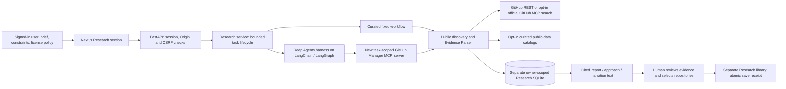

# Research Scout: approach and implemented architecture

> **Historical source material — copied 25 October 2026.** This document originated in the GitHub Manager Research Scout work of 23 October 2026. Implementation statements, paths, commands, localhost addresses, test counts and budgets describe that original prototype or proposal, not an implementation in this repository. No code, credentials, data stores or spending authorization are transferred. See the [standalone project scope](../README.md) before using this material.

## Product problem and minimal solution

A repository manager knows what a user has already collected. A research task starts earlier: **which public repositories might help build this particular solution, what evidence supports that judgement, and what should be checked before adoption?**

Research Scout adds a brief-driven investigation and review step. Its outputs are a comparison, an implementation approach, a narration script and a user-selected library. It keeps exploratory material out of the existing personal workspace and curated evaluation corpus. This isolation also avoids turning a discovery lead into an accepted taxonomy assignment.

## Architecture

The new application MCP server runs in process, using the official SDK's real client/server protocol transport. It is not an unauthenticated public HTTP endpoint. It holds trusted task-bound service closures; tool arguments cannot supply an owner, token, database path or save authority. A separate adapter supports the existing official GitHub MCP server. Ordinary REST discovery remains explicit and does not claim a remote MCP connection.

## Retrieval, context and generation

This is a tool-using research agent, not the existing canonical-taxonomy classifier. It does not replace that classifier, its sparse retrieval algorithms, its evidence IDs or its benchmarks.

1. **Acquire the brief.** Validate bounded text, language, constraints, license screen, selected providers and candidate count. Credential-looking values are rejected by private storage checks. The model receives this scoped brief, the system policy and the approved tool schemas.
2. **Search.** Curated mode derives a short lexical query locally. The agent may choose and revise search words. The application strips search operators and forces public, nonarchived, nonfork results. GitHub supplies its own search ranking; this version adds no vector search, embedding index or learned reranker.
3. **Inspect.** Only names discovered by this task may be inspected. GitHub metadata is re-read by stable numeric ID and must still assert `private=false`, the expected name and canonical GitHub URL. Search results alone cannot become verified candidates. README requests carry **no OAuth credential**, so a visibility change cannot cause the user's private-repo grant to disclose a newly private README. The tradeoff is GitHub's smaller unauthenticated read quota; exhaustion pauses visibly.
4. **Parse evidence.** A bounded README is fetched from the fixed GitHub API; no embedded links, raw download URLs or install commands are followed. The existing local **Evidence Parser** selects section-aware passages and cleans known instruction/credential patterns. It produces E0 metadata and selected E1… passages internally. Research source references are task-local `repo-<id>` and `readme-<id>`; these are not claims that a full repository was read. Retained content has acquisition time and SHA-256 hash. The original file version is not pinned in this basic path.
5. **Augment the next agent turn.** Return verified metadata, the reported license, policy status, source references and bounded selected passages as untrusted tool observations. The model can now inspect another discovered lead, refine search, request opted-in catalog links, or draft. The system policy explicitly denies authority to instructions found in a README.
6. **Generate and validate.** The `draft_research` tool accepts typed findings and implementation claims with exact task source references, plus unknowns. Schema and citation membership are checked locally. Rendering the three Markdown documents is deterministic. Citation validity proves traceability, not that every model interpretation is true; human review remains necessary.
7. **Human decision.** The model cannot save. An authenticated, CSRF-protected API checks task status, verified candidates and license eligibility again, then commits selected Research snapshots atomically with an idempotency receipt.

## Agent control flow, not just a prompt

Deep Agents supplies the compiled LangGraph/LangChain harness. The dedicated profile removes default filesystem, shell, task delegation and planning tools; automatic summarization is disabled to avoid uncounted calls. The agent sees only `search_repositories`, `inspect_repository`, `discover_public_data`, and `draft_research`.

The basic task is capped at three model generations, twelve application tool actions, three GitHub searches, five inspected candidates, eighteen REST requests and four minutes. Model-provider HTTP and spending have additional guards. A successful draft ends the loop without an extra completion generation. Tool failure becomes a bounded observation or visible terminal state; there is no recursive retry or hidden credential substitution.

The application persists the brief, source observations, steps and proposal across steps. The graph holds its conversation state during the run. After a process restart, an interrupted task becomes **Waiting reconciliation**; the app does not automatically resume a model call or replay an uncertain write. Full durable graph resumption, long-running background execution and model-visible long-term memory remain future work.

## Licensing and public data

GitHub's reported SPDX metadata supplies a preliminary code-license screen. The permissive allowlist is intentionally small: MIT, Apache-2.0, BSD-2-Clause, BSD-3-Clause, ISC, Zlib and 0BSD. A known license may still impose obligations; unknown, custom, dual or missing licenses require review. Commercial intent is context, not a permission verdict.

Public-data research uses selected, curated provider links and a few source-backed static listings. It distinguishes catalog discovery, provider authentication, dataset-specific licensing, usage restrictions and possible processing/download cost. AWS Open Data is not assumed to mean AWS-owned, free-to-process or unrestricted. Enigma is treated as a commercial service. Kaggle competition acceptance, Hugging Face gating and publisher exceptions are not bypassed. Details and primary references are in [public-data-and-licenses.md](../research/public-data-and-licenses.md).

## Decisions and tradeoffs

| Decision | Benefit | Limit / next step |
| --- | --- | --- |
| Separate SQLite and Research library | Protects personal data, accepted labels and frozen evaluation work | No automatic import or cross-library deduplication |
| Curated baseline alongside agent | Immediate useful discovery without model cost; clear comparison point | Lexical matching can miss relevant projects |
| Public-only bounded passages | Predictable context and narrower disclosure | No complete code/dependency understanding |
| Existing Evidence Parser reused unchanged | Familiar section extraction and no benchmark drift | No claim that RAKE/TF-IDF/BM25 are new Scout ranking algorithms |
| Four task-scoped MCP tools | Auditable model authority with real protocol integration | General external MCP client access is not exposed |
| REST default; official GitHub MCP opt-in | Preserves existing OAuth App working path | Remote OAuth/client policy needs a real account proof |
| Short Deep Agents profile | Covers the framework through a real constrained loop | No autonomous subagents, filesystem or long-term memory |
| Human save with receipt | Reviewable and repeatable local effect | Human still assesses fit, source credibility and obligations |
| Interrupt instead of automatic replay | Avoids ambiguous paid-request duplication | Explicit fresh retry is less seamless than durable resumption |

## References

- [LangChain Deep Agents overview](https://docs.langchain.com/oss/python/deepagents/overview)
- [LangGraph persistence](https://docs.langchain.com/oss/python/langgraph/persistence)
- [Official MCP Python SDK](https://github.com/modelcontextprotocol/python-sdk)
- [Official GitHub MCP server](https://github.com/github/github-mcp-server)
- [OpenAI function calling](https://developers.openai.com/api/docs/guides/function-calling)
- [GitHub repository search](https://docs.github.com/en/rest/search/search#search-repositories)
- [GitHub README endpoint](https://docs.github.com/en/rest/repos/contents#get-a-repository-readme)
- [GitHub license metadata](https://docs.github.com/en/rest/licenses/licenses)

These sources describe the upstream interfaces; [validation](validation.md) records what this implementation actually exercised.
