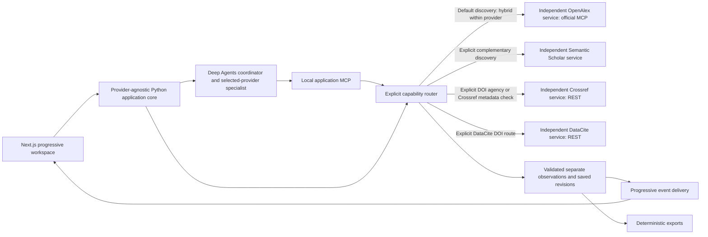

# Research Scout — System Design

**Current automatic discovery:** [Multi-source discovery, canonical DOI papers and automatic Unpaywall](automatic-federated-discovery-2026-11-09.md) is the latest user-directed default. Source selection is optional advanced behavior; a recorded eligible route searches multiple isolated services, groups matching DOIs into one paper and resolves access links through Unpaywall automatically. Earlier manual-selection/two-source defaults are superseded.

This checkpoint passed **270 Python, 43 browser and 11 structural harness cases**, plus lint/typecheck/build. Live automatic routing selected OpenAlex, arXiv and Crossref, returned 26 primary papers and obtained six Unpaywall open-access observations. The actual fixture journey proved cross-provider DOI grouping (16 observations → 10 papers). [Measured evidence, replay behavior and access limits](automatic-federated-discovery-2026-11-09.md#validation-checkpoint).

**Current provider relevance correction:** [Provider-specific queries and independent quality review](provider-relevance-v2-2026-11-09.md) replaces the shared-query/pooled stopping rule: Crossref uses bibliographic search, every selected provider gets its own query plan and repair decision, and primary results exclude adjacent/uncertain records. Search-workspace AI submissions use the same reviewed conversation path. The exact-question live retest passed: two Crossref pages, three model calls, five primary matches with abstracts, explicit intent/keywords/tags and saved LLM/provider request traces. 234 Python, 39 browser and 11 harness checks passed. Earlier checkpoints below retain their dated behavior.

**Latest November 9 query-relevance checkpoint:** [Agentic retrieval and ranking](agentic-retrieval-2026-11-09.md) adds optional structured LLM query planning, provider-batch relevance review and at most one query revision through LangGraph, retaining Deep Agents/application MCP and isolated providers. Chat direct-search fusion ordering is corrected. AI-reviewed results have explicit intent, query history, relevance reasons and shared paid-call accounting; prior deterministic-only statements below are historical where superseded. Live exact-query acceptance passed: 39 reviewed observations, 16 withheld, first reviewed batch at 14.8 seconds; 225 Python, 32 browser and 11 structural harness cases pass.

**Latest implemented checkpoint — November 9:** [Provider expansion and progressive abstracts](provider-expansion-2026-11-09.md) activates arXiv, OpenAIRE Graph V3, Europe PMC and Crossref discovery, plus a separate Unpaywall DOI access action. The four discovery paths have actual live UI/agent/MCP proof; Unpaywall live lookup now passes after private contact configuration, with five reported access locations and zero model calls. Eight services, six explicit discovery choices, provider-local CPU reranking, early abstract/description display and separate access observations preserve the existing architecture. Validation: 185 Python tests, 27 browser journeys, 11 harness evals; zero new OpenAI calls.

**Latest November 9 abstract/source checkpoint:** [Visible abstracts and richer source context](richer-sources-and-abstracts.md) implements chat abstract previews, explicit same-provider detail reading and local richer evidence for future answers. The [source research review](../discovery/research/free-scholarly-sources-review-2026-11-09.md) recommends independent arXiv, OpenAIRE V3 and Europe PMC integrations next, with scoped roles, current free-access/rate conditions and three successful endpoint probes. Those proposed providers are not current connections.

**Latest November 9 implementation:** [Provider contributions and optional streaming answers](streaming-generation-2026-11-09.md) is the current architecture checkpoint. Explicit saved-evidence generation now streams real OpenAI deltas through a LangChain Runnable/LangGraph branch, independently of deterministic Deep Agents retrieval. Live acceptance passed with one model request and zero new research calls. Production model selection and bookmark retention remain open. Crossref/DataCite topic search is a documented adapter gap; S2 search remains rate-limited. Earlier checkpoints below retain their historical scope.

**Approved Increment 1 and implemented local framework · October 26, 2026**

**Latest access proof — November 9:** [OpenAlex OAuth and live discovery acceptance](openalex-connection-2026-11-09.md). The user resumed sign-in; OAuth, native keyword/semantic search, details and an actual filtered exploration UI/MCP journey passed. OpenAlex authorization is no longer deferred. Generation remains disabled; S2 keyed-search access is still independent.

**Latest implemented integration — November 9:** [Execution record and current routing architecture](integration-execution-2026-11-09.md). Functional exploration conversations now use explicit LangGraph routing, existing Deep Agents/MCP discovery children, exact DOI REST routing and progressive resource responses in the retained Dub UI. Crossref/DataCite live UI and S2 details have measured proof; OpenAlex sign-in was deferred and S2 search access remains gated. Hosted generation/model choice and bookmark-retention redesign are deferred by the user's latest direction.

**Latest implementation review — November 9:** start with the [current architecture and agentic audit](implementation-review-2026-11-09.md) and its [three-diagram review board](diagrams/review-2026-11-09/index.html). Fresh local checks confirmed the core, four provider processes and application MCP in fixture mode; the frontend was not reachable. The two Deep Agents/LangGraph graphs still use a scripted model. Live connection evidence and next proof gates are qualified by date in that review.

**Execution plan — November 9, approved with scope adjustment:** [Live connections and exploration chat](live-operations-and-chat-plan.md) records the approved integration work and subsequent generation/retention deferrals. The original reviewed v0.1 is preserved. The user retained the current Dub-inspired implementation and declined the HabitQuest previews.

This folder records the standalone design and its research basis. The user approved Increment 1 development/design and validation. The local framework is implemented with Python/FastAPI, Next.js, actual Deep Agents/application MCP, independent provider processes and progressive SSE. See [implementation status](implementation-status.md) for adopted decisions and [validation evidence](../docs/validation/increment-1.md) for measured results. OpenAlex OAuth/native live hybrid, Semantic Scholar live readiness and a hosted language model remain gates; fixture success is not live acceptance.

## Design documents

| Document | Purpose | Status |
| --- | --- | --- |
| [Automatic multi-source discovery](automatic-federated-discovery-2026-11-09.md) | Default automatic routing, DOI-based canonical papers, preserved provider provenance and automatic Unpaywall access. | Latest implementation checkpoint; current validation in linked record |
| [Provider-specific relevance v2](provider-relevance-v2-2026-11-09.md) | Provider-aware query plans, independent refinement, Crossref bibliographic/cache correction and primary/related separation. | Implemented follow-up; current evidence in linked checkpoint |
| [Agentic retrieval and relevance ranking](agentic-retrieval-2026-11-09.md) | LLM query interpretation, bounded per-provider relevance review, one query revision, ranked progressive batches and shared paid-call ledger. | Implemented; current execution evidence in linked checkpoint |
| [Provider expansion and progressive abstracts](provider-expansion-2026-11-09.md) | Eight-provider architecture, new routes/configuration, Unpaywall limits/access configuration and measured live discovery/streaming proof. | Implemented; new discovery and Unpaywall access live |
| [Richer sources and visible abstracts](richer-sources-and-abstracts.md) | Abstract display/retrieval/context correction; proposed source expansion and measured API evidence. | Abstract fix implemented; new adapters proposed |
| [Free scholarly sources review](../discovery/research/free-scholarly-sources-review-2026-11-09.md) | Existing research reconciled with current APIs, quotas and bounded arXiv/Europe PMC/OpenAIRE probes. | November 9 evidence and recommended sequence |
| [Research inputs](research-inputs.md) | Complete Basic Research/Interim Research readings, provenance, original scope assumption and later refinements. | Planning evidence and change history |
| [Product organization](product-organization.md) | Journeys, resource/provider facets, conceptual entities and two MVP outcomes. | Proposed organization |
| [Application and agent architecture](architecture.md) | Provider-agnostic core, independent services, agents/MCP, primary OpenAlex hybrid retrieval and progressive delivery. | Approved target; local framework implemented |
| [Provider isolation and routing](provider-routing.md) | Separate service ownership, explicit routes, justified DOI checks and immutable provider observations. | Implemented; live readiness varies by provider |
| [Hybrid retrieval](hybrid-retrieval.md) | Lexical/semantic branches, query embedding, effective filters and within-provider fusion. | Implemented fixtures/contracts; live gates explicit |
| [Progressive results](progressive-results.md) | Early usable entities, saved events/snapshots, UI stability, reconnect and recovery. | Implemented and browser/process validated |
| [Increment 1 execution/review plan](increment-1.md) | Twelve work packages, independent provider readiness, contracts, finite limits and acceptance evidence. | Version 0.3; development approved |
| [Implementation status](implementation-status.md) | Adopted technologies, executable ownership, limits and package completion/live gates. | Current implementation record |
| [Live connections and exploration chat plan](live-operations-and-chat-plan.md) | Concrete env/access contract and approved deterministic routing/chat adjustment, with subsequent scope changes. | Routing implemented; explicit answer demo now added; production model/retention open |
| [Provider contributions and streaming answers](streaming-generation-2026-11-09.md) | Current provider roles, coverage gaps, executable routing/streaming diagrams, bounded demo profile and measured acceptance. | Implemented; one live stream passed |
| [Integration execution and current architecture](integration-execution-2026-11-09.md) | Implemented conversation/provider routing, configuration, measured live proof, validation and operational runbook. | November 9 implementation; per-provider access gates explicit |
| [OpenAlex live connection acceptance](openalex-connection-2026-11-09.md) | OAuth connection, real native hybrid/year-filter/detail checks and actual exploration UI/MCP proof. | Connected and passed; supersedes the earlier sign-in deferral |
| [Architecture illustrations](diagrams/README.md) | Illustrated overview, exact captions/prompts, review and preserved earlier diagram. | Target illustration; generation-time status preserved |
| [Dub-inspired UX adoption](dub-ux-adoption.md) | Selected visual direction applied to the existing Next.js implementation; source index, persistent preview and responsive controls. | October 29 user selection; stack and service contracts unchanged |
| [UX research intake](ux-research.md) | Research/prototype evidence, historical palette, progressive hybrid flow and accessibility gaps. | Current Dub selection precedes preserved intake |
| [Inspiring Sites](../discovery/ux/inspiring-sites.md) | 30 new light-sidebar workspace and control-panel references, 15 from each of two UX research agents, plus preserved earlier context. | October 29 research; later Dub selection recorded above |
| [Six UX design directions](../discovery/ux/2026-10-28-design-exploration/README.md) | Two rounds of researched HTML concepts; new Radix/shadcn, Apple/Spectrum and Carbon/Fluent directions accompany the original three. | October 28 second round; first round not accepted, no direction selected or production UI change |

Start with Increment 1's execution summary, then the architecture and focused contracts. The research agents supplied complementary inputs to one evolving design. The source discovery documents remain dated evidence; their recommendations do not automatically select standalone technologies.

## Confirmed foundations

| Area | User direction |
| --- | --- |
| Product | Find relevant resources and knowledge, investigate a question and produce useful research results. |
| Backend | Python backend services. |
| Frontend | Next.js, with a slick modern UI and reusable components. |
| Agents | LangChain Deep Agents with multiple roles and explicit handoffs. |
| Application tools | A local Research Scout MCP server. |
| Provider tools | Prefer suitable provider MCP servers; verify actual capability/access and use API integration where needed. |
| Provider separation | Keep providers isolated; avoid multiple provider integrations in one backend. Route to specific providers and combine only for a supported reason. |
| OpenAlex | Key primary discovery resource, using its official MCP and native search capabilities appropriately. |
| Retrieval | Hybrid lexical + semantic search with consistent eligible filters. |
| Progressive UX | Show entities as soon as available; inspection and saving do not wait for every provider/agent/summary. |
| Persistence | Database/storage choices remain open for incremental discussion. |

## Implemented local service shape

One local workspace runs a provider-agnostic Python application core and independent OpenAlex, Crossref, DataCite and Semantic Scholar Python service processes. One repository does not require one shared provider backend. Each service owns its upstream client/access, cache/receipts, rate/retry policy and failures; each can start or stop independently. Default fixture mode executes actual local protocols with clearly fictional provider records and a scripted model.

The core owns API/run state, the Deep Agents coordinator and provider-bound discovery specialist, local application MCP, deterministic routing, saved observations/events, human selections and exports.

Branches are conditional routes. A discovery run selects one provider. Within that provider, the authorized hybrid plan combines lexical and semantic contributions with identity/provenance retained. It does not authorize searches across all providers or blended provider metadata.

OpenAlex accepts semantic query text and embeds it itself; no separate local query encoder is needed for its native route. Other providers require a proved native semantic capability or an explicitly configured compatible local reranker over bounded same-provider candidates. Exact Crossref/DataCite DOI lookups remain a different operation.

## Incremental product outcomes

| Milestone | Useful outcome | Proposed sequence |
| --- | --- | --- |
| MVP 1 — discovery workspace | Progressive attributed hybrid discovery, inspection, human shortlists, explicit registry metadata checks and saved-revision exports. | OpenAlex primary path first; independent Crossref/DataCite checks; separately enabled Semantic Scholar checkpoint inside revised Increment 1. |
| MVP 2 — evidence workbench | Acquired/identified content, locatable passages and supported selected-source comparison. | Later acquisition/version checks, local parsing/retrieval and evidence comparison; renumber after Increment 1 review. |

The initial OpenAlex-only proposal was a scope reduction made during planning. It was not required by the research or user. The original handoff included Crossref/DataCite early and Semantic Scholar next. This revision restores the former and proposes bringing the latter forward, preserving independent readiness.

Web, video, broad datasets/code, landscapes and research-package synthesis remain later. The resource guide's 142 entries/14 categories guide catalog/routing facets, not a requirement to implement every connector or one agent per category.

## UX and efficiency

Use the selected [Dub-inspired UX](dub-ux-adoption.md): a light sidebar, source index and persistent desktop reader with clear content states and human decisions. The [UX intake](ux-research.md) preserves earlier evidence; its blue palette and initially closed desktop inspector are superseded. The implementation retains authored React components/CSS. Browser checks cover keyboard/mobile and progressive use; broader production accessibility checks remain open.

Keep provider observations and generated annotations distinct. Publish eligible source entities before model summaries; retain human decisions and focus as later branches/checks arrive. Saved reads/decisions/exports must work when providers are unavailable.

Use [GitHub Manager Architecture](../docs/github-manager-architecture.md) for local processing, compact model inputs, cache keys, durable receipts and deterministic validation/export. It is a reference for mechanisms, not the Research Scout stack or proof of quality.

## Decisions and proof gates

- Review the [implemented checkpoint matrix](implementation-status.md#work-package-checkpoint) and recorded validation results.
- Prove OpenAlex OAuth/tools and both native hybrid branches, including actual filter differences. Deep Agents/application MCP compatibility is locked and locally tested.
- Extend the successful Crossref agency/metadata and DataCite sample probes to the enabled live journey; configure Semantic Scholar access/encoder independently.
- Select the hosted model/rates and compatible harness profile, then measure relevance and context/reference behavior with real research questions.
- Revisit production storage, identity, hosting and broader accessibility when that scope is discussed.

The local slice adopts FastAPI, atomic single-writer JSON, loopback HTTP/Streamable HTTP, SSE and versioned equal-weight RRF (`k=60`). No production database, vector store, message broker, embedding model or live language-model provider has been selected. Numerical fixture limits do not prove live token/cost or search quality.

Update this index, architecture and affected increment as decisions change. Preserve confirmed/proposed/implemented status, dated research and fixture/live distinctions. Related background: [proposal](../proposal/README.md), [development handoff](../discovery/research/research-scout-development-handoff.md), [resource guide](../discovery/research/project-research-resource-guide.md).
