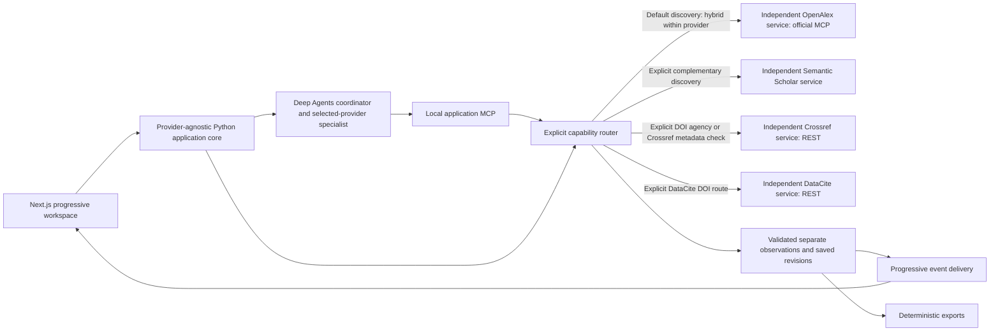

# Research Scout — System Design

**November 15 approved landing and sign-in:** [Observatory landing and local owner authentication](landing-and-local-auth-2026-11-15.md) adopts direction08 for `/`, with the existing workspace at `/app`. The user selected one owner, private local recovery delivery and a separate Research Scout Google client. All ten mockups remain preserved; no other app-design trial is adopted. [Google localhost setup](../docs/google-oauth-localhost.md).

**November 15 readable app mockup:** [Observatory App, direction 10](../discovery/ux/2026-11-15-design-skill-trials/observatory-app.html) enlarges text and controls while preserving the existing app/tab structure and connecting its visual style to Observatory. All nine earlier prototypes remain in the [ten-direction gallery](../discovery/ux/2026-11-15-design-skill-trials/index.html). This remains a local visual proposal; frontend and backend implementation are unchanged.

**November 15 additive app preview:** [Reference App](../discovery/ux/2026-11-15-design-skill-trials/datapulse-app-refined.html) refines the full workspace while preserving its structure and controls. The [nine-direction gallery](../discovery/ux/2026-11-15-design-skill-trials/index.html) retains all earlier prototypes, including Observatory as the landing-page concept. These remain proposals; the current implemented frontend and backend are unchanged.

**November 15 design trials:** [Seven standalone mockups and two reusable design skills](../discovery/ux/2026-11-15-design-skill-trials/README.md) are complete for review. This is a visual comparison over authored example content, with validated local interactions; the working application design and runtime stack remain unchanged.

**Latest November 14 information toolbar:** [Search overview, query focus, source coverage and timing](search-information-toolbar-2026-11-14.md) move to icon controls alongside Date/Limits/AI. Saved AI focus and Material tags appear beneath the settings, while full prompts and provider traces remain explicit. This supersedes the previous below-tabs information-bar placement and retains retrieval/state/budget ownership.

**Latest November 14 resource reading:** [Unified search information and readable Data/Repos](resource-information-and-reading-plan-2026-11-14.md) implements the approved v0.2 plan: one information pane below all resource tabs, accurate shared completion/coverage, source-derived points and Original/Saved excerpts with inline expansion, bounded readers, GitHub topic filters, verified saved README source and persistent local Repo notes. Existing retrieval ownership, request/credit limits, provider isolation and saved research remain intact.

**Latest November 14 central search:** [One Search across Papers, Videos, Data and Repos](central-resource-search-2026-11-14.md) adds remembered 0–20 limits and parent-owned resource jobs for new interactive searches. Data/Repos no longer need a second Find action; saved/tab reads remain read-only. Counts distinguish disabled, pending, empty, failed, relevant and overflow states. The saved embedding-query parser failure is corrected, and the larger atom tilts whole rings in three dimensions. Existing model budgets, provider isolation and credit history are preserved.

**Latest November 14 compact UI:** [Compact controls, resource loading and identity](compact-toolbar-and-brand-2026-11-14.md) puts source/date/video/AI controls on one desktop row, moves project/query actions to the workspace header and adds scoped resource-tab loading. Videos uses a slider popover, Custom and AI use icons with accessible labels/tooltips. Research Scout has a navigation mark, the curiosity tagline, proper-case headings and a larger animated atom with reduced-motion support. Retrieval, provider scope, explicit acquisition and credit policy remain unchanged.

**Latest November 14 optional AI refinement:** [AI/direct controls and used credits](optional-ai-refinement-2026-11-14.md) makes refinement an explicit remembered switch beside sources/date controls in Search and Exploration. On retains model planning/review and its gates; Off uses the saved direct query without hosted-model calls or credits, including explicit Data/Repos lookups. This supersedes the earlier mandatory-AI UI policy. Saved traces retain actual execution mode. The header displays used/100; accounting/history/reset rules are unchanged.

**Latest November 14 daily credits:** [Daily credits and model economics](daily-credit-tokenomics-2026-11-14.md) replaces the historical lifetime $0.25 admission blocker with 100 credits per local day. One credit is one dispatched hosted model request; reservations, explicit reset epochs and retained usage/cost history are authoritative in local SQLite. The header meter and `/admin` page require no login. Research/provider state and model routing stay separate.

**Latest November 14 shared AI planning:** [Shared query refinement](shared-ai-query-refinement-2026-11-14.md) adds model-authored resource queries, structured missing information, clarification continuation and source-bound generation background. It fixes the first-provider overwrite and supersedes generic AI-intent reuse for new Data/Repos work.

**Latest November 14 repository extension:** [GitHub repositories and Repos](github-repositories-2026-11-14.md) adds a separate resource lane, isolated provider8121, saved AI-context routing, bounded README parsing, local sparse ranking and progressive UI. [Analysis](../discovery/research/github-repository-source-analysis-2026-11-14.md) distinguishes the GitHub Manager reference from the newly implemented repository ranker.

**Latest November 14 dataset extension:** [Data workspace and dataset discovery](dataset-discovery-2026-11-14.md) implements the requested Analysis/Execution slice: saved AI-context reuse, a resource-specific LangGraph/DeepAgents workflow, application MCP, isolated Hugging Face/DataCite metadata operations and progressive Data results. [Research source map](../discovery/research/dataset-source-analysis-2026-11-14.md) covers twelve problem areas; other adapters remain proposed.

**Latest November 14 retrieval update:** [Required agentic retrieval and timing](required-agentic-rag-and-timing-2026-11-14.md) removes optional AI refinement from interactive topic searches, adds stable Material keyword colors and plots recorded request/stage intervals. Configuration/allowance failures block topic admission visibly; DOI and saved actions remain separate.

**November 14 frontend adoption:** [Refined + Workbench](refined-workbench-adoption-2026-11-14.md) is now the selected application design. Compact settings, Material chips, saved query/LLM/provider transparency and measured performance use the existing Next.js components and service contracts. This supersedes the November 13 preview-only status for the hybrid; other mockups remain proposals.

**November 13 project layout:** [Backend/frontend separation and uv](backend-uv-layout-2026-11-13.md) moves the Python services, tests and utilities to `backend/` with Python 3.13 and `uv.lock`; browser tests/tooling join the existing Next.js app in `frontend/`. Root `.env`, saved state and service boundaries remain in place. The [three UI refinement mockups](../discovery/ux/2026-11-13-ui-polish/README.md) were separate proposals at that checkpoint; their later Refined + Workbench hybrid is adopted above.

**Latest November 12 video configuration:** [Visible YouTube result count](youtube-video-count-2026-11-12.md) adds a remembered **Videos to fetch** selector (1–20, default 10) beside Sources/Date range and in Exploration. The selected count is saved and enforced through child runs to YouTube; original results and request budgets remain unchanged.

**Latest November 12 video behavior fix:** [Video content recovery and preview intent](video-content-recovery-2026-11-12.md) fixes short-snippet expansion and clipping, separates metadata from caption operations/retries, and makes thumbnail clicks open the player. Saved caption/selection guards and finite allowances remain intact; failed operations show their actual reason.

**Latest November 12 Videos update:** [Compact Videos workspace and reader](videos-density-2026-11-12.md) applies Papers-style title chips and aligned actions, compact descriptions/caption controls, bounded transcripts and passive desktop saved preview. Playback and caption fetching remain explicit; completed media timing stays in clock tooltips. This supersedes the earlier video-optimization deferral.

**Latest November 12 reader/abstract update:** [Reader clarity and readable abstracts](reader-and-readable-abstracts-2026-11-12.md) moves authors below the abstract, flattens metadata/Notes, relocates timing to the footer and groups duplicate citation/record versions. Abstract key points use original source sentences with one-click original text.

**Latest November 12 load-time update:** [Load times and inline PDF download](load-times-and-pdf-download-2026-11-12.md) adds adaptive elapsed/completed timing labels for search, saved metadata and media, plus an explicit bounded PDF download inside the preview. Original retrieval duration stays separate from saved-view loading.

**Latest November 12 paper workspace:** [Streamlined Papers controls and reader](papers-density-2026-11-12.md) consolidates controls and coverage, compacts paper cards/actions, explains Unpaywall and DOI checks, restores a small reader title and fixes sandboxed PDF preview. Common controls apply to Videos; video-specific optimization remains deferred.

**Latest November 11 loading refinement:** [Loading feedback and faster saved reads](loading-and-tooltips-2026-11-11.md) adds paper/video/media loaders, shared compact startup history, bounded revision-aware metadata caching and accessible icon tooltips.

**Latest November 11 reader refinement:** [Compact reader and date refresh](reader-refinement-2026-11-11.md) removes repeated reader identity, aligns source actions, collapses reporting and adds guarded paper/video loading masks. Custom ranges have an explicit Apply range & search action that retrieves new results.

**Latest November 11 project workspace:** [Research projects and seamless reading](project-research-workspace-2026-11-11.md) adds passive row-following metadata, inline abstracts/PDFs, compact provider badges and durable projects with concepts, multiple saved queries and versioned resources. Preview and project saving are separate actions; provider/model work remains explicit.

**Latest November 11 reader/loading refinement:** [Right-hand reader and progressive loading](right-panel-and-loading-2026-11-11.md) replaces main Search pop-ups with a nonmodal right panel (inline on mobile), compacts results/video cards, adds a remembered date slider and shows atom/skeleton loading. The [YouTube retrieval review](youtube-retrieval-and-relevance-2026-11-11.md) distinguishes working REST/metadata reranking/captions from proposed transcript similarity and community MCP options.

**Latest November 11 multi-agent review:** [Parallel UI stability review](multi-agent-ui-review-2026-11-11.md) fixes remaining navigation/submission races, cross-view filters, misleading video-empty states, mixed related-result tabs, thumbnail recovery and caption-worker cancellation. It also improves reader controls and video-specific guidance.

**Latest November 11 preview correction:** [Stable Search and video content](preview-stability-and-video-2026-11-11.md) keeps main Search mounted behind one focused source dialog, preserves the composer/tab/filter and uses complete conversations for recent history. Video previews add thumbnails, explicit player loading and bounded public-caption lookup with saved availability states.

**Latest November 11 refinement:** [Resource tabs and remembered search defaults](tabs-and-search-defaults-2026-11-11.md) separates Papers and Videos, defaults to OpenAlex/Crossref/arXiv/YouTube, remembers source/date/tab preferences and adds adaptive publication-year presets. Explicit selected scope is enforced by deterministic and AI routing; web search remains deferred.

**Current November 11 Search behavior:** [Main Search and readability](search-workspace-2026-11-11.md) keeps automatic and AI-reviewed results beneath the top search composer using the same retrieval pipeline. All/Papers/Web/Videos are local result views; chat opens only by explicit action. The restored Dub layout gains larger text, stronger contrast and compact advanced settings. Web search remains deferred; YouTube is now [live validated after key configuration](youtube-live-2026-11-11.md). The shared AI model allowance remains separately blocked.

**Current UI choice — November 10:** the user rejected the Material blue preview layout and requested the previous UI. The original Dub-inspired dashboard, sidebar, search/chat layout, inspector, spacing and colors are restored from commit `057a3bf`. YouTube backend/provider support remains in place and still awaits an API key. [Rollback record](ui-rollback-2026-11-10.md).

**Earlier November 10 UI/source trial (UI reverted):** [Material blue workspace and YouTube discovery](material-blue-youtube-2026-11-10.md) applies the light preview layout and earlier blue/atom identity to the full existing UI. YouTube is the ninth isolated service; its API adapter and fixtures are implemented, while live access awaits the user’s API key. Google/web search is explicitly excluded. Earlier dated checkpoints retain their historical scope.

**Current automatic discovery:** [Multi-source discovery, canonical DOI papers and automatic Unpaywall](automatic-federated-discovery-2026-11-09.md) is the latest user-directed default. Source selection is optional advanced behavior; a recorded eligible route searches multiple isolated services, groups matching DOIs into one paper and resolves access links through Unpaywall automatically. Earlier manual-selection/two-source defaults are superseded.

This checkpoint passed **270 Python, 43 browser and 11 structural harness cases**, plus lint/typecheck/build. Live automatic routing selected OpenAlex, arXiv and Crossref, returned 26 primary papers and obtained six Unpaywall open-access observations. The actual fixture journey proved cross-provider DOI grouping (16 observations → 10 papers). [Measured evidence, replay behavior and access limits](automatic-federated-discovery-2026-11-09.md#validation-checkpoint).

**Current provider relevance correction:** [Provider-specific queries and independent quality review](provider-relevance-v2-2026-11-09.md) replaces the shared-query/pooled stopping rule: Crossref uses bibliographic search, every selected provider gets its own query plan and repair decision, and primary results exclude adjacent/uncertain records. Search-workspace AI submissions use the same reviewed conversation path. The exact-question live retest passed: two Crossref pages, three model calls, five primary matches with abstracts, explicit intent/keywords/tags and saved LLM/provider request traces. 234 Python, 39 browser and 11 harness checks passed. Earlier checkpoints below retain their dated behavior.

**Latest November 9 query-relevance checkpoint:** [Agentic retrieval and ranking](agentic-retrieval-2026-11-09.md) adds optional structured LLM query planning, provider-batch relevance review and at most one query revision through LangGraph, retaining Deep Agents/application MCP and isolated providers. Chat direct-search fusion ordering is corrected. AI-reviewed results have explicit intent, query history, relevance reasons and shared paid-call accounting; prior deterministic-only statements below are historical where superseded. Live exact-query acceptance passed: 39 reviewed observations, 16 withheld, first reviewed batch at 14.8 seconds; 225 Python, 32 browser and 11 structural harness cases pass.

**Latest implemented checkpoint — November 9:** [Provider expansion and progressive abstracts](provider-expansion-2026-11-09.md) activates arXiv, OpenAIRE Graph V3, Europe PMC and Crossref discovery, plus a separate Unpaywall DOI access action. The four discovery paths have actual live UI/agent/MCP proof; Unpaywall live lookup now passes after private contact configuration, with five reported access locations and zero model calls. Eight services, six explicit discovery choices, provider-local CPU reranking, early abstract/description display and separate access observations preserve the existing architecture. Validation: 185 Python tests, 27 browser journeys, 11 harness evals; zero new OpenAI calls.

**Latest November 9 abstract/source checkpoint:** [Visible abstracts and richer source context](richer-sources-and-abstracts.md) implements chat abstract previews, explicit same-provider detail reading and local richer evidence for future answers. The [source research review](../discovery/research/free-scholarly-sources-review-2026-11-09.md) recommends independent arXiv, OpenAIRE V3 and Europe PMC integrations next, with scoped roles, current free-access/rate conditions and three successful endpoint probes. Those proposed providers are not current connections.

**Latest November 9 implementation:** [Provider contributions and optional streaming answers](streaming-generation-2026-11-09.md) is the current architecture checkpoint. Explicit saved-evidence generation now streams real OpenAI deltas through a LangChain Runnable/LangGraph branch, independently of deterministic Deep Agents retrieval. Live acceptance passed with one model request and zero new research calls. Production model selection and bookmark retention remain open. Crossref/DataCite topic search is a documented adapter gap; S2 search remains rate-limited. Earlier checkpoints below retain their historical scope.

**Approved Increment 1 and implemented local framework · October 26, 2026**

**Latest access proof — November 9:** [OpenAlex OAuth and live discovery acceptance](openalex-connection-2026-11-09.md). The user resumed sign-in; OAuth, native keyword/semantic search, details and an actual filtered exploration UI/MCP journey passed. OpenAlex authorization is no longer deferred. Generation remains disabled; S2 keyed-search access is still independent.

**Latest implemented integration — November 9:** [Execution record and current routing architecture](integration-execution-2026-11-09.md). Functional exploration conversations now use explicit LangGraph routing, existing Deep Agents/MCP discovery children, exact DOI REST routing and progressive resource responses in the retained Dub UI. Crossref/DataCite live UI and S2 details have measured proof; OpenAlex sign-in was deferred and S2 search access remains gated. Hosted generation/model choice and bookmark-retention redesign are deferred by the user's latest direction.

**Latest implementation review — November 9:** start with the [current architecture and agentic audit](implementation-review-2026-11-09.md) and its [three-diagram review board](diagrams/review-2026-11-09/index.html). Fresh local checks confirmed the core, four provider processes and application MCP in fixture mode; the frontend was not reachable. The two Deep Agents/LangGraph graphs still use a scripted model. Live connection evidence and next proof gates are qualified by date in that review.

**Execution plan — November 9, approved with scope adjustment:** [Live connections and exploration chat](live-operations-and-chat-plan.md) records the approved integration work and subsequent generation/retention deferrals. The original reviewed v0.1 is preserved. The user retained the current Dub-inspired implementation and declined the HabitQuest previews.

This folder records the standalone design and its research basis. The user approved Increment 1 development/design and validation. The local framework is implemented with Python/FastAPI, Next.js, actual Deep Agents/application MCP, independent provider processes and progressive SSE. See [implementation status](implementation-status.md) for adopted decisions and [validation evidence](../docs/validation/increment-1.md) for measured results. OpenAlex OAuth/native live hybrid, Semantic Scholar live readiness and a hosted language model remain gates; fixture success is not live acceptance.

## Design documents

| Document | Purpose | Status |
| --- | --- | --- |
| [Information icons and automatic AI focus](search-information-toolbar-2026-11-14.md) | Overview/query/coverage/timing icons in the Date/Limits/AI toolbar, visible clock and saved AI focus below settings. Supersedes the below-tabs pane placement. | Implemented and validated: 80 unique affected browser cases, typecheck/build and seven live widths |
| [Resource information and readable Data/Repos](resource-information-and-reading-plan-2026-11-14.md) | One common information pane, readable source previews, topic clarity, versioned README source and genuine Repo notes. | Approved v0.2; implemented and validated: 433 backend / 246 unique browser / 11 harness checks; toolbar placement superseded above |
| [Reader clarity and readable abstracts](reader-and-readable-abstracts-2026-11-12.md) | Flat reader, latest record/citation display groups and original-sentence abstract points. | Latest November 12 refinement |
| [Load times and inline PDF download](load-times-and-pdf-download-2026-11-12.md) | Observed load durations, saved original search time and explicit PDF file download. | Latest November 12 refinement |
| [Streamlined Papers controls and reader](papers-density-2026-11-12.md) | One control panel, explicit coverage, compact paper cards/reader and native PDF preview. | Latest November 12 refinement |
| [Loading feedback and faster saved reads](loading-and-tooltips-2026-11-11.md) | Loading states, compact startup projections, shared metadata reads and accessible icon tooltips. | Latest November 11 refinement |
| [Compact reader and date refresh](reader-refinement-2026-11-11.md) | Content-first reader, aligned actions, collapsed reports, transition guards and explicit custom-date refresh. | Latest November 11 refinement |
| [Research projects and seamless reading](project-research-workspace-2026-11-11.md) | Compact workspace, automatic metadata preview, inline content and durable project/concept/query/resource organization. | Latest November 11 implementation |
| [Right-hand reader and loading](right-panel-and-loading-2026-11-11.md) | Nonmodal details, compact video rows, date slider and loading placeholders. | Latest November 11 UI refinement |
| [YouTube retrieval and relevance](youtube-retrieval-and-relevance-2026-11-11.md) | Actual REST/MCP/query/caption behavior, current primary-source research and proposed caption-passage retrieval. | Implementation review and follow-up recommendations |
| [Parallel UI review](multi-agent-ui-review-2026-11-11.md) | Three focused agent reviews plus integrated navigation, filtering, reader and caption-cancellation fixes. | Latest November 11 checkpoint |
| [Stable previews and video transcripts](preview-stability-and-video-2026-11-11.md) | Preserved Search context, hydration/draft protection, thumbnails/player and bounded caption lookup. | Latest November 11 live/fixture acceptance passed |
| [Tabs and search defaults](tabs-and-search-defaults-2026-11-11.md) | Separate Papers/Videos, selected-source scope, adaptive publication years and remembered preferences. | Latest November 11 implementation |
| [YouTube live acceptance](youtube-live-2026-11-11.md) | Supplied key loaded on restart; 10 live videos through graph/MCP/provider and main Search; saved replay unchanged. | November 11 live passed; web deferred |
| [Main Search and readability](search-workspace-2026-11-11.md) | Progressive main Search, local result categories, explicit chat, larger text, key setup and current runtime gates. | November 11 validated UI; YouTube live; AI allowance blocked |
| [Material blue UI and YouTube](material-blue-youtube-2026-11-10.md) | Trial UI rejected and restored; isolated YouTube public-video discovery retained. | UI superseded; YouTube live key pending |
| [Automatic multi-source discovery](automatic-federated-discovery-2026-11-09.md) | Default automatic routing, DOI-based canonical papers, preserved provider provenance and automatic Unpaywall access. | Latest implementation checkpoint; current validation in linked record |
| [Provider-specific relevance v2](provider-relevance-v2-2026-11-09.md) | Provider-aware query plans, independent refinement, Crossref bibliographic/cache correction and primary/related separation. | Implemented follow-up; current evidence in linked checkpoint |
| [Agentic retrieval and relevance ranking](agentic-retrieval-2026-11-09.md) | LLM query interpretation, bounded per-provider relevance review, one query revision, ranked progressive batches and shared paid-call ledger. | Implemented; current execution evidence in linked checkpoint |
| [Provider expansion and progressive abstracts](provider-expansion-2026-11-09.md) | Eight-provider architecture, new routes/configuration, Unpaywall limits/access configuration and measured live discovery/streaming proof. | Implemented; new discovery and Unpaywall access live |
| [Richer sources and visible abstracts](richer-sources-and-abstracts.md) | Abstract display/retrieval/context correction; proposed source expansion and measured API evidence. | Abstract fix implemented; new adapters proposed |
| [Free scholarly sources review](../discovery/research/free-scholarly-sources-review-2026-11-09.md) | Existing research reconciled with current APIs, quotas and bounded arXiv/Europe PMC/OpenAIRE probes. | November 9 evidence and recommended sequence |
| [Research inputs](research-inputs.md) | Complete Basic Research/Interim Research readings, provenance, original scope assumption and later refinements. | Planning evidence and change history |
| [Product organization](product-organization.md) | Journeys, resource/provider facets, conceptual entities and two MVP outcomes. | Proposed organization |
| [Application and agent architecture](architecture.md) | Provider-agnostic core, independent services, agents/MCP, primary OpenAlex hybrid retrieval and progressive delivery. | Approved target; local framework implemented |
| [Provider isolation and routing](provider-routing.md) | Separate service ownership, explicit routes, justified DOI checks and immutable provider observations. | Implemented; live readiness varies by provider |
| [Hybrid retrieval](hybrid-retrieval.md) | Lexical/semantic branches, query embedding, effective filters and within-provider fusion. | Implemented fixtures/contracts; live gates explicit |
| [Progressive results](progressive-results.md) | Early usable entities, saved events/snapshots, UI stability, reconnect and recovery. | Implemented and browser/process validated |
| [Increment 1 execution/review plan](increment-1.md) | Twelve work packages, independent provider readiness, contracts, finite limits and acceptance evidence. | Version 0.3; development approved |
| [Implementation status](implementation-status.md) | Adopted technologies, executable ownership, limits and package completion/live gates. | Current implementation record |
| [Live connections and exploration chat plan](live-operations-and-chat-plan.md) | Concrete env/access contract and approved deterministic routing/chat adjustment, with subsequent scope changes. | Routing implemented; explicit answer demo now added; production model/retention open |
| [Provider contributions and streaming answers](streaming-generation-2026-11-09.md) | Current provider roles, coverage gaps, executable routing/streaming diagrams, bounded demo profile and measured acceptance. | Implemented; one live stream passed |
| [Integration execution and current architecture](integration-execution-2026-11-09.md) | Implemented conversation/provider routing, configuration, measured live proof, validation and operational runbook. | November 9 implementation; per-provider access gates explicit |
| [OpenAlex live connection acceptance](openalex-connection-2026-11-09.md) | OAuth connection, real native hybrid/year-filter/detail checks and actual exploration UI/MCP proof. | Connected and passed; supersedes the earlier sign-in deferral |
| [Architecture illustrations](diagrams/README.md) | Illustrated overview, exact captions/prompts, review and preserved earlier diagram. | Target illustration; generation-time status preserved |
| [Dub-inspired UX adoption](dub-ux-adoption.md) | Selected visual direction applied to the existing Next.js implementation; source index, persistent preview and responsive controls. | October 29 user selection; stack and service contracts unchanged |
| [UX research intake](ux-research.md) | Research/prototype evidence, historical palette, progressive hybrid flow and accessibility gaps. | Current Dub selection precedes preserved intake |
| [Inspiring Sites](../discovery/ux/inspiring-sites.md) | 30 new light-sidebar workspace and control-panel references, 15 from each of two UX research agents, plus preserved earlier context. | October 29 research; later Dub selection recorded above |
| [Six UX design directions](../discovery/ux/2026-10-28-design-exploration/README.md) | Two rounds of researched HTML concepts; new Radix/shadcn, Apple/Spectrum and Carbon/Fluent directions accompany the original three. | October 28 second round; first round not accepted, no direction selected or production UI change |

Start with Increment 1's execution summary, then the architecture and focused contracts. The research agents supplied complementary inputs to one evolving design. The source discovery documents remain dated evidence; their recommendations do not automatically select standalone technologies.

## Confirmed foundations

| Area | User direction |
| --- | --- |
| Product | Find relevant resources and knowledge, investigate a question and produce useful research results. |
| Backend | Python backend services. |
| Frontend | Next.js, with a slick modern UI and reusable components. |
| Agents | LangChain Deep Agents with multiple roles and explicit handoffs. |
| Application tools | A local Research Scout MCP server. |
| Provider tools | Prefer suitable provider MCP servers; verify actual capability/access and use API integration where needed. |
| Provider separation | Keep providers isolated; avoid multiple provider integrations in one backend. Route to specific providers and combine only for a supported reason. |
| OpenAlex | Key primary discovery resource, using its official MCP and native search capabilities appropriately. |
| Retrieval | Hybrid lexical + semantic search with consistent eligible filters. |
| Progressive UX | Show entities as soon as available; inspection and saving do not wait for every provider/agent/summary. |
| Persistence | Local SQLite for economics; research/provider records keep their current stores while broader database choices remain open. |

## Implemented local service shape

One local workspace runs a provider-agnostic Python application core and independent OpenAlex, Crossref, DataCite and Semantic Scholar Python service processes. One repository does not require one shared provider backend. Each service owns its upstream client/access, cache/receipts, rate/retry policy and failures; each can start or stop independently. Default fixture mode executes actual local protocols with clearly fictional provider records and a scripted model.

The core owns API/run state, the Deep Agents coordinator and provider-bound discovery specialist, local application MCP, deterministic routing, saved observations/events, human selections and exports.

Branches are conditional routes. A discovery run selects one provider. Within that provider, the authorized hybrid plan combines lexical and semantic contributions with identity/provenance retained. It does not authorize searches across all providers or blended provider metadata.

OpenAlex accepts semantic query text and embeds it itself; no separate local query encoder is needed for its native route. Other providers require a proved native semantic capability or an explicitly configured compatible local reranker over bounded same-provider candidates. Exact Crossref/DataCite DOI lookups remain a different operation.

## Incremental product outcomes

| Milestone | Useful outcome | Proposed sequence |
| --- | --- | --- |
| MVP 1 — discovery workspace | Progressive attributed hybrid discovery, inspection, human shortlists, explicit registry metadata checks and saved-revision exports. | OpenAlex primary path first; independent Crossref/DataCite checks; separately enabled Semantic Scholar checkpoint inside revised Increment 1. |
| MVP 2 — evidence workbench | Acquired/identified content, locatable passages and supported selected-source comparison. | Later acquisition/version checks, local parsing/retrieval and evidence comparison; renumber after Increment 1 review. |

The initial OpenAlex-only proposal was a scope reduction made during planning. It was not required by the research or user. The original handoff included Crossref/DataCite early and Semantic Scholar next. This revision restores the former and proposes bringing the latter forward, preserving independent readiness.

Web, video, broad datasets/code, landscapes and research-package synthesis remain later. The resource guide's 142 entries/14 categories guide catalog/routing facets, not a requirement to implement every connector or one agent per category.

## UX and efficiency

Use the selected [Dub-inspired UX](dub-ux-adoption.md): a light sidebar, source index and persistent desktop reader with clear content states and human decisions. The [UX intake](ux-research.md) preserves earlier evidence; its blue palette and initially closed desktop inspector are superseded. The implementation retains authored React components/CSS. Browser checks cover keyboard/mobile and progressive use; broader production accessibility checks remain open.

Keep provider observations and generated annotations distinct. Publish eligible source entities before model summaries; retain human decisions and focus as later branches/checks arrive. Saved reads/decisions/exports must work when providers are unavailable.

Use [GitHub Manager Architecture](../docs/github-manager-architecture.md) for local processing, compact model inputs, cache keys, durable receipts and deterministic validation/export. It is a reference for mechanisms, not the Research Scout stack or proof of quality.

## Decisions and proof gates

- Review the [implemented checkpoint matrix](implementation-status.md#work-package-checkpoint) and recorded validation results.
- Prove OpenAlex OAuth/tools and both native hybrid branches, including actual filter differences. Deep Agents/application MCP compatibility is locked and locally tested.
- Extend the successful Crossref agency/metadata and DataCite sample probes to the enabled live journey; configure Semantic Scholar access/encoder independently.
- Select the hosted model/rates and compatible harness profile, then measure relevance and context/reference behavior with real research questions.
- Revisit production storage, identity, hosting and broader accessibility when that scope is discussed.

The local slice adopts FastAPI, atomic single-writer JSON, loopback HTTP/Streamable HTTP, SSE and versioned equal-weight RRF (`k=60`). No production database, vector store, message broker, embedding model or live language-model provider has been selected. Numerical fixture limits do not prove live token/cost or search quality.

Update this index, architecture and affected increment as decisions change. Preserve confirmed/proposed/implemented status, dated research and fixture/live distinctions. Related background: [proposal](../proposal/README.md), [development handoff](../discovery/research/research-scout-development-handoff.md), [resource guide](../discovery/research/project-research-resource-guide.md).
