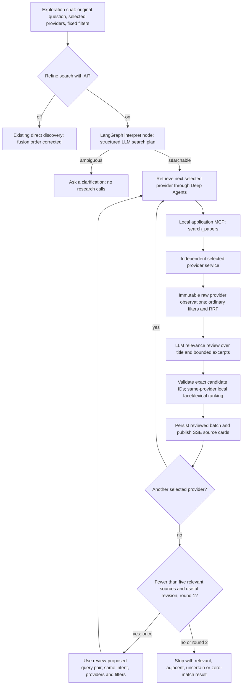
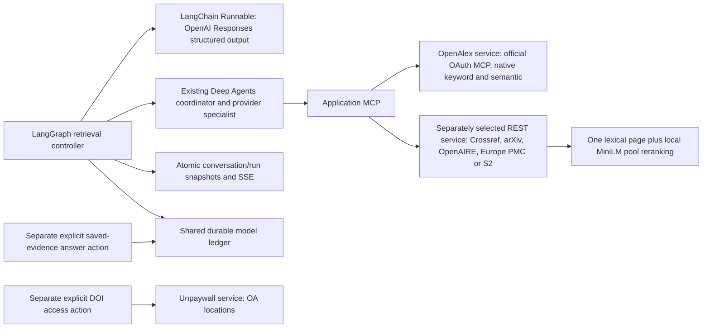

# Agentic query refinement and relevance ranking

**November 9, 2026 · implemented bounded discovery workflow; live acceptance recorded below.**

The user reported that “What's the impact of how we improve the context model needs to have for better generation?” returned pharmacy, COVID-19 and biologics work, despite intending machine learning and context for LLM generation. This checkpoint adds optional LLM query planning, relevance review and one evidence-driven query revision to the existing stack. It supersedes the earlier blanket deferral of hosted retrieval reasoning. The Deep Agents discovery coordinator/specialists remain deterministic capability dispatchers; the new LangGraph retrieval controller makes real, bounded LLM requests through a LangChain Runnable.

## Diagnosis from saved live observations

The exact question already existed in OpenAlex run `a2f274ec38104eb1a602706fb5556dc9`, Crossref run `b6360ea426e54cd0aa73cc2fcf0cc7e5`, plus empty arXiv/Semantic Scholar attempts. Reading these snapshots required no provider or model request.

- Both query branches received the entire conversational question. Broad terms such as context, model and generation did not reliably identify the intended discipline.
- OpenAlex returned 20 records from its native keyword and semantic searches. The first arrivals included *The Seventh Generation Pharmacist*, COVID-19 economics and biologics. The pool also contained relevant context/RAG papers, including *Provence* and *Sufficient Context*.
- Chat copied entities in arrival order, ignoring the saved fusion score. Direct chat now orders by that existing score. RRF itself only combines ranks; it does not establish topical relevance or resolve ambiguity.
- Crossref returned 20 broad word matches. The offline intent-facet diagnostic found no complete intended-facet match. Its local embedding reranker cannot recover a paper absent from the lexical candidate pool.
- The existing MiniLM is a bi-encoder over a bounded provider pool, not a cross-encoder, LLM relevance assessor or full-corpus vector index.

The [offline diagnostic](../docs/validation/2026-11-09-query-relevance-diagnostic.json) records the exact pools, hashes and heuristic ordering. Its facet counts are diagnostics over a reused example, not independent accuracy labels.

## Implemented workflow

The planner returns interpreted intent/domain, disclosed assumptions, short lexical and natural-language semantic queries, required/optional intent facets and a brief rationale. These facets are ranking signals, not hidden hard filters. If intent cannot be reasonably inferred, the planner asks one clarification instead of guessing a discipline. The original user question remains unchanged in every child run; actual query inputs are saved separately and included in idempotency identity.

The review receives every candidate in the current provider batch, up to 20, with IDs mapped by the application to exact run/source/version identities. It labels each `relevant`, `partial`, `irrelevant` or `unknown`, with a short reason. Missing, duplicate or foreign IDs reject the whole review; no raw batch is substituted in chat. Missing abstracts are visible evidence limitations. Multilingual/large excerpts are shortened deterministically to fit the context envelope while retaining every candidate ID. Reported reviewed-character counts describe the actual excerpts supplied.

Unrelated candidates stay in the originating raw run and in review assessments, but are withheld from chat results. Adjacent and uncertain candidates remain visibly labeled. No medical-domain blacklist is used: clinical work about the requested ML technique can be relevant.

Within each provider, accepted candidates are ordered first by review category, then the versioned local intent-facet/lexical policy. That policy uses explicit phrase alternatives, title weighting, saturated term-frequency/specificity signals and facet coverage. Existing RRF provides a tie signal. Scores are uncalibrated heuristics, never confidence percentages. Provider groups remain separate; no cross-provider score fusion or metadata blending occurs.

An additional search is allowed only after all selected providers finish the first round, fewer than five accepted records have a `relevant` label, and a review supplies a distinct query pair. It preserves the original intent/facets/providers/filters. It stops after round two even if relevance is poor. Zero useful matches is a valid result. This is a transparent policy threshold, not a tuned optimum.

## Provider and framework boundaries

OpenAlex remains the default discovery provider. Its semantic query embedding remains provider-owned. This change does not introduce OpenAI embeddings, a vector database, full-text passage retrieval or automatic provider selection. Provider services do not receive the OpenAI credential. Crossref topic discovery, DOI metadata checks, DataCite registry lookup and Unpaywall access resolution retain their independent roles.

**Unpaywall is not an alternative unlimited discovery corpus.** The current official API documents 100,000 requests/day and DOI-based OA lookup. Its topic-search endpoint was retired September 18, 2026. OpenAlex and Unpaywall expose the same underlying data through different surfaces. Unpaywall supplies OA location/license/version observations, not a replacement semantic/abstract search pipeline. Sources: [Unpaywall API](https://unpaywall.org/api), [OpenAlex’s Unpaywall explanation](https://help.openalex.org/access/unpaywall/), verified November 9.

## Progressive UX and saved evidence

The discovery-only **Refine search with AI** control defaults on when the live profile is configured and selected services are live. Direct search remains available. API clients must explicitly send `agentic:true`; omitted values preserve existing behavior. Fixture launch forces the feature off. The legacy Search workspace remains direct discovery.

The refinement panel shows interpreted intent, assumptions, current query inputs, round history, relevance review status and excluded-record reasons. Provider activity separately counts scholarly calls and OpenAI planning/review calls. No answer text is generated by this action.

AI mode adds a deliberate relevance-review barrier for each provider batch. The first reviewed batch appears before another selected provider or an optional second round completes. Direct mode continues publishing ordinary eligible entities immediately. Core raw child-run snapshots remain accessible as diagnostic provider observations: they have not passed chat’s LLM review. The review annotations belong to the conversation, not provider-authored metadata.

Stable source identities and first-admitted observation versions survive refinement. Later same-provider duplicates cannot replace an earlier reviewed observation. Ranking may change as useful papers arrive; source anchors and focus remain stable. A later saved-evidence answer pins an AI-reviewed source to the exact reviewed observation if provider details have since changed, preventing newer content from inheriting an earlier relevance assessment. Direct-source answers retain the earlier richer-detail behavior.

## Bounds, failures and replay

| Boundary | Implemented limit |
| --- | --- |
| Providers | User-selected, maximum two; never silently added/switched |
| Search rounds | Maximum two, maximum four provider child runs |
| Raw candidates | Maximum 20 per provider/round; 40 per provider across rounds |
| Model requests | One planner + up to four provider-batch reviews = maximum five; normally two for one provider/one round |
| Model input/output | 48,000 context bytes including instructions; maximum 2,600 output tokens/request |
| Model profile | Temporary `gpt-6-luna`, Responses structured output, `store:false`, no tools/retries/fallback, 60-second call timeout |
| Model accounting | One durable reservation per retrieval turn, maximum $0.05; shared with writer under existing $0.25 workspace ceiling |
| Research accounting | Existing per-run/provider grants, round-specific operation identities, maximum 24 attempts/holds per conversation turn |
| Total turn | Existing 420-second deadline; cancellation and restart never automatically replay |

The model ledger records dispatch intent before networking, per-step attributable token usage and conservative estimated cost. A pre-dispatch input/output upper-bound check protects the remaining turn reservation. All dispatched steps must settle before the hold is released; unknown outcomes retain the whole hold across restart. Proven zero-dispatch work releases its unused reservation. Reloads/idempotent resubmission read saved state without model/provider calls. Invalid output is a stopped operation, not a retry trigger. A final cancellation check fences the HTTP dispatch window.

## Validation and current limits

Authored graph tests exercise actual LangGraph and Deep Agents execution with provider/model doubles: query separation, exact coverage validation, no-match, clarification, one repair only, fixed providers/filters, progressive reviewed batches, five-call ceiling, cancellation, shared budgeting and immutable reviewed versions. Local ranking tests cover hard negatives, multilingual terms, missing content and clinically applied ML relevance. These tests establish behavior, not scientific search quality.

The existing eleven synthetic context/harness evals remain separate from these new checks. Live before/after inspection uses the user’s reported query and is a regression example, not a held-out relevance benchmark. A broader reviewed query set, independent relevance judgments, recall/nDCG measurement and a cross-encoder comparison remain future quality work. The LLM’s judgments can be wrong; the UI exposes their basis and uncertainty. Full-text grounded answering and production model selection remain separate decisions.

Implementation: [retrieval controller](../src/research_scout/retrieval.py), [local ranking](../src/research_scout/relevance.py), [conversation integration](../src/research_scout/conversations.py), [shared paid ledger](../src/research_scout/generation.py). Framework references: [LangGraph agentic RAG](https://docs.langchain.com/oss/python/langgraph/agentic-rag), [Deep Agents](https://docs.langchain.com/oss/python/deepagents/overview), [OpenAI structured output](https://developers.openai.com/api/docs/guides/structured-outputs?api-mode=responses), [temporary model](https://developers.openai.com/api/docs/models/gpt-6-luna), consulted November 9.

### Live acceptance of the exact reported question

[Open the saved live trial](http://127.0.0.1:3100/?conversation=97846fde51ac46579f3301eb9d3b7612). The [live UI receipt](../docs/validation/2026-11-09-agentic-retrieval-live-ui.json) records the actual queries, provider branches, assessments, timings and saved replay.

- The planner inferred natural-language processing/generative AI, disclosed its assumptions and wrote lexical input `context modeling generation quality` plus a focused semantic question about context, output relevance/coherence and factuality. No manual rewrite was supplied to the trial.
- OpenAlex native keyword/semantic branches succeeded: 19 distinct retained candidates. Crossref discovery and its local semantic-pool ranking succeeded: 20 candidates. Three actual scholarly HTTP/MCP search attempts in total.
- The two reviews labeled 10 observations relevant, 11 adjacent/partial, 16 irrelevant and 2 uncertain. Chat retained 23 labeled observations; unrelated candidates stayed in raw runs/assessment history. These are model labels, not independent ground truth or precision measurements.
- The leading OpenAlex papers included *Context-Guided Dynamic Retrieval for Improving Generation Quality in RAG Models*, *How to Make Context More Useful?*, *ContextCite*, *Learning to Filter Context for Retrieval-Augmented Generation* and *Context-faithful Prompting for Large Language Models*. Crossref contributed separately, including language/speech context modeling and long-context quality evaluation.
- Three model requests (one planner, two reviews), conservative estimated model cost $0.001535875; no answer generation. First reviewed-source snapshot arrived after 14.836 seconds, before terminal completion at 32.057 seconds. No second round was needed; the repair branch has authored graph proof, not a separate live repair-quality claim.
- Reload preserved sources and usage with zero new requests. Desktop, 390 px and 320 px checks passed without overflow or browser errors. [Desktop](../docs/validation/2026-11-09-agentic-retrieval-desktop.png) and [mobile](../docs/validation/2026-11-09-agentic-retrieval-mobile.png) screenshots preserve the visible state.

The first two development validation attempts stopped at the planner before scholarly calls. The second private capture identified a 163-character assumption rejected by a 160-character custom validator whose limit was absent from the API schema. Item bounds are now explicit in the schema and local types (assumptions up to 240 characters), with a schema/local-parity regression. The captured response validates against the correction. Both paid attempts were settled and preserved ([first receipt](../docs/validation/2026-11-09-agentic-retrieval-live-first-attempt.json), [diagnostic receipt](../docs/validation/2026-11-09-agentic-retrieval-live-second-attempt.json)); no automatic application retry occurred. Across the failed development probes and successful trial, five model requests cost an estimated $0.001954625, separate from OpenAlex usage. Complete model outputs remain private audit data in ignored local state.

Final validation: **225 Python tests, 32 browser journeys and 11 structural harness cases passed**. The closing [execution receipt](../docs/validation/2026-11-09-agentic-retrieval-final.json) preserves code fingerprints and qualifications. Evidence: [Python regression receipt](../docs/validation/2026-11-09-agentic-retrieval-python-complete.xml), [32 browser journeys](../docs/validation/2026-11-09-agentic-retrieval-browser.json), [11 structural harness cases](../docs/validation/2026-11-09-agentic-retrieval-harness-final.json). Type-check, production build and Ruff passed. Earlier source-expansion/streaming receipts remain unchanged.
