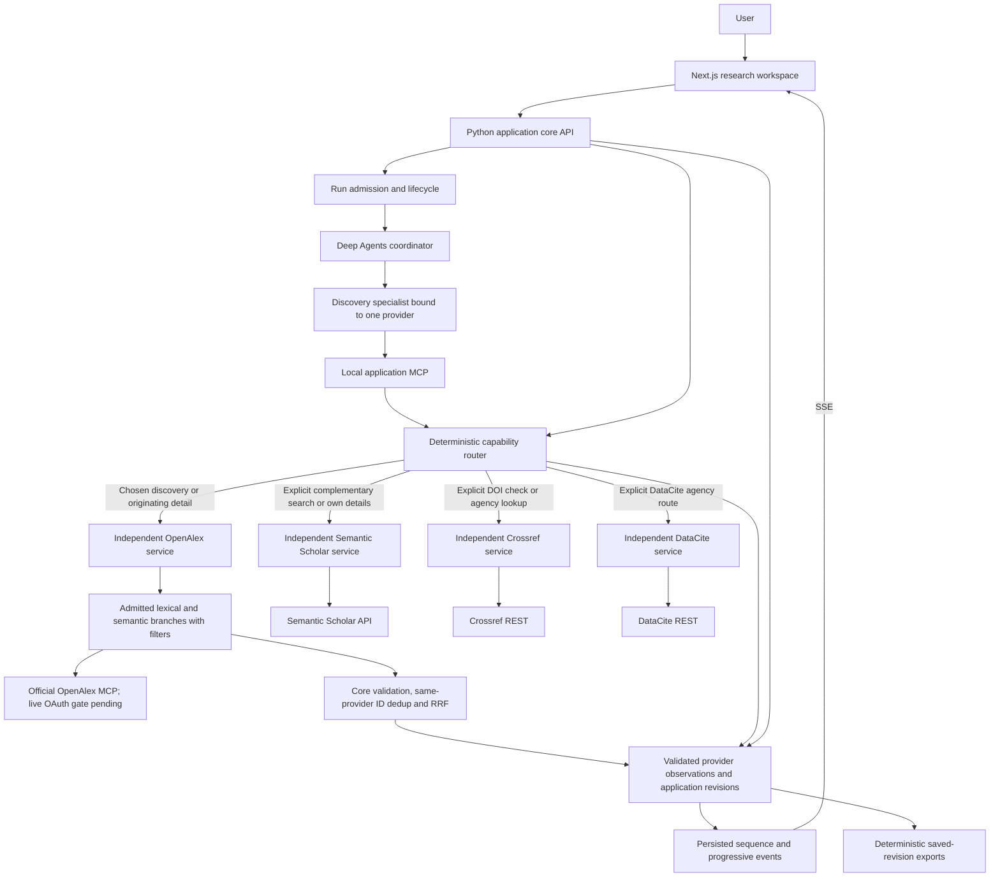

# Application and agent architecture

**Current automatic discovery:** [Multi-source discovery, canonical DOI papers and automatic Unpaywall](automatic-federated-discovery-2026-11-09.md) is the latest user-directed default. Source selection is optional advanced behavior; a recorded eligible route searches multiple isolated services, groups matching DOIs into one paper and resolves access links through Unpaywall automatically. Earlier manual-selection/two-source defaults are superseded.

**Current provider relevance correction:** [Provider-specific queries and independent quality review](provider-relevance-v2-2026-11-09.md) replaces the shared-query/pooled stopping rule: Crossref uses bibliographic search, every selected provider gets its own query plan and repair decision, and primary results exclude adjacent/uncertain records. Search-workspace AI submissions use the same reviewed conversation path. The exact-question live retest passed: two Crossref pages, three model calls, five primary matches with abstracts, explicit intent/keywords/tags and saved LLM/provider request traces. 234 Python, 39 browser and 11 harness checks passed. Earlier checkpoints below retain their dated behavior.

**Latest November 9 query-relevance checkpoint:** [Agentic retrieval and ranking](agentic-retrieval-2026-11-09.md) adds optional structured LLM query planning, provider-batch relevance review and at most one query revision through LangGraph, retaining Deep Agents/application MCP and isolated providers. Chat direct-search fusion ordering is corrected. AI-reviewed results have explicit intent, query history, relevance reasons and shared paid-call accounting; prior deterministic-only statements below are historical where superseded. Live exact-query acceptance passed: 39 reviewed observations, 16 withheld, first reviewed batch at 14.8 seconds; 225 Python, 32 browser and 11 structural harness cases pass.

**October 26, 2026 · approved Increment 1 target; local framework implemented**

**Latest November 9 implementation:** [Eight-provider routing/streaming architecture and execution](provider-expansion-2026-11-09.md) adds independent arXiv, OpenAIRE, Europe PMC and Unpaywall services, plus Crossref discovery. New discovery is live-proved through the existing Deep Agents/application MCP; REST semantic branches rerank bounded same-provider pools locally. Unpaywall access metadata stays separate and now has live proof with its required contact configured privately. This record supersedes the older provider count and pending-adapter statements below.

**Latest November 9 abstract correction:** the [abstract/source design delta](richer-sources-and-abstracts.md) adds visible chat abstracts and explicit originating-provider detail reads. A new answer resolves richer saved records locally and cites their exact versions; prior answers keep their original snapshots. No new retrieval occurs during generation. The proposed arXiv/OpenAIRE/Europe PMC integrations remain separate from this implemented correction.

**Latest November 9 architecture:** [Provider contributions and streaming answers](streaming-generation-2026-11-09.md#implemented-routing-and-streaming-architecture) supplies the current executable routing and sequence diagrams. The outer LangGraph has an explicit `generate` branch invoking a LangChain Responses-stream Runnable over saved evidence. OpenAI writes only on that action; OpenAlex remains primary MCP discovery. Crossref/DataCite expose DOI lookup/checks only, with broader topic endpoints still unwired. The one-call live stream passed. Earlier diagrams and generation-disabled statements below retain their checkpoint context.

**November 9 implemented extension:** [Current conversation/provider routing architecture and execution](integration-execution-2026-11-09.md#framework-and-routing-ownership) adds a compiled LangGraph turn controller, deterministic resource responses and conversation APIs/UI while preserving each Deep Agents/MCP discovery child and provider boundary. Generation is disabled. That record supplies the latest live proof/access status; the diagrams below preserve the original Increment 1 contracts.

**Current implemented snapshot — November 9:** see the [architecture/agent review](implementation-review-2026-11-09.md) and [three current diagrams](diagrams/review-2026-11-09/index.html) for verified framework ownership, current local reachability, dated live probes and remaining proof. The original Phase 1 illustration below retains its proposed-generation status. This document continues to preserve the target contracts and their rationale.

The [confirmed stack](README.md#confirmed-foundations) is Python, Next.js, LangChain Deep Agents, multiple agent roles, a local application MCP server and suitable provider MCP integrations. The user additionally requires **isolated provider services**, **explicit routing**, **progressive entity display**, **OpenAlex as a key discovery resource** and **hybrid lexical/semantic retrieval with filters**. Development is approved; [implementation status](implementation-status.md) identifies adopted local protocols/storage/limits, executable ownership and remaining live gates. [Validation](../docs/validation/increment-1.md) separates fixture, actual local-protocol and public adapter evidence.

[Increment 1](increment-1.md) defines execution. [Provider isolation and routing](provider-routing.md) specifies service ownership and justified cross-provider checks. [Progressive results](progressive-results.md) specifies entity delivery and recovery; [hybrid retrieval](hybrid-retrieval.md) specifies branch plans, embeddings, filters and within-provider fusion.

*Illustrated overview; [caption, prompts, visual review and preserved earlier scope](diagrams/README.md). The Mermaid diagrams and focused contracts below define exact routes and delivery behavior.*

## Deployable shape and ownership

The implemented local packaging uses one local owner, a Next.js frontend, a provider-agnostic Python/FastAPI application core and independently launched Python provider services. Separate agents or modules alone do not establish a service/process boundary.

The core owns the application API, run coordinator, local application MCP, deterministic router, application state, human selections, event delivery and exports. Each provider service owns exactly one upstream integration, its access, cache namespace, limits and failures. Do not mount all four provider implementations inside the core or make their startup configuration mutually dependent.

The outgoing branches are **conditional routes**, not parallel fan-out. A discovery run binds one provider; OpenAlex is the default. DOI checks are explicit human actions with registration-agency routing. Provider services never call one another. An unknown agency may require a separately recorded Crossref agency lookup, as detailed in the routing design.

The API and application MCP reuse the same application domain rules. Provider SDKs and credentials stay in their respective services. A versioned internal contract may be shared; provider runtimes, retry loops and raw-record storage are not shared.

## OpenAlex as the primary discovery resource

Use OpenAlex's official MCP as the preferred first integration. Its documented `search_works` supports keyword/Boolean searching and `mode: "semantic"`; complex selections can use OQL, with a preview capability. `get_work` supplies detailed records. Verify the runtime schemas, supported combinations and returned query provenance before enabling modes. [Official connector](https://help.openalex.org/access/connector/).

Keep these distinct:

| Search need | Proposed OpenAlex route |
| --- | --- |
| Semantic branch of the hybrid plan | Meaning-oriented query text, provider-generated query embedding and supported filters. |
| Lexical branch of the same hybrid plan | Keywords, phrases/Boolean terms and eligible filters; preserve executed matching scope and ranking. |
| Consistent scope across both branches | Requested/effective filter contract, supported filters/OQL and deterministic local post-filtering only when returned fields permit it. |
| Inspect a returned/identified work | Detail lookup through the same OpenAlex service. |

Semantic matching is a provider capability; it does not require a new local embedding store or using Semantic Scholar. OpenAlex's semantic REST reference documents different constraints from keyword search, including incompatible filters. Do not translate these into unverified MCP arguments or combine incompatible parameters in one request. The user-authorized hybrid plan explicitly dispatches two bounded requests within OpenAlex, then combines only that provider's eligible results. Record chosen mode, actual query, returned OQL where present, ranking and warnings. [Semantic search](https://help.openalex.org/api/semantic-search/), [search mechanics](https://help.openalex.org/api/searching/).

The OpenAlex service retains both branch queries/ranks and provider observations. The core validates eligibility, deduplicates canonical provider IDs and applies versioned equal-weight RRF (`k=60`) to eligible branch ranks. Raw lexical/semantic scores are not interchangeable. The implemented cap is ten raw results per native branch and a twenty-entity union before filtering, so early lexical arrivals cannot consume all capacity; fewer may be eligible afterward. Filters unsupported upstream are evaluated locally only from sufficient fields; unknown/unsupported constraints remain visible rather than silently relaxed. The current API enforces only explicit structured year/type filters as hard predicates; question wording is retrieval intent. Arbitrary natural-language exclusions require a later explicit predicate contract.

The OpenAlex service owns its remote MCP client, read-tool allowlist, OAuth and provider usage. Its broader catalog does not automatically grant application agents profile mutation, citation traversal or every advertised capability. A REST alternative requires a recorded transport decision; no automatic MCP-to-REST retry.

Semantic Scholar adds a separately enabled complementary discovery choice. It does not replace OpenAlex's semantic route or silently fill an OpenAlex result set. Its relevance-search endpoint is not automatically proof of vector retrieval. Where a native semantic capability is absent, propose compatible local query/document encoding and semantic reranking of that provider's bounded lexical candidate pool. This does not discover records outside the pool; model/resource choices remain open. Crossref/DataCite registry lookups are exact-identifier operations and do not require hybrid search. See the [hybrid contract](hybrid-retrieval.md).

## Application responsibilities and agent authority

| Owner | Responsibility and authority |
| --- | --- |
| Brief/run services | Snapshot question, selected provider/mode, filters, allowed operations and limits; own cancellation and terminal outcome. |
| Coordinator | Delegate one bounded discovery task; return structured summary and saved record references. Cannot expand providers or mutate selections. |
| Discovery specialist | Use the selected provider's admitted application search capability. No nested delegation or provider substitution. |
| Router | Validate operation scope, capability, identity, readiness, operation ID and remaining grants before dispatch. |
| Provider service | Execute one provider's operations, map responses, journal real upstream attempts and preserve attributable results/errors. |
| Observation/event services | Validate and persist records, enforce versions and publish application events without waiting for model summaries. |
| Shortlist/revision service | Apply human include/exclude and citation-source decisions, preserve reasons and immutable snapshots. |
| Export service | Render saved records and warnings deterministically; no external calls. |

A discovery specialist is a provider-bound role instance, not authority to invoke every provider. One coordinator and one specialist are sufficient for the first path; independently enabled provider work can publish through the same event contract. Add agents for useful responsibilities, not to manufacture one model per service.

Inspect the effective Deep Agents tools and role catalog. Limit scratch/planning tools to run-local state; disable unrestricted general delegation, filesystem/shell access and unneeded defaults. Count internal repairs/compaction within the model limits. Custom tool arguments alone do not prove default capabilities disappeared. [Deep Agents subagents](https://docs.langchain.com/oss/python/deepagents/subagents), [backends](https://docs.langchain.com/oss/python/deepagents/backends).

Do not load repository development skills or `AGENTS.md` into end-user research instructions automatically. Runtime instructions are separately authored, scoped and versioned.

## MCP and service contracts

| Boundary | Purpose | Proposed transport/contract |
| --- | --- | --- |
| Application MCP | Stable, run-scoped tools backed by core application rules | Implemented loopback Streamable HTTP at `/mcp/`; actual client/server tests. |
| Core to provider service | Explicit single-provider operation and attributable response/update | Implemented versioned loopback HTTP with newline-delimited discovery events. |
| OpenAlex provider MCP | Provider's official remote capability surface | OAuth/Streamable HTTP, narrow verified read allowlist. |
| Other upstream providers | Suitable verified provider MCP where available; otherwise documented API | Implemented Crossref/DataCite REST and Semantic Scholar API adapters. No unidentified MCP dependency. |
| Core to browser | Saved snapshot and progressive entity/status events | Implemented persisted SSE snapshots with opaque event cursors and explicit gap resync. |

Application `search_papers`/detail names need not mirror upstream names. Bind run/provider capability handles server-side; model-supplied IDs do not grant scope. No arbitrary URL, filesystem path or credential argument is exposed. Human decisions, DOI checks and exports stay outside the initial agent's mutation capability.

Prove the selected Deep Agents/MCP lifecycle, request context, nonblocking calls, cancellation and effective capabilities, then lock versions. Current LangChain MCP documentation describes a beta surface; copied historical imports are not a compatibility proof. [LangChain MCP](https://docs.langchain.com/oss/python/langchain/mcp).

## Data identity and observation contracts

| Contract | Minimum distinctions |
| --- | --- |
| ResearchRequest/Run | Brief revision, selected discovery provider, lexical/semantic branch plan, requested/effective filters, capabilities, finite limits and status. |
| ProviderOperation/Attempt | Operation ID, provider, intent, actual upstream attempt, transport/schema, times, outcome, retry and usage/unknown holds. |
| ProviderObservation | Provider/record/version identity, original fields, content origin, missingness, query/attempt references and retrieval time. |
| IdentityLink | Exact identifier relationship and supporting observations; uncertain/conflicting versions stay explicit. |
| MetadataCheck | Selected DOI, agency evidence, matching provider observation, field agreement/conflicts and partial/unavailable state. |
| ApplicationEvent | Durable sequence, scoped entity/version reference and status/update type; no hidden model reasoning or secrets. |
| Selection/ExportRevision | Human state/reason, explicitly chosen citation-record snapshot and immutable observation/check references. |

Keep records provider-specific. An exact normalized DOI can link observations; it does not create a blended authoritative record. Similar titles never trigger automatic identity collapse. Do not pool citation counts, mix relevance scores or overwrite source fields with model output or another provider's metadata.

Registry agreement checks bibliographic identity/metadata, not scientific correctness. Metadata, abstract and acquired source text remain distinct; an OA location or provider full-text matching does not prove this application acquired/read the paper.

## Progressive delivery, state and recovery

Persist every valid, scoped entity before publishing it to the UI or passing its reference to a model. The UI renders that entity immediately; it does not await all providers, the completed page-normalization batch, a final agent turn or a summary. If the upstream returns a complete page, progressive publication begins when that page arrives; do not claim upstream item/token streaming.

The implemented event stream has saved snapshots, ordered IDs, replay, deduplication and explicit gap recovery. Reconnect reads/replays saved application data; it never reruns a provider/model request. Source rows remain stable, inspectable and saveable while work continues. Details and DOI observations update separately without moving focus or overwriting human decisions. Optional generated fit notes remain a target; source metadata is already usable without them. See [progressive results](progressive-results.md).

Discovery execution states remain `CREATED → QUEUED → RUNNING → SUCCEEDED | EMPTY | PARTIAL | FAILED | CANCELLED | INTERRUPTED`. Operation/provider statuses and human selection state are independent. Receiving a first row is not whole-run completion. A model failure after successful retrieval yields retained, visible partial results.

Human detail/check actions have their own timeouts and remaining budgets after discovery completes or after reopen. They do not reopen the agent execution. Cancellation fences new work and late application effects while retaining completed records and uncertain-attempt receipts.

Persist admission before dispatch. Services own upstream retries; the core does not blindly retry an uncertain dispatch or change provider. Operation IDs and durable grants prevent restart from resetting allowances. Saved reads, human decisions and exports work with all provider services stopped.

Selection changes, chosen-record hydration or newly included check/observation versions produce a new export revision. Existing exports remain immutable. New updates can be shown beside a saved selection without silently replacing the snapshot already chosen. Reevaluate eligibility when updated metadata changes a filter-bearing field: remove an ineligible version from the current eligible rank view, retain any human-saved record/history visibly with a warning, and preserve earlier exports.

## Persistence and efficiency

**No production database is selected.** The local slice implements application-owned JSON snapshots/manifests behind interfaces, with one core writer, atomic publication, version checks and bounded saved event history. State plus its event sequence publish in one aggregate; this does not promise transactional behavior across separate files/services. Provider services own separate locked journals/cache namespaces and do not write application state.

Prove crash/reopen behavior and reject unsupported multiple writers. If these contracts require a transactional store, choose one before implementation. Framework checkpoints, operational receipts, secrets, provider cache and exports have different owners/lifecycles.

Carry forward useful mechanisms from [GitHub Manager Architecture](../docs/github-manager-architecture.md): local ID/abstract normalization, compact model inputs referencing complete saved records, cache keys with provenance/freshness, durable receipts, deterministic validation and exports, and admission before every external attempt. Reopen/save/export need no inference. Do not transplant README-specific thresholds, parsing or ranking assumptions into scholarly discovery.

The revised design preserves the agent/MCP foundation, restores explicit registry checks, retains OpenAlex's primary role and makes isolation, hybrid retrieval and progressive results structural requirements. Framework compatibility and local recovery have test evidence. Remaining gates include OpenAlex actual access/tools/search modes, Semantic Scholar access/encoder, hosted-model compatibility/cost admission and real-question quality; the [implementation checkpoint](implementation-status.md#work-package-checkpoint) records each.
