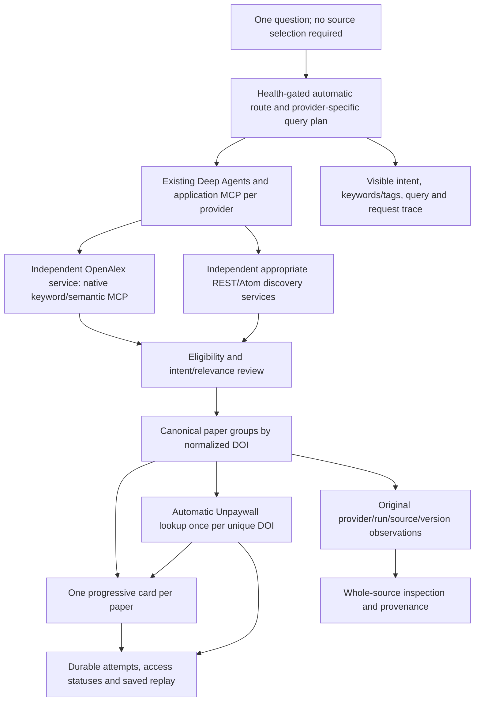

# Automatic multi-source discovery, DOI grouping and Unpaywall

**November 9, 2026 · latest user-authorized behavior.** The user requires discovery without source selection, automatic DOI-based deduplication and visible Unpaywall integration. This supersedes the earlier manual-source prerequisite and two-source default. Provider process isolation, immutable observations, relevance checks, visible query traces and finite budgets remain in force.

## Default user journey

The user enters a question and starts a search. Both Search workspace and Exploration default to `routing:auto`; neither requires choosing a provider. Optional advanced manual controls retain legacy one/two-provider behavior. Topic searches open the same progressive reviewed conversation, including when explicit AI opt-out uses model-free discovery.

A local service-health snapshot identifies eligible resources without making upstream probes. The AI planner chooses two to four complementary eligible discovery services and writes separate queries for each. OpenAlex is included when eligible; technical/preprint questions can use arXiv, biomedical questions can use Europe PMC, and scholarly metadata/other resources contribute complementary recall. Known access/rate/quota failures are skipped with recorded reasons; unverified anonymous Semantic Scholar search is not silently probed. Model-free fixture/direct mode uses a deterministic topic-appropriate route instead.

The connection/route view includes Unpaywall as an **automatic access resource**, not a keyword search endpoint. DataCite remains a registry role. The user sees planned, skipped, running, completed and access-enrichment outcomes rather than having to understand provider API selection.

Discovery child runs currently execute serially under the existing global admission owner. Each reviewed batch publishes canonical papers before other services or access enrichment finish. This is multiple-source orchestration, not a claim that upstream retrieval is already concurrent. Automatic Unpaywall results update the existing paper cards progressively.

## Canonical paper identity

- A complete supported DOI, normalized for case, DOI prefix/resolver URL and encoding, defines `paper_id=doi:<normalized DOI>`.
- A record without a valid DOI retains provider-scoped source identity. Similar titles do not trigger fuzzy merges.
- Each paper keeps its contributing provider badges and exact run/source/observation-version references. Different titles, authors, dates or abstracts remain attributable to their original observations.
- One whole representative observation supplies the displayed bibliographic fields and abstract. Selection prefers useful available content/relevance using a deterministic policy; it does not manufacture a record by mixing fields.
- Paper IDs and ordering remain stable while additional providers or access results join. A clicked source inspector pins its exact source rather than following later representative changes.
- The optional answer writer uses one whole observation per canonical DOI, preventing duplicate provider records from consuming the limited evidence envelope or masquerading as independent corroboration. Earlier generated citations remain unchanged.

Raw observations remain in originating runs and the private conversation aggregate. Public repeated metadata can use compact references to bound SSE/history size; full saved results and request traces are restored through local read-only turn access, without another provider/model call.

## Automatic Unpaywall enrichment

After discovery, unique primary DOI groups enter the automatic access stage. The system persists each DOI's intent before calling the independent Unpaywall service. Operation identity includes the DOI, so distinct papers cannot accidentally replay the first DOI's result. A duplicate DOI reported by several providers triggers one access operation for that turn.

Access states distinguish queued, running, succeeded, not found, failed, blocked, deferred by budget and not applicable. Missing configuration or unavailable access does not remove the paper or its other provider links. Papers without a supported DOI do not produce an Unpaywall call. Related/uncertain records remain outside automatic primary-result enrichment and answer evidence.

The current local slice checks up to 12 unique primary DOIs within the existing parent turn allowance. Additional groups are explicitly deferred rather than hiding extra network work. The provider service's per-turn access journal cap is 12, while its durable daily limit remains 100,000. Existing explicit single-DOI access actions continue to work. All access URLs are provider-reported metadata; no PDF/full-text download is implied.

Unpaywall supplies OA locations, versions and licenses, not independent scientific abstracts or topic search. The official [Unpaywall API](https://unpaywall.org/api) documents DOI lookup and a 100,000-call daily limit; its topic-search endpoint is retired. Provider credentials/contact configuration stay in the ignored local environment, outside UI request traces.

## Bounds and failure behavior

| Boundary | Current behavior |
| --- | --- |
| Discovery selection | Automatic 2–4 eligible services; degraded single service only if it is the sole eligible choice |
| Retrieval rounds | Maximum two; only weak providers with useful distinct revisions and remaining grant capacity retry |
| Model calls | Maximum one planner plus eight batch reviews, under one existing $0.05 turn reservation and shared $0.25 workspace ceiling |
| Research requests | Existing 24 attempts/holds per turn, shared by child discovery and automatic access |
| Access enrichment | Maximum 12 unique primary DOI lookups and remaining allowance; no hidden retry |
| Provider failures | Separate statuses and receipts; no off-plan fallback or deletion of other providers' papers |
| Public access view | First eight returned access locations with omitted counts; full access observation stays private |
| History/events | Existing bounded SSE window; large histories compact excerpts/audit bodies/old result arrays with local full-turn restoration |
| Replay/restart | Saved reads make no upstream/model call; uncertain work is held/interrupted rather than automatically redispatched |

Provider query/keyword/tag traces remain visible. Native OpenAlex semantic calls are distinct from local encoder reranking of another provider's fetched lexical page. Canonical paper grouping introduces no cross-provider raw-score fusion, citation-count pooling or field blending.

## Validation checkpoint

Meaningful cases cover DOI case/resolver variants across providers, immutable conflicting observations, missing DOI, representative selection, automatic routing eligibility, once-per-DOI access, per-DOI failures, parent/provider budgets, interrupted grants, saved replay, four-provider planner bounds and large-history projection. Browser checks cover default no-selector entry points, progressive grouped cards/provider badges, Unpaywall access links/blocked states and advanced manual compatibility.

Validation passed: **270 Python tests, 43 browser cases and 11 structural harness cases**, plus Ruff, TypeScript and a production Next.js build. The browser suite explicitly enabled actual fixture services and skipped no cases. [Python receipt](../docs/validation/2026-11-09-automatic-federation-python.xml), [browser receipt](../docs/validation/2026-11-09-automatic-federation-browser.json), [harness receipt](../docs/validation/2026-11-09-automatic-federation-harness.json).

The [final checkpoint receipt](../docs/validation/2026-11-09-automatic-federation-final.json) records source fingerprints and privacy checks. No configured API credential/contact values were found in 862 scanned source, test, documentation, frontend build and application-log files; the private environment remains mode `0600` and ignored.

The [actual fixture journey](../docs/validation/2026-11-09-automatic-federation-fixture.json) automatically routed to OpenAlex, Crossref, arXiv and OpenAIRE. Sixteen primary observations became ten canonical papers. Two DOI groups each retained four provider observations and received one Unpaywall lookup apiece. Reload preserved results and usage. These fictional records prove integration/grouping/replay, not live research relevance.

The [bounded live browser journey](../docs/validation/2026-11-09-automatic-federation-live-ui.json) used the user's exact question, “What's the impact of how we improve the context model needs to have for better generation?” No source was selected. The planner chose **OpenAlex, arXiv and Crossref**; Crossref alone received one query refinement. Twenty-six reviewed primary observations produced twenty-six paper cards. This particular set contained **no identical DOI overlap**, so the positive cross-provider merge evidence is the fixture journey, not an inferred live reduction. Different preprint/published DOIs remain different papers under the exact-DOI policy.

First papers appeared after **22.7 seconds** while the turn was running. Papers and access results both updated progressively; the full turn completed in **124.6 seconds**. Twelve automatic Unpaywall operations returned **six open-access observations and six not-found outcomes**. Seven additional DOI groups were visibly deferred by the 12-lookup cap; seven records lacked an applicable DOI. The turn honestly reports `PARTIAL` for incomplete access enrichment without hiding its papers. These are reported locations, not downloaded content or independently checked links.

The live turn used **17 research HTTP attempts and five model requests**, with a recorded estimated model cost of **$0.004661375**. It did not invoke answer generation. Saved reload made zero new provider/model calls and retained all paper/access observations. Desktop and 390/320-pixel layouts passed with no horizontal overflow or browser errors. [Open the saved live run](http://127.0.0.1:3100/?conversation=9e6d5b2e5bbf4ef480ba01e22d215b5f). This one-question integration check is not a calibrated relevance or coverage benchmark.
