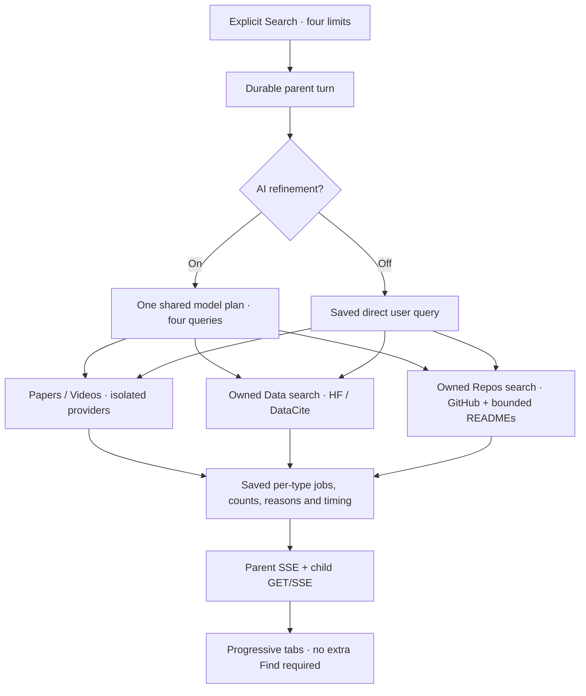

# One search across four resource types

November 14, 2026. This update supersedes the extra Find action for Data/Repos in **new interactive topic searches**. Existing saved reads and older API requests remain compatible; opening a tab or reopening history never admits new work.

## Why the saved embedding search returned so little

The saved AI search for “embedding model domain adaptation approaches” did not hit a five-paper fetch limit. Its first OpenAlex and Crossref reviews each received 20 candidates. OpenAlex marked six observations relevant; Crossref marked none relevant, 15 partial and five irrelevant. The stored snapshot contains six retained observations, six canonical paper groups and six display cards; it does not substantiate the reported five, which may reflect a UI filter or another revision. Canonical cards can be fewer than relevant observations when duplicate identities are grouped. Related/rejected observations remain separately inspectable rather than being promoted to primary results. The existing bounded policy permits one provider query repair and treats five relevant observations as sufficient for repair scheduling; five is not a result cap. A maximum is not a target that the system fills with weak matches.

The subsequent arXiv review failed JSON parsing. The stored Responses output contained an intermediate assistant commentary message and a final answer containing valid structured JSON. Concatenating both texts produced an extra-data parser error and stopped later literature/video work before YouTube was requested. The response used 1,960 output tokens, so this was not evidence of output-token truncation. Separately, Data and Repos had the older explicit-Find lifecycle and had not been admitted by that Search.

The parser now selects one explicit final-answer message, preserves refusal/incomplete checks, rejects ambiguous multiple final answers, and retains compatibility with a single unphased legacy message. This follows the distinction between intermediate commentary and final answers in the [official OpenAI Responses schema](https://developers.openai.com/api/reference/resources/responses/methods/create). Planning instructions also preserve unspecified embedding modality instead of silently restricting a general embedding question to text embeddings. These corrections do not prove relevance quality on a new live query; validation uses saved receipts and controlled fixtures without spending model credits.

## Interaction and limits

Search and Exploration send `modality_limits`: Papers, Videos, Data and Repos, each an integer from 0 to 20. Defaults are 20/10/10/10. Zero disables a type; all-zero topic searches are rejected. The compact **Limits** popover exposes four remembered sliders. “Max” is finite, not an unlimited provider or model allowance. Editing controls changes the next explicit search and does not alter saved results or launch work.

Papers limits eligible canonical results across the paper providers, with provenance and overflow counts retained. Each provider’s candidate union also respects the selected Papers maximum (never above 20), so the combined pre-grouping observations can exceed the final card maximum. Provider review pools stay bounded at 20; relevance filtering and exact identity grouping can produce fewer cards. Videos caps YouTube candidates. **Data is per catalog**, currently Hugging Face and DataCite, so its combined total may exceed one catalog's slider value. Repos caps GitHub candidates; README acquisition remains bounded at five. Source selection still determines eligible paper/video providers. Data/Repos-only searches work without a paper/video provider; exact DOI lookup and saved/generation operations retain their separate paths. No web-search integration is added.

## Ownership, streaming and failures

The explicit limits object opts into orchestration. Omitted limits on legacy conversations retain historical API/idempotency behavior; a central conversation can retain its saved limits for continuation. Each parent turn stores `resource_jobs` keyed by `papers`, `videos`, `datasets`, `repos`, including status, phase, limit, optional child search ID, record/candidate counts and a reason/error. New child admission is persisted before dispatch; the parent waits for its owned work, cancellation propagates, and restart/read paths do not implicitly replay acquisition. Independent failures remain visible rather than masquerading as empty successful searches. Data/Repos reuse the same saved plan with no additional hosted model calls; a Data/Repos-only AI search needs the existing planning call and no paper relevance reviews.

The UI follows saved child IDs and snapshots even before those tabs have been visited. Opening a tab only reads. Disabled, pending, failed, genuinely empty and relevant-result counts have distinct explanations. Saved query plans and limits are execution facts; next-search preferences never rewrite them.

## Search activity illustration

The query window reserves space for a 104px activity atom. Each full ring plane tilts about X/Y axes and precesses independently under perspective; particles remain attached to their orbit plane. The nucleus stays centered. Input and submit controls remain clear. Narrow layouts adapt, and reduced-motion preference leaves three visible static rings.

## Validation boundary

Acceptance covers parser phase handling, bounded limits, one-admission ownership, independent partial failures, cancellation/recovery, repeated request compatibility, progressive unvisited tabs, preference persistence and actual three-dimensional ring transforms. Real isolated HTTP/MCP fixtures exercise the service path without external providers or model calls. A later explicit live search is needed to measure changed relevance and source coverage; fixture counts are not research-quality evidence. Existing live research, configuration and credit history must be preserved through restart.

## Accepted implementation

The final source passes 426 backend tests (one optional encoder proof skipped), Ruff, TypeScript checking, the production frontend build, all 223 browser tests and all 11 scripted agent/MCP harness checks. Ten final focused browser checks also pass. Actual isolated HTTP/MCP fixtures verify that one direct main Search retrieves all four resource types, including unvisited Data/Repos, without additional hosted model calls or separate Find actions. Desktop/mobile screenshots were visually inspected, including settled off-canvas navigation and static reduced-motion rings.

The live stack was restarted only after an idle check. All 13 services are healthy; saved reads preserve 58 historical paper cards, 10 video cards and six cards in the embedding-query case. All 809 protected existing JSON/config files are unchanged. Daily credits remain 10 used / 100 (90 available); historical economics totals are unchanged. Validation made zero new paid model calls, zero live provider searches and zero live API writes. Existing saved searches keep their prior receipts: press main Search again to use the new integrated flow. A fresh paid relevance benchmark was not performed.

[Combined validation receipt](../docs/validation/2026-11-14-central-search-final.json) · [Python results](../docs/validation/2026-11-14-central-search-python.xml) · [saved-live checks](../docs/validation/2026-11-14-central-search-live-readonly.json).
