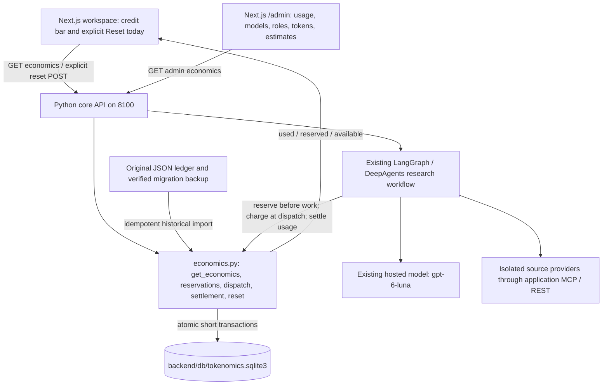

# Daily credits and model economics

The user approved a daily 100-credit allowance, an explicit temporary reset control, local SQLite accounting and an Admin page without a login. This replaces the earlier lifetime $0.25 admission gate. It does not erase the original ledger, past costs or unresolved provider charges. Habit Quest supplies the reference for the allowance bar, reservations and separate accounting; [the reference review](daily-credit-tokenomics-reference-2026-11-14.md) records the differences.

## Implemented policy

One credit means one dispatched hosted model HTTP request. Planning, relevance review, a bounded repair and answer generation each consume a credit when dispatched. Failed or interrupted requests also consume a credit if dispatch occurred; unknown provider usage remains unknown. Source REST/MCP operations, saved reads, local lexical ranking and local embeddings consume no model credits. A research search can therefore use several credits. The allowance is not a guarantee of 100 complete searches.

Admission atomically reserves the maximum model requests allowed by the existing workflow: one answer request, or one planning request plus at most two review/repair requests per selected discovery provider. Four providers reserve at most 9 credits. Dispatch moves one reserved credit to used; terminal completion/cancellation releases only unused reservations. Other requests cannot spend reserved credits. The existing model, output/context limits, provider quotas, finite topology and per-operation app-cost estimate check remain in place.

Allowances follow midnight in `America/New_York`, including daylight-saving transitions. A manual reset creates a new epoch for the same day and makes 100 credits available. It never deletes a call. Work admitted before midnight or reset retains its original window; late dispatch/usage belongs there. Consequently Admin admission-day totals can include multiple allowance windows, while dispatch-hour breakdowns use UTC.

## Request flow and ownership

SQLite is authoritative for economics. `GenerationService.ledger` is a compatibility projection, not another writable ledger. The original JSON is retained byte-for-byte with a verified backup before import. Imported calls keep their historical window; they do not debit today's new allowance. Original settled estimates and unresolved exposure stay reportable. Research/projects/provider observations continue using their existing storage.

The canonical live/default application stores the database in `backend/db/`; fixture and temporary cores use their own state-local database. `SCOUT_TOKENOMICS_DB_PATH` can override the canonical path and `SCOUT_TOKENOMICS_TIMEZONE` selects the local allowance timezone. The default allowance is 100. SQLite files and sidecars are ignored by Git; schema/migration code and the DB README are tracked.

Transactions use `BEGIN IMMEDIATE`, foreign keys, a busy timeout and full synchronization with the DELETE rollback journal. This avoids the installed runtime's affected WAL path described by [SQLite's WAL-reset advisory](https://www.sqlite.org/wal.html#walreset). No database server or new package dependency is introduced.

## API and interface

| Endpoint | Behavior |
| --- | --- |
| `GET /api/economics` | Current window, allowance, used/reserved/available credits, reset time, invocation/token/cost coverage. |
| `POST /api/economics/reset` | Explicit action with `expected_window_id` and `idempotency_key`; compare-and-swap conflicts return 409. |
| `GET /api/admin/economics?day=&limit=&cursor=` | Current economics plus retained totals, role/model/admission-day/UTC-hour breakdowns and paginated operations with invocation metadata. |

The workspace header continuously shows the credit bar. Its disclosure explains reservations and offers Reset today and Admin. Visible polling/focus refresh and model-mutation events update the balance. A balance/window change rechecks Search and Exploration readiness, including after midnight or reset. Loading/error states never invent 100 credits. Failed refreshes mark the last confirmed balance stale.

Reset is user-triggered only. Ambiguous network outcomes retain the original idempotency key and expected window for an explicit Retry reset, even if a later GET observes the committed new window. A definitive conflict refreshes the canonical balance and requires another explicit decision. Slow pre-reset reads cannot replace a newer balance.

Admin has no login, as explicitly selected by the user. It is part of the existing localhost application. It shows call outcomes, models/roles, durations, actual reported token counters, known subtotals and missing-usage coverage. Accounting stores no prompts, answers, source text or credentials. USD figures retain the app's historical estimation assumptions and basis version; they are not verified current model prices or provider invoices. Unknown usage/holds remain visible separately from known estimates.

## Validation

Acceptance covers concurrent reservations, 100-credit exhaustion, daily/DST rollover, reset CAS/idempotency, ambiguous UI retry, cancellation/restart recovery, late settlement in the original window, legacy migration/backup integrity and fixture/live database isolation. Browser checks cover meter updates, blocked-search recovery, errors, Admin reads and 320px layouts. Full regression, isolated model fixtures and saved-live read-only checks are recorded in [the validation receipt](../docs/validation/2026-11-14-tokenomics-final.json). Validation does not require a paid model request or a reset of the user's real allowance.

Completed acceptance: 407 backend tests passed with one optional encoder proof skipped; 11 scripted harness checks passed. All 206 browser cases are verified across the 205-pass full run and 65-pass affected rerun after fixing the mobile mode indicator, followed by 7 final credit checks. The original mobile assertion was preserved. TypeScript, production build and Ruff pass. Actual fixture UI→HTTP API→SQLite reset and live saved-read checks pass; 13 live services are healthy, retrieval is ready and the current allowance is 100/100. All 719 pre-existing live JSON/config files remain byte-identical. The historical 13 operations / 27 model invocations are retained; no paid model request or real-allowance reset was used in validation.
