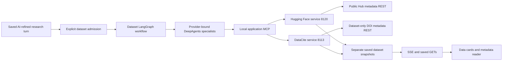

# Dataset discovery and the Data workspace

**Later shared-planning update:** [Policyv7](shared-ai-query-refinement-2026-11-14.md) now requires a validated model-authored resource query for new acquisitions. Historical saved reads and accepted retries remain available.

November 14, 2026. The user requested two subagents, **Analysis** and **Execution**, to research dataset sources and implement a resource-specific fetch agent with a separate Data tab. The [source analysis](../discovery/research/dataset-source-analysis-2026-11-14.md) reconciles the earlier resource guide and development handoff, maps problem areas to original sources, and verifies current primary API documentation.

## Implemented slice

Data joins Papers and Videos without changing the Next.js/Python stack. A dedicated dataset-discovery workflow reuses the selected research turn’s saved, validated AI-refined intent, keywords, domain and query. It does not create another hosted model request. Topic discovery still requires AI planning; raw questions, DOI lookups and unplanned/failed contexts cannot masquerade as a refined dataset intent. Historical dataset DOI records remain readable in Data, separately from papers.

Opening Data restores saved results through GETs. **Find matching datasets** explicitly admits catalog work; Refresh is also explicit. Reopening a tab or history never repeats catalog searches. A visible, remembered per-catalog limit is 1–20, default10. The default route includes Hugging Face and DataCite, with a bounded request per selected catalog. Failure in one catalog preserves available records and existing literature results.

The dataset agent is resource-specific. Problem/domain labels guide query shaping and applicability; this slice does not create a new autonomous process for every domain label. The analysis’s specialist repositories for government statistics, health, geospatial, economics and other areas remain proposed adapters.

## Service and framework boundary

| Layer | Implementation |
| --- | --- |
| Data UI | `dataset-results.tsx`, with catalog cards, saved-context indicator, visible limit, progressive skeletons, explicit lookup/cancel, a responsive metadata reader and recorded query/timing details. |
| Application API | Separate `/api/dataset-searches` lifecycle and `/api/dataset-providers` inventory. Requests contain conversation/turn references, selected catalogs, limit and an idempotency key rather than arbitrary raw query text. |
| Workflow | Actual LangGraph lifecycle and narrowly bound LangChain DeepAgents dataset specialists, using deterministic capability dispatch over the existing model plan. No additional hosted reasoning or dataset relevance model is claimed. |
| Application MCP | `search_datasets` and saved `get_dataset_search`, alongside existing paper tools. Specialists receive only their bound catalog capability; no filesystem, shell or dataset loader is granted. |
| Hugging Face | New isolated catalog service on8120, official public Hub REST metadata search. |
| DataCite | Existing isolated service on8113, with a separate dataset operation constrained to `types.resourceTypeGeneral:Dataset`. Registry DOI behavior and paper-provider enums remain unchanged. |
| Persistence/delivery | Independent dataset-search receipts, revisions and SSE under the existing local state directory. No production database/authentication/hosting change. |

The official Hugging Face hosted MCP is a separate, unconfigured transport option whose setup involves account settings. This implementation uses the working local MCP boundary and anonymous official REST catalog access; it does not claim a hosted Hugging Face MCP connection or native semantic Hub search. See the primary-source evidence in the analysis.

## Matching and provenance

Catalog shaping retains meaningful terms/phrases and excludes Boolean operators and generic-only searches before upstream attempts. Matching is a transparent local metadata hint using the saved AI context. It is not a new LLM review, calibrated relevance score or evidence of scientific suitability. Known domain/task metadata and informative terms prevent generic phrases such as “model performance” from promoting unrelated records. Candidate matches and unassessed hits are distinguished; unassessed current catalog records are separately revealed, while historical records remain readable without being counted as matches.

Each dataset keeps provider, record ID and observed version/revision identity. Cross-catalog records are not merged by citation DOI; a Hugging Face citation DOI can identify a paper rather than the dataset. DataCite registered relationships retain type and direction and remain separate from inferred topic fit. Unknown licenses, access rights, dataset versions and original creators/publishers stay unknown. Hugging Face catalog ownership is labeled separately from original authorship and publication.

Hugging Face catalog creation years and DataCite publication years have explicit date bases. DataCite resource lifecycle dates are reported as resource dates, not observation/coverage periods. Literature publication filters are retained as context provenance but do not exclude older dataset releases. Declared geography/coverage is not a schema, sample-quality or population-suitability assessment.

## Lifecycle and interaction guarantees

Accepted idempotency keys bind to client references/catalogs/limit before consulting a later mutable parent plan; replay retains the accepted context fingerprint and does not redispatch. New explicit refreshes can capture a newer refined context. Dataset search, provider attempts, partial outcomes and original timing spans are persisted. Cancellation and restart recovery preserve received records and do not silently replay catalog work.

The client fences asynchronous responses by selected research context and revision, retains the original research draft, and keeps the paper reader mounted while Data is visible so unsaved notes survive tab changes. Dataset hover/focus uses already loaded metadata; mobile detail opening is explicit. Stage timing and provider activity expose recorded catalog queries/arguments without fetching again. Provider text is escaped and credential-bearing/local/invalid dataset links are excluded from navigation.

## Scope and validation

This is metadata discovery. Dataset files, executable loaders, ingestion, schema/missingness profiling, analytical execution and dataset-specific project pins are deferred. Existing paper/video projects, notes and source versions remain supported.

The [combined validation receipt](../docs/validation/2026-11-14-datasets-final.json) records backend/browser/harness results, the actual local browser→agent→MCP→catalog fixture path and generic anonymous public API probes. Fixtures are explicitly authored metadata and saved-plan examples, not live research-quality evidence. Sanitized Data previews are [desktop](../docs/validation/2026-11-14-datasets-fixture-1440.png) and [mobile](../docs/validation/2026-11-14-datasets-fixture-320.png).

The app was restarted with the new Hugging Face service and both dataset catalogs configured in live mode. Read-only inspection confirms the Data controls and existing paper/video views without dispatching a live dataset lookup. A proposed bounded lookup using saved user research terms was rejected by automatic approval review pending explicit authorization for that payload and Hugging Face/DataCite destinations. No workaround or saved-query live lookup was performed without that authorization. The existing model allowance and credentials remain unchanged.

**Later approval and live metadata check:** The user explicitly approved the saved terms. The exact provider diagnostic completed: Hugging Face returned2 records (0 local metadata candidates), DataCite returned0, with1 attempt each and0 model calls/file downloads. This confirms catalog access, not currentv7 app-search or live relevance quality. The historical search was unchanged; its missingv7 plan was not fabricated or bypassed. [Measured receipt](../docs/validation/2026-11-14-datasets-approved-live.json).
