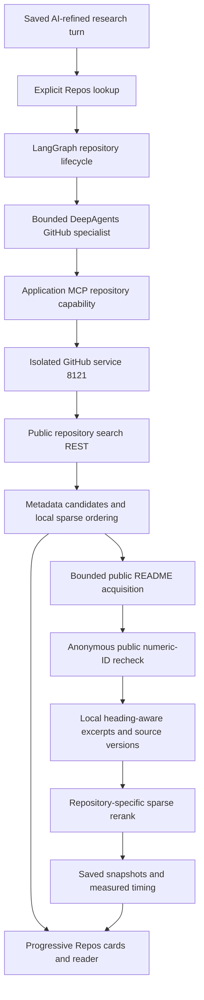

# GitHub repository discovery and the Repos workspace

**Later shared-planning update:** [Policyv7](shared-ai-query-refinement-2026-11-14.md) now requires a validated model-authored resource query for new acquisitions. Historical saved reads and accepted retries remain available.

November 14, 2026. The user requested separate **Analysis** and **Execution** subagents, another provider-bound agent and a **Repos** resource tab. [Source analysis](../discovery/research/github-repository-source-analysis-2026-11-14.md) reviews the actual GitHub Manager source and current official GitHub API documentation. This is an extension of the existing Next.js/Python application, alongside Papers, Videos and Data.

## Reference and implementation boundary

GitHub Manager’s deployed organization workflow uses local heading-aware README evidence selection, source-linked phrases and sparse canonical-label retrieval. Its newer public-discovery prototype uses bounded metadata and README acquisition. Neither constitutes a deployed embedding/vector database for repository discovery. This slice adapts its evidence, versioning and budget principles; it adds a repository-specific local sparse ranker instead of copying taxonomy-label scores.

The new lane reuses the selected research turn’s saved, valid AI-refined intent, lexical query, domain, keywords and tags. It does not create an additional hosted model request. The original topic workflow remains agentic and requires model planning/relevance review; repository evidence ranking here is deterministic lexical matching and capability dispatch over that saved plan, with its method disclosed. No vector index, code clone, executable README processing or empirical code-quality assessment is included.

## User journey and controls

1. Ask a research question through the existing AI-refined topic search, or open a saved research turn with a valid plan.
2. Open **Repos** beside Papers, Videos and Data. Opening the tab/history restores saved records with GETs only. It does not start GitHub or model work.
3. Choose the visible remembered **Repos to fetch** count (1–20, default10), then explicitly choose **Find matching repos** or **Refresh repos**. Up to five candidates receive README acquisition plus an anonymous public identity recheck in one accepted operation: at most eleven HTTP requests (one search, five README reads and five identity checks). The UI discloses the count, README bound and request cap.
4. Repository metadata appears progressively. Queued README candidates are distinguished from those outside the inspection cohort. README excerpts and local ordering update as bounded acquisition finishes. Existing results remain available during partial failures or cancellation.
5. Desktop hover/focus follows available repository evidence in a nonmodal right-hand reader; mobile details open explicitly. Cards show description, topics, language, license, activity and popularity metadata. The reader shows match reasons, missing requirements, selected README sections, source lines and version/provenance details. Stars/forks are not relevance signals.
6. Expand GitHub requests/timing to inspect the actual derived query, bounded operations, attempts and measured stage intervals. Saved reads/reload never repeat acquisition. Original paper/video reader notes stay mounted and survive resource-tab changes.

Publication-year filters remain literature settings. Repository activity dates retain their original semantics rather than being treated as publication dates. Counts and coverage belong to the separate Repos snapshot, not the parent paper provider report.

## Service and framework boundary

| Layer | Implemented role |
| --- | --- |
| Next.js frontend | `repository-results.tsx`, `repo-results.module.css`, `lib/repositories.ts` and the shared resource tabs. |
| Application API | Separate `/api/repo-providers` inventory and `/api/repo-searches` lifecycle: explicit start, saved list/detail, SSE and cancel. Requests contain saved conversation/turn references, count and idempotency key; no raw caller query. |
| Repository workflow | Actual LangGraph lifecycle and provider-bound LangChain DeepAgents specialist, dispatching a narrow repository capability from the previously saved model plan. |
| Application MCP | `search_repositories` and saved `get_repository_search`. No arbitrary GitHub endpoint, shell, filesystem or executable loader is granted to the specialist. |
| GitHub provider | Independent Python service on **8121**, using fixed official GitHub REST search/README routes, per-operation bounds, provider journals/cache and progressive NDJSON to core. |
| Persistence | Separate saved repository snapshots, source/evidence versions, request and timing receipts under existing ignored local state. Existing projects/research/model ledger are preserved. |

The remote GitHub MCP service is not configured by this slice. The implemented MCP boundary is Research Scout’s application server, with official REST inside its isolated GitHub service. No GitHub Manager OAuth grant, credential, private corpus or runtime state is copied.

## Retrieval, evidence and ranking

The provider derives an application-owned public repository query from saved problem anchors, with explicit name/description/topics/README scope. It records the actual query rather than presenting the original question as the executed GitHub expression. Empty, generic or unsupported plans fail visibly; no silent one-word fallback or unconstrained provider switch is introduced. GitHub best-match acquisition is a bounded candidate pool, not exhaustive repository recall.

Metadata is ordered locally before selecting the bounded README cohort. The repository ranker combines weighted name, description, topics and selected README tokens using sparse BM25-style scoring; popularity does not affect that score. Eligibility requires meaningful task context, not one shared generic word. Candidate and unassessed states remain explicit. A local match is a discovery hint, not calibrated confidence, a new LLM endorsement or proof that the project solves the problem. The limitation is particularly relevant for synonyms, negation, multilingual text and evidence outside the selected excerpt budget.

README parsing uses a bounded Markdown subset with heading context and original Markdown line ranges. It excludes code blocks, script/style/comment blocks, installation/license noise and instruction-like lines, strips HTML tags, and retains readable evidence without rendering remote HTML or executing instructions. Selected text is extractive; it is not an LLM summary. Byte and excerpt bounds can omit relevant material, so the original source remains available for review.

Stable repository row identity uses the numeric GitHub ID, preserving reader selection while README observations arrive. Metadata/evidence fingerprints and a separate observation ID identify the exact observation. Repository names and ownership can change; source observations retain the name used at acquisition. README content is checked against its reported Git blob hash, followed by a bounded anonymous metadata check that the public numeric repository ID and name still agree. Failed checks discard README promotion and preserve search-time metadata with a reason. These separate requests do not establish an atomic GitHub snapshot. A blob SHA is not a commit SHA: the immutable Git blob API link is distinguished from the mutable current-branch README web link. The UI does not manufacture a `/blob/<README-blob-SHA>` browser permalink.

## Access, recovery and limits

Only explicitly public repository search records are admitted. README reads use the public endpoint with bounded encoding/size validation and fixed GitHub hosts; provider download URLs and embedded document links are not followed. A missing, inaccessible, oversized, malformed or rate-limited README remains a distinct outcome alongside retained metadata. A public endpoint404 does not prove deletion or absence. Public visibility does not establish a reuse license; absent/unasserted licensing stays unknown.

The provider supports public anonymous discovery; an optional server-only GitHub token can increase search allowance. README and identity reads remain anonymous to avoid acquiring subsequently private content through that token. GitHub quotas and secondary throttling still apply, with conservative local bounds and reported pauses. No automatic retry is made after an ambiguous request or rate limit. Configuration presence is separate from successful upstream access; official API documentation and fixture checks do not prove live relevance quality.

Accepted request keys bind saved conversation/turn references and count before consulting a later mutable query plan. Repeating an accepted request returns its saved receipt. A new explicit refresh may capture a newer plan; navigation/reload does not authorize replay. Cancellation/restart preserve received observations, finalize interrupted state and do not silently redispatch remaining README work. Conditional cache reuse must preserve source identity and parser/query policy compatibility.

## Validation and remaining scope

[The validation receipt](../docs/validation/2026-11-14-repos-final.json) records backend, browser and structural harness checks; actual local fixture browser→agent→MCP→GitHub-service behavior; source/build agreement; privacy scanning and protected-state comparison. Authored fixtures establish contract behavior, not live retrieval accuracy. The final production-build browser run passes194/194; the clean backend run passes387 tests with one optional encoder proof skipped, and all11 scripted structural harness checks pass. A separate anonymous fixed public Requests/Python probe returned one repository, seven README evidence sections and a confirmed public ID in three HTTP requests with zero model calls. Live access and saved-user-context live discovery must be reported separately from fixture and read-only checks.

Deferred: complete-code retrieval, clone/execution, dependency inspection, release/commit lineage analysis, embedding or neural reranking, additional hosted model review, repository-specific project pins and remote GitHub MCP transport. The existing paper/video project and note behavior remains available.

Sanitized actual fixture previews: [desktop](../docs/validation/2026-11-14-repos-fixture-1440.png) and [mobile](../docs/validation/2026-11-14-repos-fixture-320.png).
