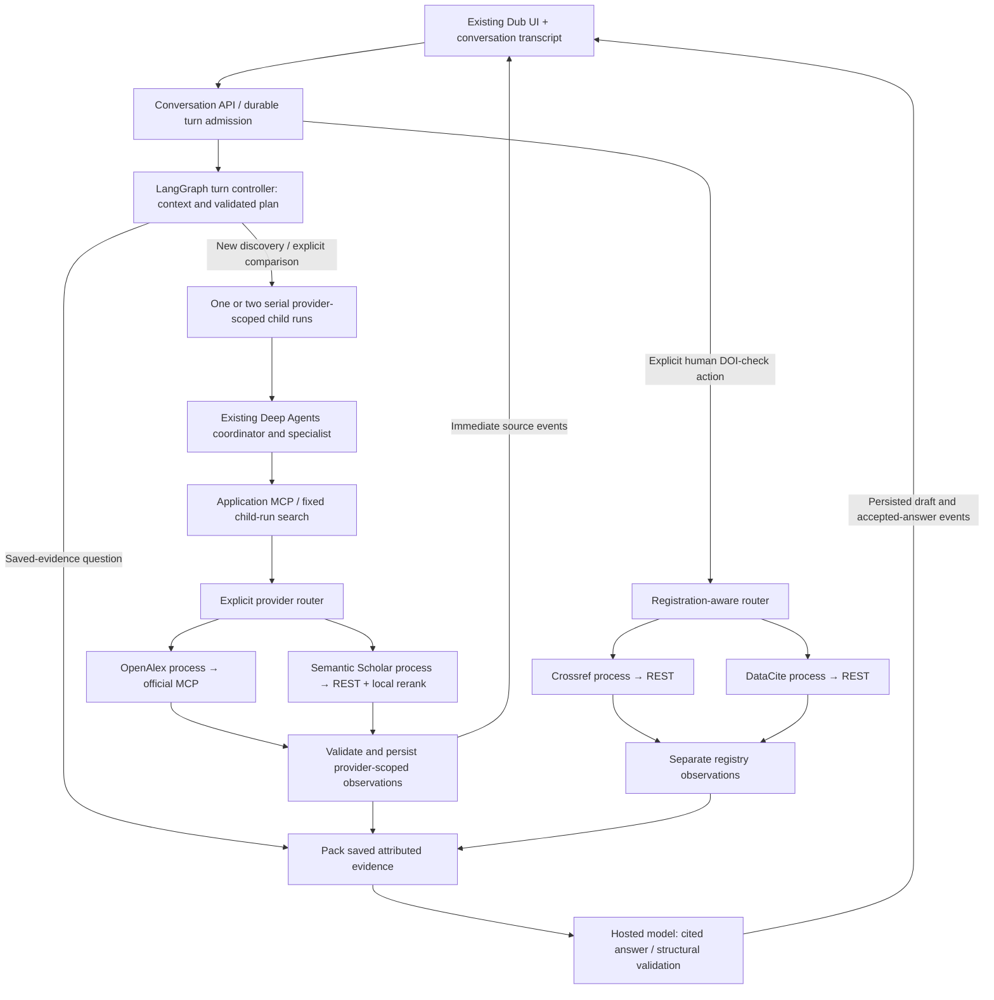

# Live connections and exploration chat — execution plan

**November 9, 2026 · v0.1 · proposed for user review; implementation not started**

Make the existing four provider integrations operational, replace the scripted model with a hosted model, and turn the exploration input into a conversational research workspace. Preserve the current Dub-inspired interface and Python/Next.js stack. The HabitQuest prototypes were declined and are not an implementation direction.

This completes the remaining live gates from Increment 1 and adds a conversation layer. It does not claim that conversation support already exists. The [implemented architecture review](implementation-review-2026-11-09.md), [provider audit](../docs/reviews/2026-11-09-live-provider-plan-audit.md) and [chat/agent audit](../docs/reviews/2026-11-09-chat-agent-plan-audit.md) are the evidence base. The user requested this plan before execution; no application, dependency, credential or runtime configuration is changed by this planning pass.

## 1. Starting point and gaps

The [fresh local observation](../docs/reviews/2026-11-09-operational-planning-status.json) found core `8100` and all four provider services `8111–8114` responding in **fixture mode**, with `live_model_configured=false`. Frontend `3100` refused the connection. No project `.env`/`.env.local` or frontend env file exists; the current shell has none of the checked OpenAlex, Semantic Scholar or hosted-model credential variables. Values were not printed, and no other repository's secrets were searched or copied.

| Already implemented | Work still needed |
| --- | --- |
| Real Deep Agents coordinator/specialist graphs running on LangGraph; actual application MCP transport. | A hosted LangChain model adapter/profile, measured usage/cost admission and live tool compatibility. `FixtureChatModel` is currently hardcoded. |
| Independent OpenAlex, Semantic Scholar, Crossref and DataCite processes with live adapters. | OAuth/key setup, actual hosted contract checks, pacing and dated independent live acceptance. |
| Progressive provider events → persisted snapshots → browser SSE. | Conversation/turn/message contracts, follow-up context and grounded assistant responses. |
| Source inspection, human shortlist, explicit DOI checks, notes and immutable exports. | Conversation-wide references/selection and exports without weakening existing run behavior. |
| Atomic JSON persistence, operation admission, cancellation and restart-to-interrupted. | Turn-level durable admission and aggregate budgets across child runs, planning and synthesis. |

Entering endpoints or setting `SCOUT_MODE=live` cannot enable the missing model/chat code. The current launcher also defaults its CLI mode to fixture and overwrites the loaded mode; that must be corrected. Current fixtures and the October 26/30 test reports remain regression evidence, rather than new live acceptance.

## 2. What each connection will do

| Connection | Hosted target / protocol | Required access | Operational exit gate |
| --- | --- | --- | --- |
| Application MCP | `http://127.0.0.1:8100/mcp/`, Streamable HTTP | Local core, admitted run identity; no external key. | Real initialize/list/search, fixed run/provider scope, saved-read zero-call behavior. |
| **OpenAlex — primary discovery** | `https://mcp.openalex.org/mcp`, official MCP | User-owned OAuth authorization, with expiry/refresh handling. | Actual hosted schemas plus separate keyword and native semantic calls with supported equivalent filters, source details and usage/provenance. |
| **Semantic Scholar — complementary discovery** | `https://api.semanticscholar.org/graph/v1`, REST | API key recommended for reliable keyed acceptance; compatible local encoder for its implemented hybrid route. | Keyed search/details, shared pacing, real bounded-pool semantic reranking and visible partial failures. |
| **Crossref — DOI agency/metadata** | `https://api.crossref.org`, REST | No key for existing public reads; contact email for polite identification. | `/works/{doi}/agency` and `/works/{doi}`, counted separately; exact agency route and separate observation. |
| **DataCite — DOI metadata** | `https://api.datacite.org`, REST | No key for public Findable DOI metadata. | `/dois/{doi}`, correct normalization, explicit miss/visibility limits; known-agency route independent of Crossref availability. |

There are two MCP surfaces, not four provider MCP servers. Crossref/DataCite topic search is not implemented and is not quietly added by this plan. A useful chat can use both discovery resources and the registries for their respective purposes. The public interfaces and access requirements were checked against [OpenAlex](https://help.openalex.org/access/connector/), [Crossref](https://www.crossref.org/documentation/retrieve-metadata/rest-api/), [DataCite](https://support.datacite.org/docs/rest-api) and [Semantic Scholar](https://webflow.semanticscholar.org/product/api/tutorial).

OpenAlex embeds semantic query text on its servers. No separate query-embedding API is needed there. Semantic Scholar's implemented semantic route reranks at most twenty same-provider lexical candidates using compatible query/document embeddings; it does not add independent semantic recall. Its full hybrid gate requires a concrete, pinned encoder implementation and measured local resource limits. Until that passes, advertise lexical/details readiness separately and keep hybrid unavailable or explicitly partial. See the [provider audit](../docs/reviews/2026-11-09-live-provider-plan-audit.md) and [OpenAlex semantic contract](https://help.openalex.org/api/semantic-search/).

## 3. Environment and access work

After review, extend `.env.example`, implement the settings below, then create the ignored root `.env` with real locally supplied credentials. Never put placeholder values into a configuration marked ready. Public registry reads need endpoint/contact configuration, not invented API keys.

**Existing working names:** `SCOUT_STATE_DIR`, `SCOUT_CORE_URL`, `SCOUT_API_URL`, the four internal `SCOUT_*_URL` variables, `SCOUT_OPENALEX_OAUTH_TOKEN`, `SCOUT_SEMANTIC_SCHOLAR_API_KEY`, and `SCOUT_CONTACT_EMAIL`. Internal service URLs remain loopback addresses. Hosted upstream addresses belong in the provider processes, not in the core's internal URL slots.

**Proposed configuration contract — requires implementation before use:**

```dotenv
# Internal application/service endpoints — retain existing semantics.
SCOUT_CORE_URL=http://127.0.0.1:8100
SCOUT_API_URL=http://127.0.0.1:8100
SCOUT_OPENALEX_URL=http://127.0.0.1:8111
SCOUT_CROSSREF_URL=http://127.0.0.1:8112
SCOUT_DATACITE_URL=http://127.0.0.1:8113
SCOUT_SEMANTIC_SCHOLAR_URL=http://127.0.0.1:8114
SCOUT_STATE_DIR=.scout/live

# Independent modes; this is the target live profile, not today's state.
SCOUT_MODEL_MODE=live
SCOUT_OPENALEX_MODE=live
SCOUT_CROSSREF_MODE=live
SCOUT_DATACITE_MODE=live
SCOUT_SEMANTIC_SCHOLAR_MODE=live

# Hosted scholarly upstreams — new names, trusted HTTPS defaults.
SCOUT_OPENALEX_MCP_URL=https://mcp.openalex.org/mcp
SCOUT_CROSSREF_REST_BASE_URL=https://api.crossref.org
SCOUT_DATACITE_REST_BASE_URL=https://api.datacite.org
SCOUT_SEMANTIC_SCHOLAR_REST_BASE_URL=https://api.semanticscholar.org/graph/v1

# Existing credentials / contact; populate locally, not in review artifacts.
SCOUT_OPENALEX_OAUTH_TOKEN=
SCOUT_SEMANTIC_SCHOLAR_API_KEY=
SCOUT_CONTACT_EMAIL=

# New hosted-model profile — exact supplier/model/rates still to be selected.
SCOUT_LLM_PROVIDER=
SCOUT_LLM_MODEL=
SCOUT_LLM_API_KEY=
SCOUT_LLM_BASE_URL=
SCOUT_LLM_PRICE_PROFILE=
SCOUT_LLM_MAX_INPUT_TOKENS=8000
SCOUT_LLM_MAX_OUTPUT_TOKENS=1500
SCOUT_LLM_MAX_TURN_COST_USD=0.50
```

`SCOUT_LLM_API_KEY` is a proposed project-level setting mapped into the chosen provider's supported LangChain client; it is not an existing SDK contract. A base URL is optional and must fit that exact integration's authentication, tool, streaming and usage behavior. Select **one** hosted model integration first, pin it and prove it; supporting arbitrary compatible hosts is not this milestone.

Also implement a provider-owned OpenAlex OAuth credential-store path and the S2 `SCOUT_SEMANTIC_SCHOLAR_ENCODER_FACTORY`/model/revision/cache settings. Derive OAuth client/callback/refresh fields from the actual authorization-server metadata; do not invent issuer URLs or scopes. The existing bearer variable can bootstrap a bounded test, but normal operation needs supported authorization/refresh and a reconnect state after expiry/revocation. The local encoder must actually be installed/configured; a factory string alone is insufficient.

Configuration rules:

1. Explicit CLI settings override the same shell settings; shell overrides root `.env`; then use documented defaults. Resolve provider-specific modes before the legacy `SCOUT_MODE` fallback. Unspecified CLI defaults must not overwrite `.env`. Keep an explicit fixture profile.
2. Record resolved provider modes and model profile on each immutable run/turn. Update the existing run-wide mode checks to validate each observation against its owning operation's expected profile. Do not mislabel mixed diagnostics as wholly live research.
3. Give core/model credentials only to the core, OpenAlex credentials only to its service, and the S2 key only to S2. Next.js gets the core routing address, with no upstream secrets. Validate upstream origins and suppress sensitive headers/errors in receipts.
4. Use separate fixture/live state and namespace caches by the effective provider/profile/schema/encoder configuration. Existing saved runs/exports are preserved; no reset is needed.
5. Make health a zero-upstream-call liveness check. Report configured access, last verified capability/time and precise blockers separately. Only an explicit bounded preflight performs live probes.

## 4. Agent and chat architecture

Use the existing frameworks with clear responsibilities: **LangChain** supplies hosted chat models, messages, tools and typed output; **Deep Agents** retains the narrow coordinator/specialist loops; an explicit **LangGraph** turn controller adds conversational routing and status. Deep Agents itself runs on LangGraph, so this extends the existing framework rather than replacing it. See the [framework overview](https://docs.langchain.com/oss/python/deepagents/overview).



One turn follows `admit → prepare context → plan/validate → retrieve if needed → pack evidence → synthesize → validate/publish`. Clarification and saved-evidence answering can skip retrieval. The model cannot change the admitted providers, hard filters or budget. Keep query rewrites/standalone follow-up queries explicit in the saved plan; reject unsupported constraints or ask a focused clarification instead of pretending they were enforced.

Default discovery remains OpenAlex. An explicitly selected OpenAlex + Semantic Scholar comparison creates **two separate child runs**, initially serial to preserve the existing single-active-run constraint. Admit **one globally active chat turn or legacy research run** in this local core; reject another start with an explicit busy response while saved reading/review remains available. Reserve the active-turn slot so another legacy search cannot interleave and steal its child admission. Provider services never call one another. A turn-level grant covers all children, planning, answer generation and retries; another child does not create free allowance.

The research-supported reason for cross-provider synthesis is the user's explicit comparison of complementary scholarly coverage. Present each provider's results and limitations separately; synthesize a narrative with observation-specific citations. DOI-equivalent results may be linked for comparison, with both observations retained. Do not pool cross-provider ranks, merge metadata fields or count duplicate DOI observations as independent scientific corroboration.

Crossref/DataCite checks remain human actions. An explicit request to verify included sources may route through the same deterministic action contract; a model-proposed check alone does not authorize it. Keep the three-source limit, required inclusion and registration-agency route. Agent tools cannot silently shortlist, adopt citation metadata or export.

### Conversation state, APIs and delivery

- Keep the existing atomic JSON/single-writer persistence for this local slice. Add conversation/turn/message records, expected revisions, idempotency keys, immutable child-operation links and bounded replay events. Persist operation intent/linkage before dispatch; reconcile local IDs after interruption without re-executing upstream work.
- Store raw user messages, effective scope/plan, child-run references, accepted answers, cited evidence versions and usage receipts. Pack bounded history for each turn, preserving user constraints and source references. “The second paper” resolves against the previous visible snapshot, not a changing sorted list.
- Add `POST/GET /api/conversations`, `GET /api/conversations/{id}`, `POST /api/conversations/{id}/turns`, replayable `GET .../events`, turn cancellation and conversation selection/export actions. Keep existing research-run APIs compatible.
- Emit turn/plan/provider/source/answer events with conversation, turn and child-run identities. Commit message identity before text deltas, batch bounded draft updates and support cursor/snapshot resynchronization. Opening/reconnecting never invokes a provider or model. A saved-evidence **new answer** may invoke the model, with zero new retrieval and its own charge admission.
- Sources are usable before any final answer. Stream clearly marked answer drafts; accept final answers only after validating cited provider/run/source/version/field references. Structural validation is not an entailment guarantee. Unsupported or stale citations must be rejected; any repair consumes the same finite grant.
- New conversation shortlists contain at most **three observations total across child runs**. Preserve legacy per-run behavior. Conversation selection is the authority; child-run inclusion needed by existing check APIs is a revision-bound projection, not an independent extra shortlist. Before a conversation-owned DOI check/export uses that projection, verify the authoritative revision and complete local reconciliation; never permit stale child inclusion to authorize work after a deselection. Fence direct child mutations that would bypass conversation ownership. Test interrupted projection recovery without paid work. Human reasons and citation-source choices remain intact.
- Restart marks unfinished turns/children interrupted; completed evidence and accepted messages remain readable. No automatic graph or paid-operation resume is added. Application JSON is not a LangGraph checkpointer; persistent framework checkpoint/resume is deferred until its ownership and replay policy are designed. [LangGraph persistence](https://docs.langchain.com/oss/python/langgraph/persistence) distinguishes these mechanisms.

## 5. Dependency-ordered execution packages

| ID | Work | Depends on | Reviewable exit evidence |
| --- | --- | --- | --- |
| OP-01 | Settle exact hosted model/profile, local encoder choice and finite live allowance; extend settings/env example, fix loading/precedence, isolate child secrets and add truthful readiness. | Plan review; model/account inputs where needed | Resolved nonsecret config report; missing/invalid config tests; fixture/live mode matrix. Populate ignored `.env` only after settings work. |
| OP-02 | Connect OpenAlex OAuth/refresh, capture actual hosted MCP schemas, verify read allowlist and lexical/semantic/filter/details contracts. | OP-01; user OAuth sign-in | Dated actual MCP proof, source IDs/query echoes, attempts, filter outcomes and expiry/reconnect behavior. No REST substitution. |
| OP-03 | Operationalize Crossref/DataCite public reads through their independent services and registration-aware core path. | OP-01; parallel with OP-02 | Both DOI agencies exercised; unknown/unsupported agency handled; DataCite known-agency path works when Crossref is stopped. |
| OP-04 | Add one real LangChain model integration to the existing Deep Agents graphs, preserve allowlists and replace fixture accounting in live mode. | OP-01; selected model credential/rates | Real model/tool/structured-output proof, actual token/attempt/charge receipts, cancellation and refusal of hidden retries/tools. |
| OP-05 | Configure S2 key and shared request pacing; prove search/details; implement/pin/wire the compatible provider-local encoder. | OP-01; API access and encoder; parallel with OP-02–04 | Keyed REST proof plus local hybrid/space/scope/resource proof; 429/encoder failure stays provider-local and visibly partial. |
| OP-06 | Run the first complete live OpenAlex → real model → application MCP → progressive UI → human registry check → export journey. Restore/start the existing frontend using owned processes. | OP-02–04 | One actual live vertical slice; early source before answer; saved review/export works with services stopped. |
| OP-07 | Add conversation storage/APIs and the outer LangGraph turn controller; reuse current child-run execution and add saved-context answering. | OP-04, OP-06 | Three-turn single-provider chat; follow-up uses saved evidence; duplicate-send/restart/cancel/replay tests. |
| OP-08 | Add explicitly selected two-provider chat and requested registry-check integration with aggregate turn grants/citations. | OP-03, OP-05, OP-07 | Distinct provider child runs, partial-provider survival, separate registry evidence and correct citation/version/selection semantics. |
| OP-09 | Complete exploration chat in the current Dub UI: transcript, follow-up composer, source links, stages, stop, errors and responsive inspector. | Shell can start with OP-07; integrate OP-08 | Desktop/mobile/keyboard walkthrough, stable notes/reader and early source actions during answer streaming. No redesign/framework swap. |
| OP-10 | Run regressions, context/harness/grounding evals and bounded live acceptance; reconcile architecture/status/runbooks with measured outcomes. | Applicable OP-01–09 | Per-connection readiness matrix, end-to-end receipts, measured usage/latency, reviewed questions and remaining limitations. |

**Checkpoints:** A — independent connection/config proofs (OP-01–05); B — first live product journey (OP-06); C — conversational multi-resource workspace (OP-07–10). Access failures block only their affected provider track. Do not call checkpoint A or C complete while a required provider/encoder/model gate is still blocked.

## 6. Limits, failure behavior and acceptance

Retain current child-run bounds: one provider per child, one delegation/search, ten raw records per native branch, twenty-record union/pool, three-source human shortlist, existing per-provider attempt grants and sixteen overall research attempts per child. Initial chat adds at most two discovery children, running serially. All limits below are **proposals for review**, not active authorization or measured consumption:

| Scope | Proposed finite ceiling |
| --- | --- |
| Turn | 24 research upstream attempts total across children/checks; 16 model generations and 20 model HTTP attempts including planner/specialists/synthesis/repairs; $0.50 model charges plus unresolved holds. Child caps also apply. |
| Model generation | At most 8,000 input and 1,500 output provider tokens, subject to selected model/profile support and remaining cost. Existing fixture byte units remain separately labeled. |
| Conversation | $2.00 cumulative model charges/holds. A new turn never resets prior spending; global core admission still permits only one active chat turn or legacy run. |
| Initial live acceptance session | 48 research upstream attempts, 32 model generations / 40 model HTTP attempts and $2.00 cumulative model charges/holds across all test conversations. Lower turn/conversation/account limits still win. |
| Time | Keep 180-second child deadlines and 30-second explicit detail/check timeout; propose 420 seconds per two-child turn and a 60-second per-model-request timeout. |

Record actual hosted MCP calls separately from unobservable provider-internal API requests/credits. Authentication/discovery-control traffic has separate finite preflight bounds and receipts; it does not imply free or unlimited upstream use. Confirm account allowance and current model rates before activation. Reserve before every external/model dispatch, settle on actual usage, keep unknown-outcome holds and disable unaccounted SDK retries. An attempt cap is not a target to exhaust.

S2's introductory keyed allocation is documented as one request/second across endpoints; enforce a provider-wide gate for search and details, and respect the actual granted allocation/cooldown. OpenAlex native semantic pacing and filter restrictions need their own gate. Begin with no automatic research retry; later bounded retries debit the original operation/turn grant. Model output failure preserves source records; a second-provider failure preserves the first provider's results. Cancellation fences future/late effects without claiming an already sent upstream request was undone.

Required evidence:

1. **Connection contracts:** actual application MCP; both OpenAlex branches/details; S2 keyed search/details plus real encoder; Crossref agency/metadata and DataCite singleton. Test schema drift, expiry, 401/403/429, missing records and provider outage. Destructive/live fault injection is unnecessary; use fake upstreams for most failures.
2. **Real conversation:** initial OpenAlex discovery; follow-up about saved evidence with zero new retrieval; explicitly selected S2 comparison; human inclusion plus Crossref and DataCite registry examples; reload and export. If live research does not naturally yield both agencies, use separately labeled known-DOI acceptance cases rather than injecting fake records into a live chat.
3. **Durability and delivery:** early source before answer, stable note/reader context, duplicate send, interrupted dispatch, stop during retrieval/output, reconnect, replay gap, restart and zero-call saved review/export. Verify all child/model costs count toward parent ceilings.
4. **Context and answer evals:** preserve existing eleven synthetic structural cases, then add follow-up ambiguity, scoped rewrites, multiple-provider identity collisions, conflicting registry observations, missing abstracts, empty/partial results, source instruction injection, unsupported claims and stale/invented citations. Keep human relevance/citation-support review separate from structural pass/fail and model self-grading.
5. **Measurements:** time to first usable source and accepted answer, upstream/model attempts, tokens/cost/holds, context omissions and cited observation versions. Record denominators, mode/model/encoder/schema versions and reviewed question IDs. A small live set establishes scoped acceptance, not literature-wide recall or scientific validity.

Run the project's appropriate Python/lint, context/harness evals, TypeScript/build and Playwright suites, including the explicitly required actual-backend case. Add new tests for the functional contracts above. Record new dated evidence without rewriting prior validation receipts; update architecture diagrams/status only to the behavior actually implemented and demonstrated.

## 7. Review decisions and access dependencies

The recommended choices for this review are: keep the current UI; preserve provider isolation; use explicit serial child runs for multi-resource comparisons; retain local JSON without automatic graph resume; and apply one global three-source conversation shortlist. Select the exact hosted supplier/model and local encoder during OP-01, with pinned versions, verified rates and a tool/usage compatibility proof before live activation.

The external inputs still needed are **OpenAlex OAuth sign-in**, a **Semantic Scholar API key**, the **hosted-model account/key and exact model**, and a **Crossref contact email** if using polite identification. They go into the ignored local configuration/credential store during execution. They cannot be reconstructed from architecture documents or copied from another project's configuration.

No production deployment, database migration, new scholarly providers, PDF/full-text ingestion, general web search or UI redesign is included. Broader Crossref/DataCite topic discovery and parallel child execution can be later increments after this operational baseline works.
