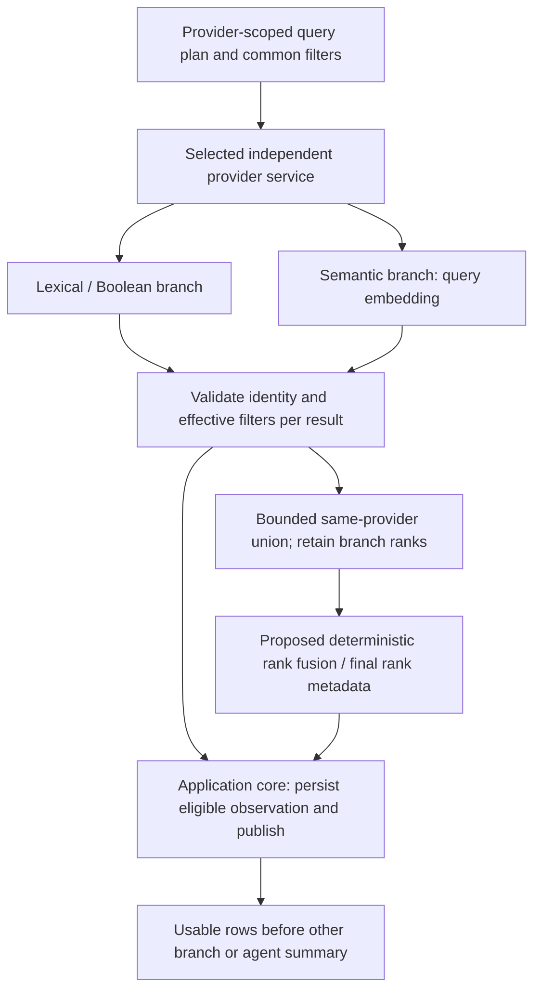

# Hybrid retrieval within a selected provider

**Current automatic discovery:** [Multi-source discovery, canonical DOI papers and automatic Unpaywall](automatic-federated-discovery-2026-11-09.md) is the latest user-directed default. Source selection is optional advanced behavior; a recorded eligible route searches multiple isolated services, groups matching DOIs into one paper and resolves access links through Unpaywall automatically. Earlier manual-selection/two-source defaults are superseded.

**Current provider relevance correction:** [Provider-specific queries and independent quality review](provider-relevance-v2-2026-11-09.md) replaces the shared-query/pooled stopping rule: Crossref uses bibliographic search, every selected provider gets its own query plan and repair decision, and primary results exclude adjacent/uncertain records. Search-workspace AI submissions use the same reviewed conversation path. The exact-question live retest passed: two Crossref pages, three model calls, five primary matches with abstracts, explicit intent/keywords/tags and saved LLM/provider request traces. 234 Python, 39 browser and 11 harness checks passed. Earlier checkpoints below retain their dated behavior.

**Latest November 9 query-relevance checkpoint:** [Agentic retrieval and ranking](agentic-retrieval-2026-11-09.md) adds optional structured LLM query planning, provider-batch relevance review and at most one query revision through LangGraph, retaining Deep Agents/application MCP and isolated providers. Chat direct-search fusion ordering is corrected. AI-reviewed results have explicit intent, query history, relevance reasons and shared paid-call accounting; prior deterministic-only statements below are historical where superseded. Live exact-query acceptance passed: 39 reviewed observations, 16 withheld, first reviewed batch at 14.8 seconds; 225 Python, 32 browser and 11 structural harness cases pass.

**October 26, 2026 · approved hybrid strategy; local framework implemented**

See [implementation status](implementation-status.md) for executable ownership and [validation](../docs/validation/increment-1.md) for evidence. The core now applies explicit year/type eligibility and equal-weight RRF (`k=60`) to provider-scoped branch contributions. Arbitrary question wording is retrieval intent, not a parsed hard exclusion predicate. OpenAlex native live hybrid still requires OAuth/tool proof; the optional real Semantic Scholar encoder is not configured.

The user requires hybrid retrieval using lexical search, semantic matching and filters, including a query embedding. OpenAlex remains the primary discovery resource. This supersedes the earlier lexical-only, single-query first-slice proposal. It does not supersede [provider isolation](provider-routing.md): each discovery run selects one provider, and lexical/semantic combination happens only inside that provider's result scope. No automatic cross-provider search, fallback, fused ranking or pooled citation metrics is introduced.

This document defines the retrieval contract. [Progressive results](progressive-results.md) defines saved-state publication and browser delivery; [architecture](architecture.md) and [Increment 1](increment-1.md) own the runtime, execution sequence and final limits. Database, model dependencies and local embedding implementation remain open.

## 1. Retrieval shape and responsibilities

One provider-scoped query plan contains a lexical branch, a semantic branch and common research constraints. The selected provider service owns branch execution, capability mapping, local processing and attempt accounting. The application core owns run state, validated observation publication, human selections and exports. Agent roles formulate bounded queries and consume source references; they cannot add providers or relax constraints to obtain more results.



For OpenAlex, both branches query the provider's corpus. For a provider without a verified native semantic endpoint, the semantic branch can instead rank a bounded set of that same provider's metadata using a compatible local encoder. That latter path has a smaller search scope and cannot claim provider-wide semantic discovery.

Union and rank handling must not create a wait barrier before the first usable entity. A validated lexical result is useful while the semantic branch is running, and the reverse is also true. Retained source observations remain separate from the evolving rank view.

## 2. OpenAlex: native semantic query embedding

OpenAlex documents `search.semantic` accepting query text. It embeds the query in the same space as work title/abstract embeddings and returns semantic matches. The current reference limits input to 2,000 characters, results to 50 and semantic requests to one per second; it disallows combining multiple search parameters in one request and lists unsupported semantic filters for country and citation-count conditions. Treat these as a dated capability baseline, with actual transport/schema checks before implementation. [Official semantic search](https://help.openalex.org/api/semantic-search/), opened October 26, 2026.

The official MCP connector documents `search_works` in keyword/Boolean or `mode: "semantic"` form and accepts OQL for complex selections. Verify its live argument/filter/output schema rather than assuming all REST features are exposed identically. [Official connector](https://help.openalex.org/access/connector/), opened October 26, 2026.

The proposed primary route is the **OpenAlex service → official OpenAlex MCP**, with two separately admitted branch operations:

| Branch | Query and responsibility |
| --- | --- |
| Lexical | Execute keyword/Boolean terms and supported structured constraints; use OQL when its verified capability expresses the desired lexical selection. Record matching fields, query/OQL and ranking/reranking configuration. |
| Semantic | Send a plain-language semantic question and the supported common constraints. OpenAlex performs the query embedding and semantic retrieval. Preserve actual input/truncation, returned ranks and provider-reported metadata. |

The embedding requirement is met by OpenAlex's native operation. Research Scout does **not** need to call a separate embedding API, recreate OpenAlex's vectors, download its corpus or select a vector database for this path. Do not send a locally generated vector to a text-only tool or compare vectors from a different model with OpenAlex's internal vectors. The application records native semantic execution; it must not claim access to raw vectors or a pinned provider model version unless the selected interface actually supplies that information.

One lexical request plus one semantic request is intentional same-provider hybrid retrieval, not an automatic fallback. Scheduling them concurrently is a proposal subject to that service's endpoint limits and grants; no correctness rule depends on which branch completes first. OQL syntax is not assumed to combine vector and lexical search in a single remote operation. If a native semantic capability is unavailable, retain and label partial lexical results rather than calling another research provider.

## 3. Other services and the bounded local option

| Service | Retrieval responsibility |
| --- | --- |
| OpenAlex | Primary native lexical + semantic discovery with common constraints. |
| Semantic Scholar | Separately selected discovery provider. Prove actual search capabilities; a relevance-ranked search response alone is not proof of a vector-semantic query interface. If no suitable native semantic interface is established, propose bounded local semantic ranking over its own metadata candidates. |
| Crossref / DataCite | Exact selected-DOI metadata and routing operations under [provider policy](provider-routing.md). Do not force semantic retrieval or embeddings into identity-specific lookups. A future broader discovery lane needs its own research justification and contract. |

For the proposed local option, first obtain an explicitly bounded, attributable candidate pool from the selected provider's lexical retrieval for this run. Compatible saved observations may satisfy that same recorded query/pool through cache reuse; they do not silently expand it with unrelated saved records. Record the exact pool membership, query/scope, retrieval time, permissions and version. Encode the question and candidate titles/available abstracts, then compute semantic similarity locally over those candidates. Preserve the lexical ordering as a separate signal.

This is **semantic ranking of the bounded candidate pool**. It cannot discover a work absent from that pool, establish corpus-level semantic recall or replace native provider-wide semantic retrieval in a claim about coverage. If the pool comes only from the lexical branch, both branches share that candidate-generation limit. The local semantic stage can run as metadata batches arrive; it must not hold already eligible lexical rows off screen.

The local model, runtime/package, memory/download requirements, licensing, latency, CPU/GPU fit, token/input limits and cost/privacy implications require explicit selection and capability proof. No named encoder or dependency is adopted here. A hosted embedding endpoint is a separate model-infrastructure dependency that can send the query and source metadata off the machine; it is not silently enabled by choosing a research provider. If compatible embedding execution is not configured, show semantic capability as unavailable/partial rather than labeling lexical output as completed hybrid retrieval.

## 4. Embedding compatibility and cache contract

For any application-managed query/document encoding, compatible vectors are mandatory:

- Use the same supported encoder family/version, dimensions and compatible query/document modes. Models with prescribed query/document prefixes or paired modes must use those modes correctly; equal dimensions alone are not compatibility.
- Record tokenizer/input transformations, document field selection, truncation policy, precision where relevant, similarity function and normalization configuration. Preserve title-only versus title-plus-abstract completeness.
- Do not mix local model vectors with native OpenAlex vectors, an older embedding version, another provider's pool or vectors produced under incompatible settings. Invalid, nonfinite, empty or dimension-mismatched vectors do not receive a fabricated similarity.
- Cache document embeddings by provider/record/observation scope, normalized input content hash, encoder identity/version, document mode, dimensions and transformation/normalization settings. Query-vector keys bind the actual query text/hash, query mode and compatible configuration. An observation or configuration change invalidates incompatible reuse.
- Keep original text and embedding-derived scores distinct. Cached embeddings do not imply that restricted metadata can be retained indefinitely; applicable observation lifecycle still governs derived artifacts.

For native OpenAlex retrieval, use provider query/result caches and record provider-reported model/version information where available. Do not fabricate a local embedding cache or pretend an opaque remote model is pinned. A provider model/version change, if observable, is part of reproducibility/freshness, not permission to regenerate runs automatically.

## 5. Query plan, filters and coverage

Persist a query plan before dispatch with these proposed fields:

```text
provider, run_id, plan_revision
original_question, semantic_text_actual, lexical_query_actual
requested_filters and their intended field/meaning
branch_plans:
  branch_id, native_or_local, upstream_query_or_tool, matching_scope
  pushed_down_filters, locally_enforced_filters, unsupported_filters
  requested_limits, effective_limits, overfetch_ceiling
  ranking_settings, embedding_configuration_or_native_reference
branch_results:
  operation/attempt refs, input/truncation, returned_count
  filter_pass/fail/unknown counts, retained_count, upstream rank refs
  status, truncation, stop_reason, usage_known_or_unknown
union_membership, rank_configuration_version, final_or_partial_rank_status
```

Requested and effective filters are separate. Define their semantics once, then map them to each branch. A year boundary is not silently substituted for a day-level date constraint; an institution's current country is not automatically equivalent to the study's population or an author's historical affiliation. Record supported predicates, null handling and provider-specific meanings.

Distinguish **branch-specific matching expressions** from **hard inclusion/exclusion predicates**. A keyword phrase, Boolean expression or OQL text-matching clause can be a lexical retrieval signal; semantic results need not contain that exact wording. When the user explicitly requires an exact phrase, excludes a term/population or imposes another mandatory condition, record that requirement as a hard predicate shared by both branches. Enforce it using a supported equivalent operation or sufficient attributable fields; if it cannot be evaluated, disclose the limitation and keep that candidate unresolved rather than treating semantic similarity as proof of compliance. Do not silently reinterpret every lexical term as mandatory, or silently downgrade a stated hard condition into an optional ranking signal.

For every requested constraint, each branch must either:

1. Enforce it through a verified provider parameter with equivalent semantics; or
2. Apply the same deterministic predicate locally using sufficient attributable fields, marking that branch as locally postfiltered; or
3. Declare the constraint unsupported/unresolved for that branch. Do not silently drop it or present uncheckable results as matching.

OpenAlex's documented native semantic limitations are a reason to inspect this mapping, not to assume the connector supports every listed filter in every mode. For an unsupported citation/country condition, local filtering is permitted only when the returned or explicitly admitted detail fields actually establish the required value and meaning. Additional detail calls require their own bounded admission; missing fields do not become model-inferred filter facts.

Filter evaluation is `pass`, `fail` or `unknown`. Only entities passing every effective required predicate enter the eligible candidate list and its rank fusion. Unknown/pending checks may be shown as a separate diagnostic state, not as already matching results. Preserve rejected/unresolved counts and reasons without leaking unsuitable records into the main shortlist workflow.

Filter eligibility is versioned evidence, not a permanent property of an ID. Reevaluate predicates when a newer same-provider observation is adopted for a filter-bearing field. If an earlier eligible work now fails or becomes unknown, publish a versioned eligibility update, exclude it from current eligible fusion/counts and explain the changed field and observation. Preserve its visible human selection, reasons and history with an out-of-scope/unresolved warning; do not silently drop a saved source or change the user's decision. Prior exports keep their original source/filter snapshots. A separate registry disagreement does not silently replace the discovery field or its origin; any adopted source/version change and its eligibility consequences must be explicit.

The current baseline is **at most ten raw returned candidates per native branch and twenty distinct raw candidates in their same-provider union**, before local postfiltering. Postfiltering can reduce the eligible/displayed result count; ten is not a promise to fill ten eligible places. There is no extra overfetch or automatic replacement query/paging in this baseline. Increasing a raw cap or adding a fetch requires an explicitly recorded new plan/grant before dispatch, with its own finite bounds and the applicable request/time limits. A larger capped set still does not establish exhaustive coverage. If a required predicate cannot be evaluated, disclose the unsupported branch constraint and partial scope; changing the requested filter requires an explicit new plan/run rather than silent relaxation.

## 6. Same-provider union and proposed rank fusion

Canonical identities established by the originating provider deduplicate lexical and semantic hits into one run membership. Keep both immutable observations when their versions differ, plus each branch's upstream rank, observed score, query and filter disposition. Similar titles or DOI strings alone do not collapse unproved provider identities, versions or studies. No result or cached vector from a different provider enters this union.

Keep upstream ranking and the eligible-list rank separately. Local postfiltering can remove a hit; it must not rewrite the recorded upstream rank. A document absent from one bounded branch is recorded as absent from that returned set, not semantically irrelevant or absent from the corpus.

**Proposed candidate:** deterministic reciprocal-rank fusion (RRF) over eligible lexical and semantic lists:

```text
fusion_score(work) = sum over branches containing work:
                    branch_weight / (rank_constant + eligible_branch_rank)
```

Eligible branch ranks are one-based and dense after filtering. The local implementation adopts equal weights, `k=60`, ten raw records per native branch and a twenty-identity raw union, preserving raw and eligible ranks. Stable provider identity breaks ties. These parameters are versioned defaults awaiting real-question quality evaluation. RRF is a rank-combination heuristic, not a calibrated relevance probability, scientific quality estimate or entitlement to sum unlike provider scores.

For a bounded local semantic stage, fusion combines lexical rank with semantic rank **within the recorded pool**. An optional later semantic rerank of a native union also only reorders retained candidates; it does not discover new documents. If only one branch succeeds, expose the surviving branch's result with a partial rank status, rather than calling it a complete two-branch fusion.

Set separate raw branch retrieval limits, retained-union capacity and visible-list/window limits. The baseline native caps above allow at most twenty distinct raw works, with an eligible subset after filtering. The retained bound accommodates both admitted branch sets, including semantic-only hits, so faster lexical arrival cannot consume all capacity and suppress the second branch. Any final display cut is explicit and independent of whether a record has already been human-saved. Do not silently evict saved sources when the rank view changes. Local list controls may reveal the retained set without implying upstream paging support.

## 7. Progressive branch delivery

Each branch has its own admitted operation/status and filter outcome. As soon as an entity is validated against required constraints, persist it in the app core and publish the entity event using [the progressive delivery contract](progressive-results.md). Do not wait for branch union completion, RRF calculation, local embeddings, another provider or a final agent summary before displaying a valid first result.

Add branch membership and rank/status metadata to the saved observation/view contract. Initial rows have an explicit provisional rank. A later occurrence in the other branch updates that row's membership/rank fields idempotently, rather than appending a duplicate. Later embedding/fusion completion emits a versioned rank update; source-authored fields and generated annotations remain separate.

Preserve insertion order, focused identity, expanded details and saved selection while later results arrive. Indicate when the final or partial combined ranking is available; use an explicit user sort/apply action to reorder the visible rows. An automatically recomputed rank must not produce a focus/scroll jump or move the item just as the user selects it. Filters are validated before eligible publication; provisional ranking does not mean provisional compliance with a required constraint.

Branch failure, timeout, unsupported filters, rate/allowance exhaustion or missing embedding capability leaves successful eligible results available, with the affected branch and scope marked partial. No other-provider request follows. Cancel/restart/reconnect semantics remain those of the core: preserve committed entities and attempts, fence stale results and recover saved views without automatic query or embedding replay.

## 8. Attempts, limits and cost

The native two-branch baseline admits **two initial search attempts** for the selected provider, instead of the previous one-search baseline. Retries, detail hydration, postfilter-support lookups and explicit DOI checks add separately counted operations; they do not hide inside those two. A local semantic-ranking path may instead use one bounded provider search plus query/document encoding work, which must be reported as that narrower implementation rather than two corpus searches.

Reconcile all ceilings in [Increment 1](increment-1.md) before live execution. Define per-branch and per-provider request/rate/deadline limits, bounded candidate pools/union, model generation limits, embedding execution limits and overall money/uncertain-outcome holds. The provider service owns upstream retries; the app core does not add an independent retry loop. Native semantic requests obey their endpoint-specific limits even when lexical requests could run faster.

Track query encodings, document encodings, batches, token/character counts where supplied, cache hits, model/runtime versions and actual or unknown usage. Native OpenAlex query embedding belongs to the provider operation's observed charge; do not invent an additional external embedding charge or count it as a separate Research Scout model call. Provider-side reranking and API usage remain recorded where observable. Local execution can consume compute even without a per-call invoice; hosted embeddings require separately configured credentials/rates and privacy decisions. Unknown cost remains unknown, and cache/reopen never grants new spending.

## 9. Acceptance checks

| Case | Required evidence |
| --- | --- |
| Native OpenAlex embedding path | Trace shows one lexical and one native semantic operation with actual text/filter scope. OpenAlex performs query embedding; no unnecessary local vector store or separate embedding endpoint is invoked. Actual tool schemas, limits and returned completeness are verified independently from fixtures. |
| Same-provider union and isolation | Lexical-only, semantic-only and shared-identity fixtures yield the expected distinct membership, with both branch ranks retained for overlap. A separately selected provider has a separate result set; foreign records, vectors and pooled citation/relevance scores are rejected. |
| Filter consistency and missingness | Supported predicates match between branches; unsupported semantic constraints use provable bounded postfilters or remain disclosed as unsupported. Fail/unknown records do not enter eligible rows. The raw retrieval cap stops work without replacement fetching, relaxed predicates or a false exhaustive-coverage claim. |
| Lexical signal versus hard condition | A semantic synonym result can qualify without containing the lexical phrase when no exact-phrase requirement exists. With that phrase or an exclusion explicitly marked mandatory, both branches enforce the same predicate or report it unresolved; semantic similarity alone cannot pass it. |
| Changed filter-bearing observation | An eligible, saved work receives a newer same-provider date/type that fails or cannot establish the requested filter. Its eligibility update removes it from current fusion/counts, preserves visible selection/history with a warning and leaves the earlier export unchanged. A conflicting registry record alone does not silently replace the discovery field. |
| Raw candidate cap and no replacement fetch | Return ten raw hits per native branch, including overlap and filter failures. At most twenty distinct raw works are retained, fewer may be eligible, and no fetch fills missing places. A requested increase is rejected until a new explicit plan/grant establishes its raw/request limits. |
| Comparable vectors and cache invalidation | The local option encodes query/documents in compatible modes/model/version/dimensions and similarity settings. Deliberate mismatches, invalid vectors and changed content hashes are detected; incompatible cached vectors are not reused or silently compared. Missing abstracts preserve title-only scope. |
| Progressive rows and stable interaction | Delay one branch, local encoding and final model summary. Already eligible rows render and can be saved. Later overlap/rank updates create no duplicates or source-field overwrite; focus and order stay stable until an explicit sort action. |
| Branch failure and cancellation | Either branch can fail after the other commits results. The UI retains useful rows and shows partial branch/rank scope; no other provider is queried. Late cancelled-generation results cannot update the active view, and reconnect/reopen performs no research or embedding replay. |
| Attempt and embedding accounting | The test ledger distinguishes two native initial search attempts from retries/details, and distinguishes provider-native encoding from application-managed query/document encoding. Admission enforces configured ceilings across failures/restarts; actual/unknown usage and cache hits are preserved. |
| Reproducibility and scope claims | Saved manifests reproduce branch queries, requested/effective filters, retained pool membership, raw/eligible ranks, configuration versions and final/partial rank status. The bounded local option demonstrably cannot add a document absent from its pool; exports do not claim full-corpus semantic recall, calibrated confidence or independently verified scientific findings. |

Use reviewed synonym/sparse-wording cases, hard lexical distractors, missing-field examples and known eligible/excluded records to evaluate lexical-only, semantic-only and combined ranking. Keep baseline judgments separate from prompt/configuration tuning. Report candidate coverage and human relevance observations with their actual denominators; choose fusion parameters and performance targets after the baseline rather than claiming automatic quality gains from an embedding or a combined score.

## 10. Decisions still open

- Verify the preferred OpenAlex MCP's actual lexical/semantic/filter/query-reporting contract and the available native model/version observations.
- Define normalized filter semantics and the allowed local-postfilter/detail fields for each branch.
- Decide Semantic Scholar's capability route: verified native semantic retrieval if available, or the explicitly bounded local-ranking implementation with selected encoder/runtime, cost and privacy settings.
- Review the proposed raw branch/union/display caps, embedding ceilings and deterministic rank configuration; reconcile the first-increment budget and UI sort behavior. Additional overfetch remains outside the baseline and needs a new explicit plan/grant.
- Record implementation evidence separately for branch protocols, compatible embeddings, ranking usefulness and progressive browser delivery. None is established merely by this design document.
