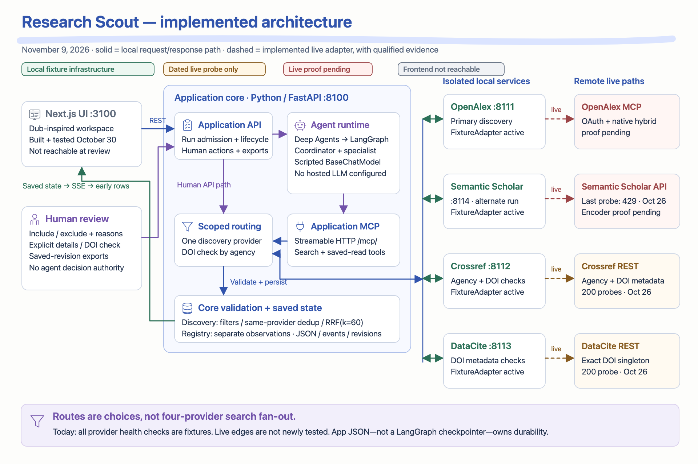
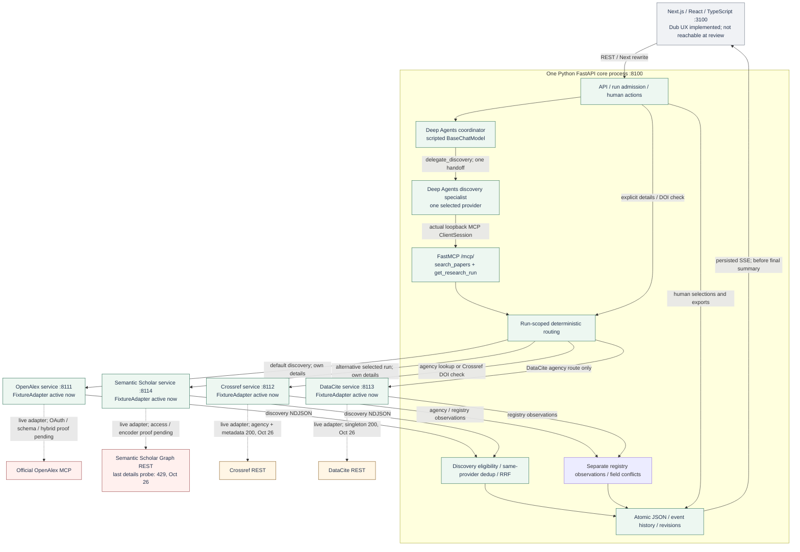
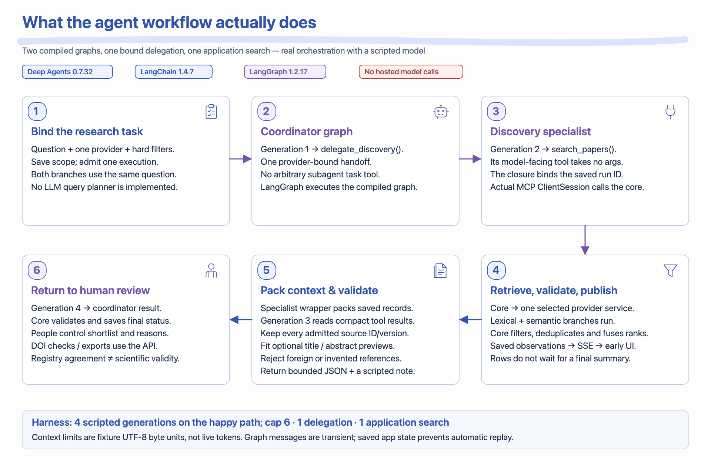
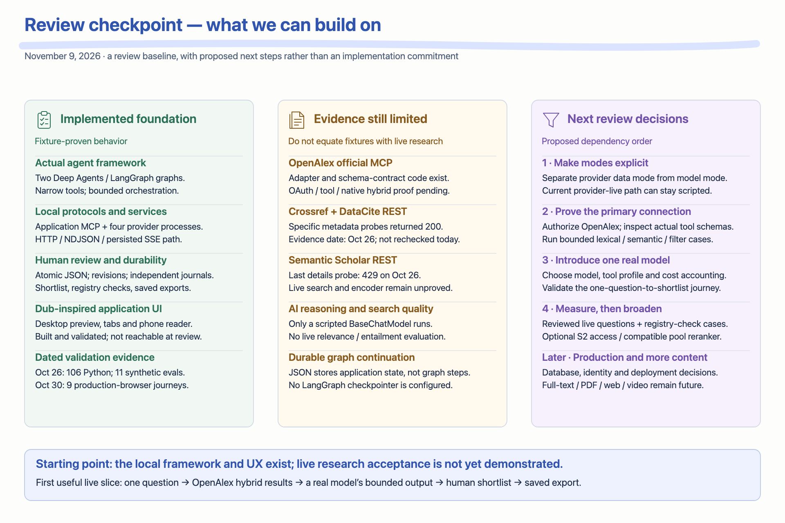
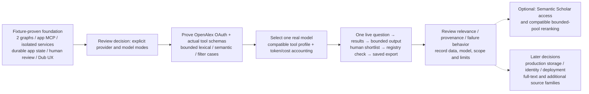

# Research Scout — implemented architecture review

**November 9, 2026 · current repository audit with an independent subagent**

**Later implementation checkpoint:** this audit predates the [integration execution](integration-execution-2026-11-09.md), [OpenAlex live acceptance](openalex-connection-2026-11-09.md) and [optional streaming-answer implementation](streaming-generation-2026-11-09.md). Use the latter's routing/sequence diagrams for the current system. The measurements, hashes and diagrams below remain evidence of this earlier audit, not current source fingerprints or reachability.

Research Scout has a working local agent framework, provider-isolated backend, application MCP, progressive results, human review and a Dub-inspired Next.js interface. The application runs **two real compiled Deep Agents/LangGraph graphs with a scripted model**. A hosted LLM, proven live OpenAlex discovery and reviewed live research quality remain unfinished.

Open the [diagram review board](diagrams/review-2026-11-09/index.html) for three zoomable figures with SVG/PNG downloads: [implemented connections](diagrams/review-2026-11-09/implemented-architecture.svg), [agent workflow](diagrams/review-2026-11-09/agent-workflow.svg) and [review checkpoint](diagrams/review-2026-11-09/review-checkpoint.svg). The earlier proposed Phase 1 illustration is preserved and is not used as evidence of current readiness.

## What was checked

The review inspected application/provider code, the installed framework factory and pinned versions, dated validation receipts, local health/configuration endpoints, and the actual application MCP initialize/tools-list exchange. The requested [subagent audit](../docs/reviews/2026-11-09-agentic-audit.md) provides detailed source/line references.

- [November 9 runtime observation](../docs/reviews/2026-11-09-runtime-status.json): core and all four provider health endpoints returned HTTP 200 in fixture mode; MCP initialize and tools-list returned HTTP 200. The frontend on 3100 was not reachable.
- [Source fingerprints](../docs/reviews/2026-11-09-source-status.json): all 40 covered source/dependency/test files match the October 30 validation baseline. This is a fingerprint check, not a fresh execution of those suites or an inventory of every future file.
- [October 26 validation](../docs/validation/increment-1.md): 106 Python cases and 11/11 synthetic context/harness evals passed. [October 30 UI validation](../docs/validation/dub-ux-adoption.md): nine production-browser journeys passed, including one actual local fixture-backend journey.
- [October 26 external probes](../docs/validation/provider-access.json): Crossref agency + metadata and DataCite metadata returned HTTP 200; Semantic Scholar details returned HTTP 429. OpenAlex was not called. These specific probes were **not repeated on November 9**.

Today's review made no research, model, DOI-check, export or external provider operation and changed no application/runtime configuration. `ready`, `access_configured=true` and semantic capability flags in a **fixture** health response are not upstream authentication or embedding proof.

## LangChain, Deep Agents and LangGraph

| Layer | What Research Scout actually uses |
| --- | --- |
| LangChain / langchain-core | `BaseChatModel`, messages, tool definitions/schema conversion, and model/tool middleware. These define the model/tool boundary and enforce allowed capabilities. |
| Deep Agents | `create_deep_agent()` builds a coordinator graph and a provider-bound discovery-specialist graph for each execution. A custom `delegate_discovery()` tool invokes the specialist. |
| LangGraph | The installed Deep Agents factory returns a `CompiledStateGraph`. Both graphs execute through `.ainvoke()` with recursion limit 12. There is no separate app-authored `StateGraph` or configured LangGraph checkpointer/store. |
| Current model | `FixtureChatModel`, a scripted LangChain `BaseChatModel`. It deterministically chooses the bound tools and emits a source-reference envelope/scope note. It is not a configured external LLM. |
| Durability | Core atomic JSON run state, event history, selection revisions and independent provider journals. Restart marks unfinished work interrupted; it does not resume or automatically rerun a graph. |
| Observability | Bounded application traces and usage receipts. LangSmith tracing is explicitly disabled around graph invocation. An installed SDK is not a connected tracing or model service. |

Pinned versions are **Deep Agents 0.7.32, LangChain 1.4.7, langchain-core 1.7.0, LangGraph 1.2.17 and MCP 1.30.0**. The [runtime](/Users/nkaul/Documents/repos/research-scout/src/research_scout/agents/runtime.py:255) constructs the two graphs; the installed Deep Agents factory delegates to LangChain `create_agent` and returns a LangGraph compiled graph. It does not add a separately hosted LangGraph service.

The coordinator can execute only `delegate_discovery()`; the specialist can execute only its run-bound, zero-argument `search_papers()`. Middleware validates both the effective tool catalog and execution. General-purpose delegation, filesystem/shell tools and stock summarization are removed. Human selections, DOI checks and exports remain API actions outside the agent's authority. Previous chat roles such as Basic Research, Interim Research and UX/design researchers were development collaborators; they are not additional runtime research workers in the application.

## Implemented connections





Arrows to provider services are conditional routes. A search uses one discovery provider. Provider responses/NDJSON pass back through the core's validation and persistence path; provider services never call one another. A DOI check may ask Crossref for the registration agency, then routes metadata to **exactly that agency's** Crossref or DataCite service. Provider metadata observations remain separate.

| Connection | Implemented interface | What works / what remains |
| --- | --- | --- |
| **Research Scout MCP** | `http://127.0.0.1:8100/mcp/`, stateless Streamable HTTP. Server tools: `search_papers(run_id)`, `get_research_run(run_id)`. The specialist exposes only the bound search wrapper. | Fresh initialize/tools-list succeeded November 9. Actual search client/server transport has fixture test evidence. No research tool was executed in this review. |
| **OpenAlex MCP** | Provider-owned client to `https://mcp.openalex.org/mcp`; supplied Bearer OAuth token; read allowlist `search_works`, `get_work`; runtime schema validation. | Implemented adapter and fake-upstream contracts. Live OAuth/tool/filter/native hybrid execution is not proved. The adapter accepts a token; interactive grant/refresh management is not implemented. |
| **Crossref REST** | `https://api.crossref.org/works/{doi}/agency` and `/works/{doi}`. Agency resolution and exact metadata checks. | Local fixture service responds. October 26 anonymous probes succeeded. No fresh upstream guarantee or live end-to-end research acceptance. |
| **DataCite REST** | `https://api.datacite.org/dois/{doi}`. Exact registered DOI metadata. | Local fixture service responds; one October 26 anonymous singleton probe succeeded. Same dated-evidence limitation. |
| **Semantic Scholar REST** | `https://api.semanticscholar.org/graph/v1/paper/search` and `/paper/{id}`; optional provider-local API key. | Fixture route works. Last external details probe returned 429 on October 26; current upstream status was not retested. No recorded live search/semantic proof. |

There are **two MCP integration surfaces** in code: the locally verified application server and the unproved official OpenAlex client path. The other three scholarly sources use REST. The four local provider processes are HTTP services, rather than four MCP servers or four autonomous LLM agents.

## AI and retrieval workflow



```mermaid
sequenceDiagram
    participant U as User / Next.js
    participant A as Core API + saved state
    participant C as Coordinator graph
    participant S as Specialist graph
    participant M as Application MCP
    participant P as One provider service
    U->>A: Submit question + selected provider + filters
    A->>A: Persist fixed run scope; admit one execution
    A->>C: Invoke compiled graph (scripted model)
    C->>S: G1: delegate_discovery()
    S->>M: G2: bound search_papers(run_id)
    M->>A: Search admitted once for this active run
    A->>P: POST /operations/search; bounded hybrid plan
    loop As validated branch/entity events arrive
      P-->>A: NDJSON source / branch outcome / provenance
      A->>A: Validate, filter, same-provider dedup, rank and commit
      A-->>U: Persisted SSE snapshot: early sources usable
    end
    A-->>M: Saved eligible observations + references
    M-->>S: Saved observation envelope
    S->>S: Wrapper normalizes and packs context; preserve IDs / versions
    S-->>C: G3: bounded output; references validated
    C-->>A: G4: validated final scripted scope note
    A-->>U: Final status + note; human selections retained
    U->>A: Explicit include/exclude, DOI check or export
```

The model-facing search wrapper has no arguments; it injects the saved run ID into the actual MCP request. The current lexical and semantic queries are both the unchanged user question. **There is no implemented LLM query planner or query-rewriting agent.** The app controls the retrieval plan, eligibility, same-provider identity and equal-weight RRF with `k=60`; these are deterministic operations.

OpenAlex's implemented live route sends text with `mode=keyword` and `mode=semantic`. Native query embedding belongs to OpenAlex, so this route does not require a local embedding service. Actual native semantics and filter compatibility still need live proof. The default fixture “semantic” branch is authored data, not an embedding model.

Semantic Scholar's optional live semantic branch encodes the query and titles/abstracts in a compatible local space and ranks a **maximum twenty-record lexical pool**. Its CLI has an explicit `--encoder-factory module:function` injection point; no concrete compatible encoder ships/configures in the default setup, and the main dev launcher has no encoder option. This route cannot discover papers absent from the fetched pool. No application vector database, PDF/full-text parsing, web/video search, citation traversal or evidence-grounded long report pipeline is implemented yet.

The successful fixture path uses **four scripted generations, one delegation and one application search**. The harness caps generations at six and uses 6,000 input / 1,500 output UTF-8 byte upper-bound units per generation. These are fixture accounting units, not live token/pricing measurements. Model HTTP requests and recorded charges remain zero. Source/version validation is structural; it is not a live model entailment or prompt-injection robustness benchmark.

## Review checkpoint and next useful slice





The important implementation nuance is that **provider mode and model mode currently differ**. `run_discovery(mode='live')` rejects live LLM execution, but the core calls it without forwarding `mode`, so it uses its scripted default. Launching provider services with `SCOUT_MODE=live` can therefore use real upstream adapters **with the scripted agent**, if their access works. That is not a real-model research workflow. Before introducing a hosted model, split those modes explicitly and bind their provenance/accounting independently.

The practical next starting point is to preserve the local framework and prove one live OpenAlex + real-model slice, with registry checks and reviewed questions. Semantic Scholar and production infrastructure can advance independently when required; they need not block that first proof. This is a proposed sequence for discussion, not a claim that access/model decisions have already been made or implemented.

## Evidence and ownership references

- [Independent subagent audit](../docs/reviews/2026-11-09-agentic-audit.md), with exact line references and limitations.
- [Agent graphs / model / actual MCP client](/Users/nkaul/Documents/repos/research-scout/src/research_scout/agents/runtime.py:197), [context packing and validation](/Users/nkaul/Documents/repos/research-scout/src/research_scout/agents/context.py:116), [harness](/Users/nkaul/Documents/repos/research-scout/src/research_scout/agents/harness.py:12).
- [Application MCP and API](/Users/nkaul/Documents/repos/research-scout/src/research_scout/api.py:19), [run orchestration](/Users/nkaul/Documents/repos/research-scout/src/research_scout/core.py:165), [provider HTTP routing](/Users/nkaul/Documents/repos/research-scout/src/research_scout/core.py:318), [DOI agency route](/Users/nkaul/Documents/repos/research-scout/src/research_scout/core.py:715).
- [Provider adapters](/Users/nkaul/Documents/repos/research-scout/src/research_scout/providers/adapters.py:92), [single-provider service and health semantics](/Users/nkaul/Documents/repos/research-scout/src/research_scout/providers/service.py:138), [optional encoder CLI](/Users/nkaul/Documents/repos/research-scout/src/research_scout/providers/__main__.py:11).
- [Atomic app storage and interruption behavior](/Users/nkaul/Documents/repos/research-scout/src/research_scout/store.py:20), [selected Dub UX](dub-ux-adoption.md), [diagram source and visual review](diagrams/review-2026-11-09/README.md).
