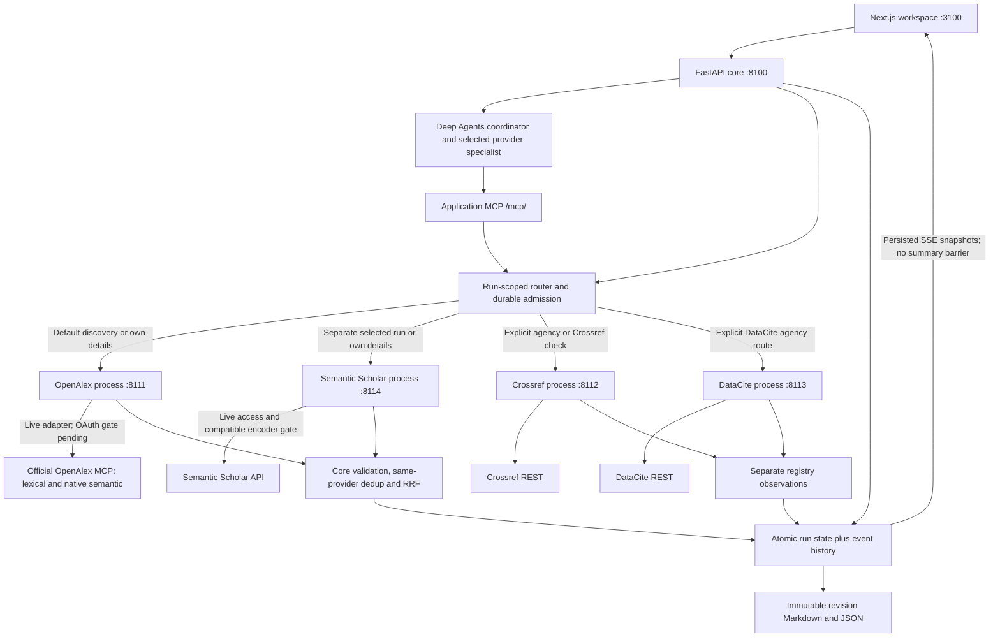

# Increment 1 implementation status

**Current automatic discovery:** [Multi-source discovery, canonical DOI papers and automatic Unpaywall](automatic-federated-discovery-2026-11-09.md) is the latest user-directed default. Source selection is optional advanced behavior; a recorded eligible route searches multiple isolated services, groups matching DOIs into one paper and resolves access links through Unpaywall automatically. Earlier manual-selection/two-source defaults are superseded.

**Validated implementation:** 270 Python tests, 43 browser cases (zero skipped), 11 structural harness cases, lint/typecheck/build passed. The live automatic route used OpenAlex, arXiv and Crossref without provider selection: 26 primary papers, six Unpaywall open-access observations, six not-found results, seven DOI groups explicitly deferred by the 12-lookup cap, and seven DOI-less papers. Fixture integration proved 16 observations → 10 canonical cards with one access lookup per shared DOI. Both saved reloads made zero new provider/model calls. Large public histories support local full-turn restoration without replay. [Receipts and current diagram](automatic-federated-discovery-2026-11-09.md#validation-checkpoint).

**Current provider relevance correction:** [Provider-specific queries and independent quality review](provider-relevance-v2-2026-11-09.md) replaces the shared-query/pooled stopping rule: Crossref uses bibliographic search, every selected provider gets its own query plan and repair decision, and primary results exclude adjacent/uncertain records. Search-workspace AI submissions use the same reviewed conversation path. The exact-question live retest passed: two Crossref pages, three model calls, five primary matches with abstracts, explicit intent/keywords/tags and saved LLM/provider request traces. 234 Python, 39 browser and 11 harness checks passed. Earlier checkpoints below retain their dated behavior.

**Latest November 9 query-relevance checkpoint:** [Agentic retrieval and ranking](agentic-retrieval-2026-11-09.md) adds optional structured LLM query planning, provider-batch relevance review and at most one query revision through LangGraph, retaining Deep Agents/application MCP and isolated providers. Chat direct-search fusion ordering is corrected. AI-reviewed results have explicit intent, query history, relevance reasons and shared paid-call accounting; prior deterministic-only statements below are historical where superseded. Live exact-query acceptance passed: 39 reviewed observations, 16 withheld, first reviewed batch at 14.8 seconds; 225 Python, 32 browser and 11 structural harness cases pass.

**October 26, 2026 · development/design approved by the user · local framework implemented**

**Latest November 9 provider expansion:** [New provider execution and architecture](provider-expansion-2026-11-09.md) supersedes the older four-service/DOI-only Crossref checkpoint. Eight isolated services expose six explicit discovery choices and a separate Unpaywall DOI access action. arXiv, Europe PMC, OpenAIRE and Crossref actual UI/agent/MCP searches succeeded with 20 records each; abstracts/descriptions arrived before completion. Unpaywall live lookup now passes after private contact configuration: one request returned five reported access locations; saved reload made no new call. Its earlier missing-contact gate remains dated evidence. Final checks: 185 Python, 27 browser, 11 harness cases; lint/typecheck/build passed. No new hosted model call was made.

**Latest November 9 abstract/source update:** [Abstract cards and richer saved evidence](richer-sources-and-abstracts.md) now supersede the accidental chat-only abstract omission and 400-character generation input. Full available provider details are read explicitly within existing allowances; new answers locally pack up to 1,200 abstract characters per source under the original overall envelope. Three OpenAlex detail calls expanded one snippet and confirmed two genuine misses. No new OpenAI call was made. The [free-source review](../discovery/research/free-scholarly-sources-review-2026-11-09.md) recommends additional isolated adapters; successful direct probes do not make them integrated connections.

**Latest November 9 streaming acceptance:** [Provider contributions and optional streaming answers](streaming-generation-2026-11-09.md) supersedes the prior blanket generation deferral. Explicit `generate` streams an OpenAI answer over at most six saved live source previews, through a LangChain Runnable in the outer LangGraph. One live call passed: 286 text deltas, seven rendered partial prefixes, first text 2.26 s, completion 20.36 s, zero new scholarly calls. Current validation: 143 Python tests, 18 browser journeys, 11 harness evals; TypeScript/build/lint passed. Production model selection, hosted retrieval-agent reasoning and retention remain separate. The original tables below are dated baseline evidence; the latest record controls current behavior.

**Subsequent November 9 OpenAlex acceptance:** the user resumed authorization, and [OAuth plus live discovery now pass](openalex-connection-2026-11-09.md). Both native branches, details and an actual 2024–2026 exploration UI/MCP run succeeded, returning fourteen eligible live records. The earlier OpenAlex deferral below is historical. No hosted-model generation was enabled.

**Latest implementation — November 9:** the [integration execution record](integration-execution-2026-11-09.md) now controls the current routing/chat checkpoint. Conversation APIs/SSE, an outer deterministic LangGraph workflow, existing Deep Agents/MCP discovery children, direct registration-aware DOI lookup and the Dub exploration UI are implemented. Live Crossref/DataCite UI and S2 details passed; OpenAlex sign-in is user-deferred and S2 search returned 429. A real local ONNX encoder is installed/configured and tested. Hosted generation/model choice and bookmark retention are deferred. The following Increment 1 tables retain their original baseline where not superseded by that dated execution record.

**November 9 review:** the [implemented architecture audit](implementation-review-2026-11-09.md) and [diagram review board](diagrams/review-2026-11-09/index.html) provide the current review baseline. All 40 covered source/dependency/test fingerprints match the October 30 receipt. Fresh local core/provider health and application-MCP catalog checks succeeded in fixture mode; frontend port 3100 was not reachable. No external provider or live-model tests were run in this audit.

**November 9 planning evidence:** [Live connections and exploration chat](live-operations-and-chat-plan.md) and the earlier [read-only local snapshot](../docs/reviews/2026-11-09-operational-planning-status.json) preserve the pre-execution state. Those observations preceded the approved implementation above. The current Dub-inspired UI remains selected.

**October 29–30 UX update:** the user selected and approved applying the [Dub-inspired direction](dub-ux-adoption.md) to the existing frontend. Implemented and validated October 30, the application now uses a light sidebar, compact source index, persistent desktop preview, tabbed source details and responsive mobile dialog. Stack, dependencies and backend/provider contracts are unchanged. See the [UI validation update](../docs/validation/dub-ux-adoption.md).

The user explicitly approved developing Increment 1 and running validation plus basic context/harness evals. This supersedes the earlier planning-only status. The approved target remains [Increment 1](increment-1.md); this record distinguishes the implemented local framework from provider access and live-quality gates. [Validation evidence](../docs/validation/increment-1.md) records actual results.

## Implemented decisions

| Area | Implementation and boundary |
| --- | --- |
| Backend | Python 3.13, FastAPI. One application core plus four independent, single-provider Python service processes. No upstream provider SDK/client is mounted in the core. |
| Frontend | Next.js App Router, React, TypeScript, authored reusable components and CSS using the selected Dub-inspired white/slate design. Source index, persistent desktop reader/mobile dialog, shortlist, saved selection reasons, explicit details/DOI checks and downloads. No new component library or dependencies. |
| Agents | Actual LangChain Deep Agents coordinator and provider-bound discovery specialist. One delegation and one application search; effective graph tools are tested. Fixture model responses are scripted; no hosted language model is configured. |
| Application MCP | Actual MCP SDK Streamable HTTP at `/mcp/`. Only `search_papers(run_id)` and saved `get_research_run` tools. Human decisions, registry checks and exports use the API. |
| Internal delivery | Loopback HTTP to independent provider services; newline-delimited branch/entity events from discovery, persisted core snapshots/events, then browser SSE. Upstream page responses are not described as per-paper streaming. |
| Primary discovery | OpenAlex is the default. Its live adapter uses only the official MCP, reads runtime tool schemas and permits needed read tools. Lexical and native semantic requests stay distinct; OpenAlex owns the semantic query embedding. OAuth/native live proof is pending. |
| Other providers | Independent Crossref agency/metadata, DataCite exact DOI metadata, and separately selected Semantic Scholar services. No automatic cross-provider discovery, fallback or metadata blending. |
| Hybrid/ranking | Provider-scoped identity, lexical/semantic provenance and eligible-branch ranks. The core applies shared deterministic filters/deduplication and equal-weight RRF with `k=60`. This versioned heuristic is uncalibrated; raw scores are not pooled. |
| Persistence | Single-writer atomic JSON run aggregates with state/event sequence committed together, bounded event history, selection revisions and immutable export snapshots. Independent provider journal/cache directories have their own process locks. This is a local implementation behind interfaces; no production database is selected. |
| Recovery | Reopen/replay/snapshot-gap recovery causes zero research/model calls. Nonterminal runs become `INTERRUPTED` after restart; no automatic agent replay. Cancel/deadline fences reject late discovery effects. |
| Review/export | Up to three included sources. Explicit agency-routed DOI checks retain separate registry observations and conflicts. Whole-record citation adoption is a human choice. Markdown and JSON exports render saved snapshots without inference or external calls. |
| Operations | Repository-only `.env`, ignored local state/logs/toolchains, locked Python/npm dependencies, owned-process launcher and a fixture CI workflow. Nothing was deployed or pushed during this work. |

The provider service normalizes/journals its own responses and preserves branch/query evidence. Shared application eligibility and rank fusion execute in the core in this implementation. This makes filter semantics consistent across independent services without placing upstream integrations in the core. The earlier target diagram summarizes those stages inside the discovery route; the executable ownership is shown below.

Provider mode and model mode require separate interpretation: the core currently invokes `run_discovery` without forwarding `mode`, so its default scripted model can call provider services launched in live mode if access permits. `SCOUT_MODE=live` does not configure a hosted LLM. The November 9 review identifies an explicit mode split and live-model accounting as next decisions. Application JSON owns durability; no LangGraph checkpointer is configured.

All four local services default to clearly labeled fictional fixtures. The live arrows describe implemented adapter routes, not proof that every live route has succeeded. A discovery run selects only one discovery provider. Crossref/DataCite calls happen only for explicit human checks.

## Implemented scope and finite limits

Questions are 3–2,000 characters and at most 2,000 UTF-8 bytes, preserved without silent truncation. The UI exposes its byte count. A pure API preflight also accounts for JSON escaping and reserved policy/tool context; unsupported encoded inputs fail with a clear 422 before a run is created. Context v2 avoids repeating the full brief, sizes source previews against the remaining envelope and preserves every candidate's ID/version even when its preview is omitted. The initial API accepts only explicit year bounds and resource type (`article`, `preprint`, `book`, `book-chapter`) as hard filters. Free-text question wording is retrieval intent; arbitrary natural-language exclusions are not parsed into guaranteed predicates. Unsupported filter keys are rejected. Required metadata that is unknown fails eligibility with a reason.

Native branches admit at most ten raw records each and a twenty-identity union. The optional Semantic Scholar local reranker admits a bounded pool of twenty same-provider candidates and requires an injected compatible query/document encoder; none is installed by default. Its ranks cover that pool only.

The core persists attempt grants before dispatch: eight attempts for the selected discovery provider, six Crossref, three DataCite and sixteen overall per run. Duplicate operations do not create new allowance; uncertain outcomes retain holds. Each provider separately journals upstream attempts and enforces its grant. One active agent execution is admitted. Agent execution has a 180-second deadline; explicit detail/check operations use a 30-second timeout. Event history is bounded to 64 events and 4 MiB, with snapshot resynchronization after a replay gap.

The fixture harness admits six generations, twelve model HTTP attempts as a future ceiling, and 6,000 input/1,500 output **fixture UTF-8 byte upper-bound units** per generation. These are not measured provider tokens. Successful scripted runs make four generations, one delegation, one application MCP search and zero model HTTP requests/charges. If complete source identities alone cannot fit, the agent reports the bounded-context failure; the core retains the already observed entities as partial, without truncating IDs/versions or re-searching. No live pricing, token accounting or paid-model admission is claimed. A hosted model needs its own configured adapter, exact tool-profile compatibility, token/cost accounting and quality evals before enablement.

Source missingness, truncation, content state and provider observations survive normalization, UI inspection and export. An abstract is not acquired full text. Detail lookup requests available provider fields; it cannot promise complete authorship or absent metadata. Hydration cannot silently replace an already chosen citation snapshot.

## Work-package checkpoint

| Package | Current evidence/status |
| --- | --- |
| I1-01 contracts/decisions | Implemented schemas, explicit service ownership, selected local transports/storage and finite limits. |
| I1-02 agents/MCP/access proof | Real Deep Agents and application MCP proven with fixtures; OpenAlex OAuth and actual live tools/search combinations pending. |
| I1-03 durable state/admission | Implemented and tested: single-writer ownership, atomic publication, restart, operation identity, uncertain holds and no free replay. |
| I1-04 OpenAlex hybrid | Independent service, fixtures and fake-upstream schema contracts pass. Official-MCP live adapter exists; native live hybrid remains gated. |
| I1-05 core/progressive delivery | Real process/MCP/SSE integration passes; usable first entity precedes semantic completion/final summary. |
| I1-06 bounded agents | Actual compiled graphs, compact references, allowed tools and structural rejection paths pass. Scripted model only. |
| I1-07 Next.js workspace | Implemented; desktop/mobile, keyboard, early save, metadata truthfulness, reconnect and actual fixture-backend browser journey validated. |
| I1-08 Crossref | Independent fixture contracts and actual core check path pass; one public agency and one public metadata probe succeeded. |
| I1-09 DataCite | Independent fixture contracts, registration-aware core route and known-agency isolation pass; one public singleton probe succeeded. |
| I1-10 Semantic Scholar | Independent service/fixture route and compatible-encoder contract tests pass. Public detail probe returned HTTP 429; configured live semantic proof pending. |
| I1-11 export/failure matrix | Deterministic immutable exports, saved operations with services stopped, partial failure, cancellation, revision and recovery tests pass. |
| I1-12 live acceptance | Partially exercised metadata adapters only. Full OpenAlex/live-agent discovery and relevance evaluation remain pending. |

## Next gates

1. OpenAlex OAuth, actual hosted tool contracts, native lexical/semantic discovery, year filters and details now have [live acceptance](openalex-connection-2026-11-09.md). Broader relevance/resource-type cases remain separate quality checks; they are not required to reconnect the working provider.
2. Configure Semantic Scholar keyed access and prove search plus real candidate-pool reranking. Live details succeeded; anonymous search returned 429. The concrete local ONNX encoder is installed/configured/tested.
3. The explicit bounded OpenAI answer-stream demo now has live acceptance; production model selection and broader model-quality/claim-support evals remain open. Retrieval routing needs no hosted model call; the fixture path stays reproducible and forces the answer writer off.
4. Review real research questions for relevance, branch contributions and metadata quality. Current authored cases establish behavior, not corpus-wide recall or scientific validity.
5. Select production database/authentication/deployment/multi-user architecture only when that scope is discussed. The local single-owner framework does not settle those decisions.

Historical research, earlier plans and [illustration source hashes](diagrams/increment-1-architecture-source-snapshot.json) remain preserved. The illustration's `PROPOSED` label is its generation-time status; its hash receipts are not rebound to later document edits.
