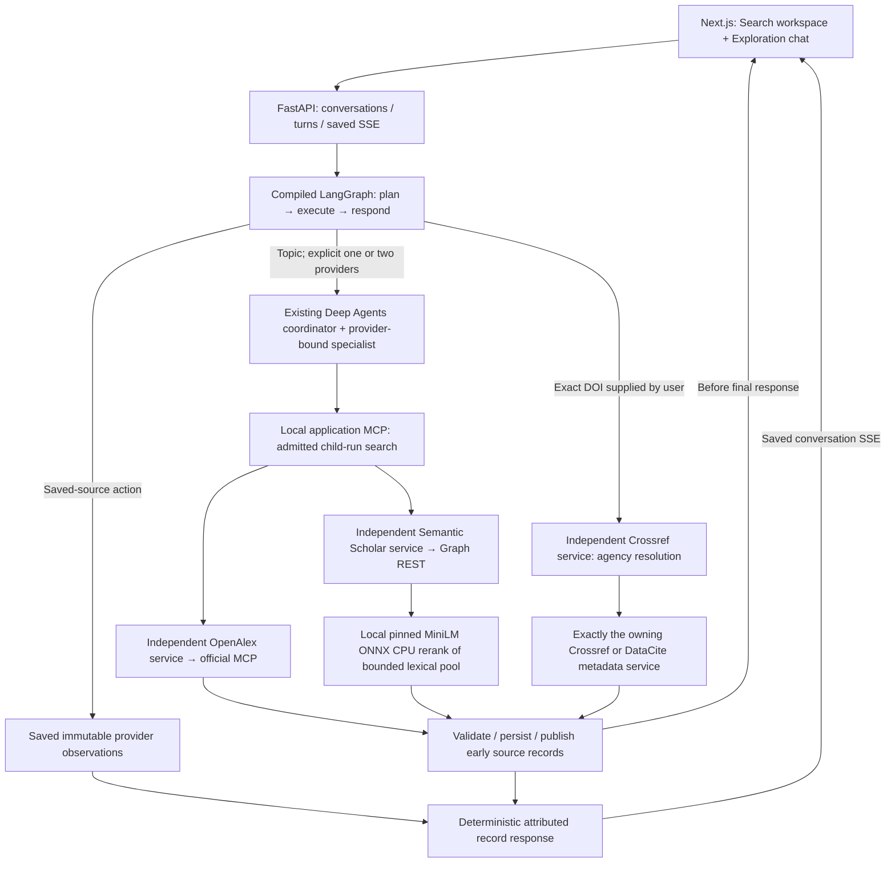

# Provider integration and exploration execution

**November 9, 2026 · implemented local routing/chat slice · generation deferred**

**Later explicit streaming request:** [Provider contributions and optional streaming answers](streaming-generation-2026-11-09.md) adds a real LangChain/LangGraph OpenAI writer over saved evidence. One live stream passed with zero new scholarly calls. This supersedes the blanket generation deferral; it does not choose the production model or change the earlier receipts and call totals below.

**Later November 9 update:** [OpenAlex OAuth and live acceptance](openalex-connection-2026-11-09.md) now supersedes the sign-in deferral recorded in this original execution checkpoint. Native keyword/semantic branches, details and a filtered actual exploration UI/MCP journey passed. Earlier receipts and nine-call totals below remain the evidence for that earlier execution, rather than being rewritten.

Research Scout now has a functional exploration UI and durable conversation API. Text is routed deterministically through an explicit LangGraph workflow: topic searches use the existing Deep Agents/application MCP discovery path, exact DOIs use registration-aware REST routing, and saved-source requests reuse observations without another external call. Responses contain attributed provider records, rather than hosted-model prose.

The user approved the [integration plan](live-operations-and-chat-plan.md), then deferred OpenAI model selection/generation, bookmark-retention changes and OpenAlex sign-in. The existing Dub-inspired UI and legacy review workflow are retained. This record supersedes the pre-execution review for current implemented behavior; the [earlier architecture review](implementation-review-2026-11-09.md) remains preserved evidence.

## Operational checkpoint

The application is left running at **http://127.0.0.1:3100/**, with core/application MCP on 8100 and independent provider services on 8111–8114. The configured profile uses live provider adapters and `SCOUT_MODEL_MODE=disabled`. Process liveness, configured capability and observed live proof are separate.

The [final running-process snapshot](../docs/validation/2026-11-09-final-runtime.json) and [read-only final UI replay](../docs/validation/2026-11-09-final-ui-readonly.json) confirm the restored profile. Process-local verification badges reset after restart; earlier successful requests remain dated proof in their receipts, rather than causing a new process to claim it has already searched. Provider labels distinguish details-only proof from verified discovery.

| Integration | Implemented and measured | Remaining access/proof |
| --- | --- | --- |
| Application MCP | Actual initialize/search path exercised by Python process tests and actual-backend browser discovery. | Live OpenAlex-backed discovery awaits its grant; fixture transport success is not live upstream proof. |
| OpenAlex official MCP | Trusted endpoint configuration, OAuth discovery/PKCE connector, private credential store, expiry/refresh support, read-tool/schema allowlist and reconnect gate. Actual authorization-server discovery produced a sign-in URL. | User selected **Connect OpenAlex later**. No OAuth grant, hosted search/schema acceptance or native live hybrid proof is claimed. |
| Crossref REST | Two preflight requests succeeded; actual UI DOI lookup succeeded through the independent service. Registration agency and metadata attempts remain distinct. | No broad topic search was added. Contact email is optional identification for public reads. |
| DataCite REST | Public singleton preflight succeeded; actual UI used Crossref agency resolution and then the DataCite service successfully. | Public Findable metadata only; a miss does not establish DOI nonexistence. |
| Semantic Scholar REST | Live detail lookup succeeded through its independent process. Search adapter, provider-wide pacing/cooldown and local CPU reranker are wired. | One anonymous search returned **HTTP 429**. API key is absent; keyed search and real candidate-pool hybrid acceptance remain pending. Detail success does not prove search. |
| OpenAI | An authorized HabitQuest key was copied into ignored local `.env` for later use. The launcher withholds it from every child process. | Model selection and hosted generation/embedding calls are deferred. **Zero hosted model requests or charges.** |

## Framework and routing ownership



LangChain supplies messages, schemas, tools and the scripted `BaseChatModel` used to drive the existing narrow Deep Agents graphs. LangGraph adds the outer typed conversation controller. This is real framework execution with deterministic routing; there is no hosted LLM reasoning or answer generation. No separately hosted LangGraph server or durable framework checkpointer is required for this local slice.

Each discovery child remains scoped to one provider, one delegation and one MCP search. An explicit OpenAlex/Semantic Scholar comparison runs the children serially and retains provider-specific identities, modes and versions. There is no provider fallback, score pooling or field blending. Direct DOI lookup is a separate human-requested read operation; it does not include a source, adopt a citation or change a bookmark. Legacy included-source verification keeps its existing inclusion rule.

## Implemented contracts and UI

- Added conversation create/list/get, turn submission and cancellation, with persisted SSE replay/snapshot recovery. User messages are bounded to 2,000 UTF-8 bytes. Conversation snapshots keep stable turn IDs, revisions, idempotency identities, child links, source observations and usage.
- The real LangGraph controller implements discover, exact DOI lookup and saved-source actions. Multi-provider routing is explicit. “Source 1” resolves against the previous saved source ordering. The app reports resource limitations instead of synthesizing unsupported findings.
- The current Dub workspace has an **Exploration chat** control, provider choices, DOI examples, response/source cards, saved conversations, stop/reconnect behavior and links into the existing inspector. Registry-only cards remain read-only and link to the original record.
- Source records appear during discovery, before the other child or final response. Saved drafts, note focus and reader state survive updates. Tests cover a blocked OpenAlex connection, deselection to allow S2 alone and DOI lookup independent of discovery access.
- Existing per-run shortlist, notes, metadata checks and exports remain. Global conversation bookmarks/retention and transcript exports are not introduced. Conversations have a finite sixteen-turn envelope; no cleanup/deletion policy was added.
- One global active conversation turn or legacy discovery run is admitted. Child ownership/linkage is persisted before scheduling; cancellation reconciles an interrupted admission/link window without dispatching it. A partial provider failure preserves the other provider's observations. Restart marks unfinished work interrupted, with no automatic external replay.
- Live provider mode is independent of model mode. Run snapshots retain per-provider expected modes, and registry observations are checked against their operation's provider/mode rather than a global live label.

## Environment and operations

The ignored root `.env` is created with mode 0600. It contains official hosted upstream URLs, internal loopback routes, independent provider modes, the local encoder factory/cache and dormant OpenAI credential. No OpenAlex or S2 secret was found in the authorized HabitQuest env files. No values appear in validation reports or frontend artifacts.

The launcher now respects loaded modes unless an explicit CLI override is supplied. `--mode fixture` selects a separate fixture namespace unless a state directory is explicitly given. Child environments receive only the settings/credentials belonging to that process. `--check-config` prints resolved nonsecret settings without starting services or making upstream requests.

```sh
# Normal local app: uses this repository's .env.
.venv/bin/python scripts/dev.py

# Nonsecret configuration inspection, no upstream calls.
.venv/bin/python scripts/dev.py --check-config

# Isolated fixture services for actual-backend acceptance.
.venv/bin/python scripts/dev.py --mode fixture --state-dir .scout/fixture-validation --no-frontend

# Later, connect OpenAlex explicitly; restarting the service is unnecessary for the token store.
.venv/bin/python scripts/connect_openalex.py

# Explicit independent live proof; no implicit retries/fallbacks.
.venv/bin/python scripts/provider_preflight.py --provider openalex --live
```

Do not start a second launcher over occupied ports. Stop only the launcher/processes owned by this project before switching profiles. The current live state is under `.scout/live`; prior state and fixture validation data are preserved.

### Local encoder

For this Intel/Python 3.13 environment, the configured implementation is a small ONNX CPU encoder rather than a PyTorch installation. Optional packages are pinned in [requirements-encoder.lock](../requirements-encoder.lock). The public model is `sentence-transformers/all-MiniLM-L6-v2` at revision `1110a243fdf4706b3f48f1d95db1a4f5529b4d41`, with the publisher's quantized ONNX file and tokenizer cached locally. It produces 384-dimensional compatible query/document vectors. See the [publisher model card](https://huggingface.co/sentence-transformers/all-MiniLM-L6-v2).

The setup command explicitly downloads two public artifacts; service startup performs no model download or hosted inference. Publisher-pinned byte sizes, model SHA-256 and tokenizer Git identity are checked before files are promoted or loaded. Query/document processing uses attention-mask mean pooling, L2 normalization, a 256-token window, at most twenty records per batch and bounded CPU threads. Truncation is disclosed in provenance. This is a bounded lexical-pool reranker, not independent S2 semantic recall or an evaluated optimal research encoder.

```sh
.venv/bin/python -m pip install -r requirements-encoder.lock
.venv/bin/python scripts/setup_local_encoder.py
# Factory configured in the local .env:
# research_scout.providers.onnx_encoder:minilm_onnx
```

## Validation and remaining gates

| Check | Actual evidence |
| --- | --- |
| Python | **131 passed**, including real loopback processes/MCP, eleven new conversation cases and the explicitly enabled real local encoder proof. [JUnit](../docs/validation/2026-11-09-integration-python.xml). |
| Python lint/dependencies | Ruff passed; `pip check` passed. Base pinned versions were constrained during optional encoder installation. |
| Existing agent context/harness evals | **11/11 passed**, scripted graph execution; no live-model quality claim. [Report](../docs/validation/2026-11-09-context-harness-evals.json). |
| Frontend | Typecheck and optimized Next.js build passed. |
| Complete browser suite | **15/15 passed, zero skipped**, including two new actual-backend chat journeys, the legacy actual-backend shortlist/export journey and details-only/rate-limit readiness labels. [Final report](../docs/validation/2026-11-09-integration-browser-final.json); the earlier [14-case run](../docs/validation/2026-11-09-integration-browser.json) is preserved. |
| Actual live UI | **Six checks passed:** Crossref lookup, saved 2009-record follow-up without a new call, agency-routed DataCite lookup, reload, 390px and 320px layouts. Four real upstream attempts, zero hosted model calls. [Report](../docs/validation/2026-11-09-live-routing-ui.json). |
| Independent live adapters | Crossref agency/metadata 200 (two attempts); DataCite singleton 200 (one); S2 anonymous search 429 (one), then a separate live S2 details 200 (one). Receipts below. |
| Local CPU model | Actual pinned-model vector/similarity/truncation test passed. Configuration preflight confirms semantic capability is wired, with no new upstream call; real S2 candidate-pool acceptance still depends on search access. |

Provider receipts: [Crossref](../docs/validation/2026-11-09-crossref-live-integration.json), [DataCite](../docs/validation/2026-11-09-datacite-live-integration.json), [S2 search](../docs/validation/2026-11-09-semantic_scholar-live-integration.json), [S2 details](../docs/validation/2026-11-09-semantic-scholar-details.json), [configured encoder](../docs/validation/2026-11-09-semantic-scholar-encoder-config.json). The complete browser suite and live resource checks are separate evidence; fixture results are not live literature results.

Total research upstream attempts in this execution are **nine**: four original preflight attempts, four through the live browser conversation, and one S2 detail probe. OAuth metadata/control traffic and public model-artifact downloads are separate from those research calls. Hosted model requests and charges remain zero.

Next access steps are the user's deferred OpenAlex sign-in and a Semantic Scholar key, followed by bounded search/hybrid proof for each. Re-enable nothing automatically: hosted-model analysis/generation and bookmark retention are later user decisions. This execution does not claim production deployment, full-text analysis, universal source coverage or live generated-answer quality.
