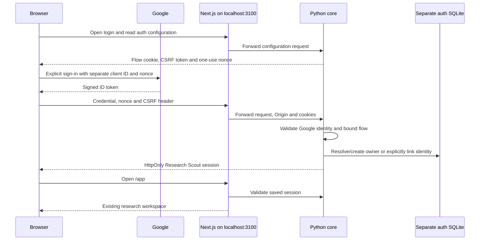

# Observatory landing and local owner sign-in

November 15, 2026. The user approved adopting **only direction 08, Research Observatory, as the landing page**, with the existing research app behind sign-in. Directions 09 and 10 are not adopted. All ten mockups remain historical comparison artifacts.

## Application routes and links

| Route | Implemented purpose |
| --- | --- |
| `/` | Public Observatory composition: floating navigation, question hero, illustrative evidence, resource entrances and workspace links. |
| `/app` | The existing ResearchWorkspace, with its current design, tabs, readers, projects and retrieval controls. Validates the real backend session. |
| `/login` | First-owner setup or username/email and password sign-in, plus configured Google sign-in. |
| `/forgot-password` | Generic recovery request; no reset token returned to the browser. |
| `/reset-password?token=…` | Single-use password reset. The page removes the token from browser history after loading it. |
| `/account` | Owner identity and explicit Google-account linking while signed in. |
| `/admin` | Existing economics page, now behind the same owner session. No separate admin credentials. |

Landing questions become `/app?q=…` drafts. They survive the login round trip and do not start a search automatically. Resource cards select Papers, Videos, Data or Repos without changing provider scope or acquiring records. Old root bookmarks with saved run/search/conversation parameters forward to `/app` with their parameters intact. Native landing links do not prefetch private research.

The public illustration is labeled illustrative. Mockup records, counts, credits, replay scripts and performance values are not application data. Landing and auth CSS Modules are isolated from the current workspace styling.

## One owner and separate persistence

The user selected **one workspace owner**, with existing research remaining in the same local workspace. This is an access gate over existing data, not per-user tenancy or a data migration. First setup atomically creates the owner. Later anonymous registration is closed.

Authentication uses a separate local SQLite database, normally `backend/db/auth.sqlite3`. It does not reuse, reset or migrate the tokenomics database, research JSON state, projects or provider caches. Passwords use salted scrypt hashes. Session and recovery tokens are stored as hashes, with expiry and revocation; browser sessions are opaque HttpOnly, SameSite=Lax cookies. Secure cookies are required with non-local HTTPS origins. A password reset invalidates existing sessions; sign-out revokes the current session.

The backend enforces authentication for research, project, provider-status and economics APIs. Frontend route guards validate the backend session, rather than trusting cookie presence. Unsafe requests require an allowed Origin and a session/flow-bound CSRF token. Auth responses are not cached. Authentication failures do not dispatch retrieval or models.

The existing application MCP path remains available to Deep Agents through a separate core-only internal credential. Browser cookies do not grant MCP access. Provider processes and the frontend never receive that credential. The existing agent/provider boundaries and budgets stay in place.

The signed-in workspace account control is a username pill at the far right of the top bar, with a circular initial and the existing account/sign-out menu. Long names truncate within the pill; the menu retains the full identity. On narrow screens, provider status uses its dot with the full label available on hover so the account and credit controls fit. [Seven-width layout and keyboard verification](../docs/validation/account-pill-2026-11-15.json).

## Google sign-in reference and configuration

**November 15 TLS fix:** The user-reported callback 503 was caused by missing Python framework CA trust files when `PyJWKClient` fetched Google's public signing keys. The verifier now keeps platform/configured trust and loads the already pinned `certifi` roots into an explicit verified `SSLContext`. That bundle is declared as a direct dependency without changing its version or downloading packages. Failure logs contain only the transport exception class; public failures remain generic. Signature, issuer, audience, expiry, nonce and verified-email checks remain enforced. The running backend has been restarted. All 488 backend tests pass (one optional encoder proof skipped), 61 focused auth/MCP/settings checks pass, and all 11 synthetic harness cases pass. The live public-key probe succeeds, an invalid synthetic signature receives 401, and 221 saved research files, 7 economics tables and existing owner/session records are unchanged. [Evidence](../docs/validation/google-oauth-tls-2026-11-15.json). Real account login remains untested; the separate automated Google-origin rejection is recorded explicitly.

HabitQuest's reviewed implementation uses Google Identity Services' popup ID-token callback. Scout follows that pattern, with backend signature/issuer/audience/expiry/verified-email validation, Google `sub` identity and an additional one-use, flow-bound nonce. The server then issues its own session. Google identity is not inferred from a pasted email address, and accounts are not silently merged by email. An existing password owner links Google explicitly from Account.

The user requested a **separate Research Scout Web OAuth client**, then supplied its configuration in the ignored root `.env`. The backend has been restarted and the frontend auth configuration returns the matching public client ID. The popup flow does not use the saved client secret, and the frontend never receives it. No HabitQuest client ID, client secret, sessions or Google Console settings are reused or changed. Live browser checks confirm origin-only referrers on both local addresses, but Google currently rejects those origins for this client. The owner reports saving all requested Console origins, but two fresh-browser rechecks still receive Google origin rejection, possibly pending propagation. Real account sign-in remains untested. [Exact localhost setup](../docs/google-oauth-localhost.md).

Google verification references: [server-side ID-token verification](https://developers.google.com/identity/gsi/web/guides/verify-google-id-token), [Web client/origin setup](https://developers.google.com/identity/gsi/web/guides/get-google-api-clientid), [GIS callback and nonce API](https://developers.google.com/identity/gsi/web/reference/js-reference). Automated tests of signed tokens are separate from a real-account Google sign-in, which needs the new client and user interaction.

## Local password recovery

The user chose `local_outbox`, with `SCOUT_AUTH_OUTBOX_DIR=.scout/auth-outbox`. Matching recovery requests create a private JSON message containing the destination, one-use reset URL and expiry. The directory is private, ignored, and never served by Next.js or the API. Unknown identifiers receive the same public response. This does not claim an email was delivered to an external mailbox.

The local configuration uses `SCOUT_AUTH_PUBLIC_URL=http://localhost:3100` for reset links. Exact browser origins include both localhost and 127.0.0.1 on port3100. The default recovery lifetime is30minutes, the auth flow10minutes and the session24hours. SMTP is a separate configurable delivery option; no SMTP service is configured in this adoption.

## Validation and operating limits

Acceptance uses disposable auth-on and auth-off fixture cores and frontend previews, synthetic credentials and a private fixture outbox. No live research or model request is required. Tests cover real API and SSR rejection, malformed/forged credentials, one-owner setup, CSRF/Origin, recovery replay and session revocation, nonce/account-linking boundaries, internal MCP authentication, URL safety and current workspace behavior. [Validation evidence](../docs/validation/landing-auth-2026-11-15-security.md).

This implements local single-owner authentication. It does not select public hosting, multi-user isolation, an external email provider or a production Google project. The separate Google client is an explicit remaining configuration step, not a successful live-login claim.
