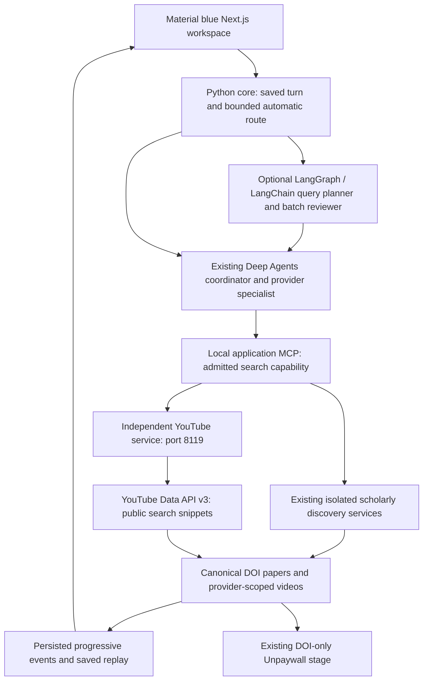

# Material blue workspace and YouTube discovery

**UI superseded:** the user rejected this layout later on November 10. [The prior Dub-inspired UI is restored](ui-rollback-2026-11-10.md). This document and screenshots preserve the trial; the YouTube backend work remains active.

**November 10, 2026 · user-authorized implementation.** Refresh the complete existing Next.js UI from the light version of [preview-v2.html](../proposal/ref/preview-v2.html), with the Material blue palette and curiosity/atom motif in the [earlier Research Scout mockup](../discovery/ux/research-scout-design-handoff/research-scout-mockup.html). Integrate YouTube only. The user explicitly removed Google/web search from this work and confirmed that API credentials are not yet available.

## Experience and appearance

The light reference informs the narrow navigation rail, light slate canvas, subtle dotted background, white rounded panels, fine blue/slate borders, and a three-part question → discover → review strip. The earlier mockup supplies “A little curiosity goes a long way,” “Explore the evidence,” and the atom. Material Blue 700 (`#1976D2`) is the accent; Blue 800 (`#1565C0`) is used for primary buttons and stronger text, with `#0D47A1` for darker interaction states. White action text uses the darker blue. Author CSS and reusable React components retain the existing stack; no Material UI dependency is introduced merely to obtain its palette.

The atom is an authored SVG. It remains still at rest and rotates only while an actual discovery turn is running or being admitted. A saved turn, answer generation, stopped work and completed retrieval do not keep the discovery animation running. The reduced-motion preference disables rotation and pulse while the existing textual retrieval status remains available.

The sidebar stays a full mobile drawer and becomes a compact labeled desktop rail at wide widths. Saved searches remain accessible in the header. Existing source inspection, exact observation pins, keyboard navigation, decisions/notes, exports, query traces, provider settings, progressive updates and read-only history restoration remain part of the app. Source results can be filtered locally into All, Papers and Videos; switching result type performs no new search. Default dates are now unrestricted, and explicit year predicates still apply consistently.

## Provider and agent ownership

There are nine independent provider services, including seven discovery providers. OpenAlex remains the primary scholarly source. Available YouTube is chosen for video/tutorial/lecture/demonstration/explainer intent, within the existing maximum four-provider automatic route. The optional AI planner receives its actual capabilities and must write a provider-specific query. Direct model-free mode also recognizes video intent. A regression check prevents “generation” from matching the genetics routing cue while retaining real gene/genetics/genomics matches. The retrieval prompt/schema checkpoint is `scout-agentic-retrieval-v5`. Missing YouTube access is recorded as skipped; no API request is attempted and the UI exposes its configuration state. Google search is neither a registered provider nor an implicit fallback.

The existing retrieval bounds remain: two rounds, at most one planner plus eight reviews, a shared model reservation, 24 research attempts/holds per turn, and up to 12 primary DOI access lookups. Children execute under the current admission owner; this change does not claim concurrent upstream retrieval.

## YouTube API contract

The provider uses official `GET https://www.googleapis.com/youtube/v3/search` with `part=snippet`, `type=video`, relevance order, a maximum ten-result first page and no automatic pagination. Explicit years map to `publishedAfter` / exclusive `publishedBefore` and are rechecked against the normalized publication year. Native lexical search fetches the pool; an explicitly configured local compatible encoder can rerank that pool. This is not native YouTube vector search.

A result retains the exact video ID, title, channel name, available channel ID, published timestamp, original watch URL and provider description. `resource_type=video` and `content_origin=youtube_search_snippet` distinguish this from a scholarly abstract. There is no transcript, video download, view count, duration or full-video-review claim. The UI exposes video links and channel links when available. Reading an available saved description does not trigger a detail/network lookup. Additional YouTube detail acquisition is not advertised as a capability.

Videos without DOIs use provider-scoped video IDs for stable canonical identity; no fuzzy title merge is introduced. They do not enter Unpaywall enrichment. The internal backward-compatible `papers` projection can contain canonical resources, but the user interface labels them by their actual type and keeps every source observation attributable.

The YouTube key is sent as the `X-Goog-Api-Key` header to the trusted official origin only. It is excluded from query traces, frontend environment, core environment and sibling services. Missing keys fail before attempt admission/networking. API errors are mapped to static sanitized access/quota messages, with no upstream response body echoed publicly. Pacing, operation receipts, recent-pool caching, conservative uncertain holds and saved replay use the existing isolated-provider mechanisms.

A local rolling limit allows at most 100 YouTube research requests per 24 hours, separately from Google's own project quota. Google's current documentation describes a dedicated default allocation of 100 `search.list` calls/day, each costing one unit in that bucket; this differs from older 100-unit-per-search guidance. Actual account quota remains authoritative. [Search method](https://developers.google.com/youtube/data/reference/rest/v3/search/list), [current quota documentation](https://developers.google.com/youtube/data/determine_quota_cost), [Google API system parameters](https://docs.cloud.google.com/apis/docs/system-parameters).

## Configuration and live gate

1. In a Google Cloud project, enable **YouTube Data API v3** and create an API key for public-data access. [Official authentication guide](https://developers.google.com/youtube/data/guides/authentication).
2. Set `SCOUT_YOUTUBE_API_KEY` in the ignored local `.env`; keep it out of chat, source files and browser code. The private local profile already includes an empty placeholder and live provider mode.
3. `SCOUT_YOUTUBE_URL=http://127.0.0.1:8119` addresses the local isolated service. Its trusted upstream defaults to the official endpoint above.
4. Restart the owned launcher, then perform a bounded explicit live video query to verify that specific project's access/quota. Until then the app honestly shows **Needs access**.

The fresh-clone `.env.example` defaults to fixtures. Fixture launches force all provider modes to fixture and paid model flags off, including YouTube. The user has not provided a YouTube key, so this checkpoint must distinguish prepared adapters / fixture integration from live YouTube acceptance. No Google or YouTube live call, cloud project creation or answer generation is needed for this implementation.

## Validation

The complete backend suite passed **276 tests with no skips**, including a real previously cached local CPU encoder check. Ruff, TypeScript and the production Next.js build passed. Eleven authored structural harness cases passed with no model HTTP requests. [Backend receipt](../docs/validation/2026-11-10-material-blue-youtube-python.xml), [harness receipt](../docs/validation/2026-11-10-material-blue-youtube-harness.json).

The browser suite covers existing workflows plus the new actual nine-service fixture path: default automatic routing, a running/idle atom, exact Material blue tokens, mixed paper/video cards, descriptions, DOI-less video exclusion from Unpaywall, local result filters, saved reload, reduced motion and 390/320-pixel layout. [Browser receipt](../docs/validation/2026-11-10-material-blue-youtube-browser.json). The final screenshot/read-only inspection receipt is linked from the final checkpoint below. Authored fixtures prove plumbing, provenance, filters and replay; they do not prove live YouTube relevance or API access.

[Palette/privacy checks](../docs/validation/2026-11-10-material-blue-youtube-privacy.json) found no configured credential/contact values in the scanned source, documentation, frontend build or application logs. The private environment remains ignored with mode `0600`. White on the primary `#1565C0` button has a 5.75:1 contrast ratio; this selected-palette check does not claim a full accessibility audit.

The final [fixture UI receipt](../docs/validation/2026-11-10-material-blue-youtube-ui.json) reports a successful automatic route to OpenAlex, YouTube, Crossref and arXiv: **24 observations → 20 canonical resources, including six video descriptions**. Two DOI groups received two access operations; videos received none. The saved preview/description reads made zero POST requests and no new research/model calls. There were no browser errors or horizontal overflow at 390/320 pixels. This is authored data, not a live YouTube query.

All **44 unique browser journeys are validated**. After the final full run, one old assertion still expected “paper” in a mixed-resource count; its test wording was corrected and the focused rerun passed without application changes. The browser receipt preserves the full-run and follow-up results rather than hiding that correction.

Screenshots: [dashboard](../docs/validation/2026-11-10-material-blue-youtube-dashboard.png), [video results](../docs/validation/2026-11-10-material-blue-youtube-videos.png), [mobile](../docs/validation/2026-11-10-material-blue-youtube-390.png). The [final checkpoint receipt](../docs/validation/2026-11-10-material-blue-youtube-final.json) records fingerprints, live configuration gates and verification scope.

The owned live stack is restored at **http://127.0.0.1:3100/** with nine registered providers. A [read-only live-profile check](../docs/validation/2026-11-10-material-blue-youtube-live-gate.json) verified the YouTube `api_key` / `needs_access` gate and preserved all 26 papers from an earlier saved live query through the Papers filter and reload, without any new POST, research or model request. Older scholarly previews that omitted the resource-type field retain their Papers lane. [Live dashboard screenshot](../docs/validation/2026-11-10-material-blue-youtube-live-dashboard.png). A final focused six-case YouTube rerun also verifies that API-key authentication is accurately labeled before credentials are configured.
