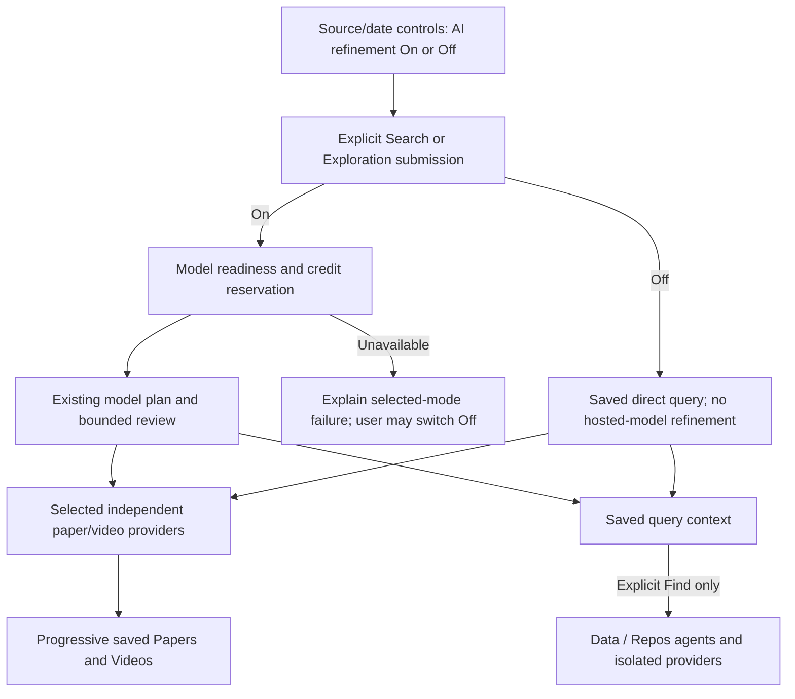

# Optional AI refinement and used-credit display

The latest user decision makes AI refinement a visible choice beside Sources and Date range. It supersedes the earlier mandatory-refinement UI policy. The default stays on; switching off explicitly chooses direct retrieval. The header now shows **Used /100**, rather than remaining credits.

## Search behavior

| Choice | Retrieval | Model credits |
| --- | --- | --- |
| AI refinement on | Existing model query planning, provider queries and bounded relevance review/repair. Missing access or allowance blocks this selected mode with a visible reason. | One credit per dispatched model request, with existing reservations. |
| AI refinement off | The saved user query goes through the existing bounded provider retrieval and local ranking pipeline without hosted-model rewriting or relevance review. | No model credits. Provider rate/request limits still apply. |

The accessible switch is labeled **AI refinement**, with On/Off state and a short explanation. It is visible in the main source/date controls for automatic and manual routing, and in Exploration controls. Changing it updates only the next-query preference: it never submits, cancels or re-runs research. The existing browser preference record gains `aiRefinement`; older records default to on without losing source/date/video settings. Search and Exploration share the same value.

Topic requests send an explicit `agentic` boolean. Both request signatures include that mode, so an idempotency key cannot be reused for a different choice. AI failures never silently become direct queries. Exact DOI lookups, saved reads and explicit answer generation keep their separate behavior. Turning off refinement does not disable the explicit answer-generation action or change its model accounting.

## Resource queries and saved history

Papers/Videos follow the selected mode. Explicit Find Data/Repos can also use a saved direct discovery query; tab opening remains saved-read only. Direct context records `query_mode=direct`, `query_origin=user_direct_query` and `origin=saved_direct_query`, the exact saved query, local lexical terms and original scope. It fabricates no model interpretation, domain, shared plan, assumptions or tags. Provider-specific escaping/filtering and executed arguments remain recorded independently.

Direct Data/Repos admission accepts explicit non-AI discovery turns with no contradictory AI history. A failed paper provider does not invalidate the saved direct query for other providers. Cancelled/interrupted turns require a new search. These resource adapters retain their 400-character query bound: a longer direct question gets an actionable message rather than silent truncation. AI turns still need their valid version 7 resource plan; failed or historical AI plans never downgrade to direct. Existing accepted receipts/retries remain readable before new-context validation.

Historical query traces describe the saved turn, regardless of the current switch. The next-search mode badge was removed from the saved retrieval-focus row to avoid claiming that an earlier AI search used no model. The old “Agentic RAG · required” and “AI required” labels are removed.

## Credits and validation

The compact meter displays actual used credits over the daily allowance. Reserved credits remain distinct from used credits; the progress bar, accessible label and disclosure retain used/reserved/available details. Reset semantics, SQLite history and the daily 100-credit policy are unchanged. No reset is needed for this update.

Acceptance covers both modes, unavailable AI, exact input/scope/date/video propagation, remembered/shared preference, no submit on toggle, truthful historical traces, mode-aware idempotency, direct Data/Repos boundaries and a real fixture UI→API→provider path with zero hosted-model calls or credit changes. The [validation receipt](../docs/validation/2026-11-14-optional-ai-final.json) distinguishes regression fixtures from saved-live read checks.

Completed validation: 410 backend tests passed with one optional encoder proof skipped; 11 scripted harness checks passed. All 213 browser cases are verified across the full run and focused reruns. Exposing compact date fields uncovered native form validation intercepting the existing inline error; the form now uses the application guard, and the original error assertion passes. Settings-field locators use their exact accessible labels. TypeScript, production build and Ruff pass; all 72 frontend source files match the validated artifact. Actual direct UI→API→agent/provider fixtures use zero hosted-model calls and preserve credits. Live saved reads preserve all 739 existing JSON/config files, model accounting and the current 6-used/94-available allowance across 13 healthy services. No paid model request, live source search or allowance reset was made.
