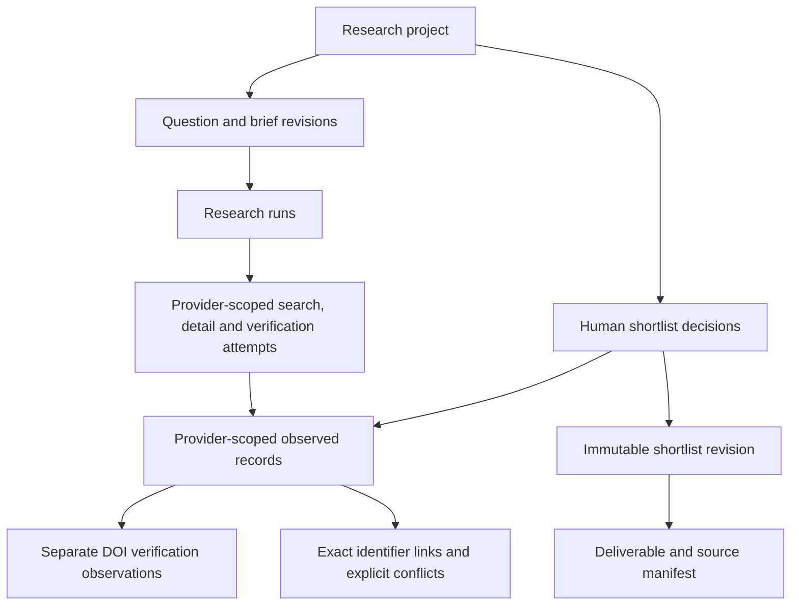

# Product organization and user journeys

**October 26, 2026 · provider isolation, hybrid discovery and progressive results confirmed; product sequence proposed for review**

**Implementation update:** the user approved Increment 1 development. Its local question → progressive sources → review → export framework is implemented; broader product organization below remains an evolving target. See [implementation status](implementation-status.md) and [validation evidence](../docs/validation/increment-1.md) for adopted scope and live gates.

Research Scout should help a user make a project decision with relevant resources and inspectable evidence. The [two research readings](research-inputs.md) support a common lifecycle across resource types, rather than a provider directory as the main user experience.

## The organizing dimensions

| Dimension | Question it answers | Examples |
| --- | --- | --- |
| Research intent | What is the user trying to do? | Understand a field; find data; choose an implementation; compare approaches. |
| Resource type | What kind of artifact is this? | Paper, dataset, repository, model, standard, documentation, web page, video. |
| Provider | Where was it discovered or observed? | OpenAlex, GitHub, a public-data catalog. |
| Acquisition route | How did the application reach it? | Provider MCP, official API, permitted download or user-provided artifact. |
| Evidence role | What does it contribute? | Original finding, replication, definition, implementation, contextual lead. |
| Deliverable | What will the user keep? | Shortlist, bibliography, evidence matrix, comparison or research brief. |

Keep these dimensions independently filterable. For example, a paper and its dataset can share a provider but remain different resources with different versions, rights and evidence roles. A search service may locate a source without being its original producer.

The latest user direction confirms that each provider remains a separate service. A provider-agnostic application core routes operations to the named provider service; it does not host multiple provider integrations. **OpenAlex is the primary/default discovery provider and first integration; Semantic Scholar is an explicitly selected complementary provider.** The selected provider defines a discovery run's source scope. The proposed implementation sequence below does not turn that selection into automatic cross-provider search or fallback. See the [provider routing contract](provider-routing.md).

The user also confirms that entities should render progressively as results arrive. A usable record or batch becomes visible after validation; the interface does not wait for the complete run, other providers, DOI checks or a final agent summary. Provider separation still applies: progressively delivered observations remain in their named provider scope rather than forming a blended result set. The [progressive-results contract](progressive-results.md) defines the update behavior.

The latest search requirement is a **hybrid lexical + semantic + filters strategy within the selected discovery provider**. This explicitly authorizes combining that provider's planned retrieval branches; it does not authorize cross-provider fan-out or metadata fusion. The [hybrid-retrieval design](hybrid-retrieval.md) defines branch capabilities, limits and the proposed ranking method.

## Common journey

1. **Frame:** state the question, decision, audience, constraints, requested source types and desired result.
2. **Discover:** select a named provider and inspect the input/filter plan for its bounded lexical and semantic branches. Show validated entities as either branch returns, with branch and provider progress alongside them; do not wait for both branches or a later summary.
3. **Inspect and verify:** open early rows while discovery continues; examine available metadata, identity, versions, access and limitations. An explicit DOI-verification operation routes to the applicable registration agency and preserves its observation separately. Pending details, verification and model notes have their own states and do not block inspection.
4. **Select:** include, exclude or save an available candidate while the run continues, preserving the user's reasons. Later records, details and agent output retain those decisions.
5. **Develop evidence:** acquire permitted content, find relevant passages and compare findings when those capabilities exist.
6. **Keep and use:** save a revision-bound deliverable with source references and explicit coverage gaps.
7. **Revisit:** reopen prior work or explicitly refresh it, retaining the earlier observation and decision history.

Increment 1 proposes framing, progressively rendered hybrid scholarly discovery within a selected provider, early metadata inspection/selection, explicit DOI verification and export through separately enabled services. It does not claim to complete the later evidence-development stage.

## Intent-led entry points

| User intent | Example user question | Resource mix | Useful outcome | Initial availability |
| --- | --- | --- | --- | --- |
| Understand the field | What work exists on institutional AI readiness? | Papers and reviews | Attributed reading shortlist | Increment 1; one selected discovery provider per run |
| Find usable inputs | Which dataset fits this population and period? | Datasets, dictionaries, official statistics | Fit/access/version comparison | Later |
| Find implementations | What maintained code or model can I adapt? | Repositories, packages, models | Pinned candidates and reproduction prerequisites | Later |
| Integrate correctly | Which interface or standard applies to this version? | Official documentation and standards | Version-specific integration references | Later |
| Compare and validate | Which approach fits the constraints, and what supports it? | Papers, benchmarks and original evidence | Supported comparison and evaluation plan | MVP 2 |
| Understand users or context | What needs, prior art or institutional records matter? | Discussions, patents, filings, funding and other records | Evidence-backed hypotheses with limitations | Later |

These are entry points into the same project workflow. They do not require a separate application or agent for every intent. Learning materials and design assets can support a project without becoming first-release modules.

## Search types and boundaries

| Search type | Actual operation | Boundary to preserve | Increment 1 |
| --- | --- | --- | --- |
| Topic discovery | Combine lexical and semantic relevance under a declared filter plan | A bounded hybrid shortlist is not exhaustive coverage; branches remain within the selected provider. | OpenAlex native lexical + semantic searches; provider-specific hybrid proof for other discovery services |
| Known-item lookup | Resolve a supplied or selected identifier/title | A provider miss is not proof an identifier is invalid. | Details from the run's selected provider; general lookup UI deferred |
| Identifier verification | Check an exact DOI against its registration agency | A verification observation does not replace the discovery provider's record or validate the paper's findings. | Explicit routing to separate Crossref or DataCite services; unknown agency remains unresolved |
| Related-work/citation exploration | Follow citations, references or version relationships | Related records are not automatically independent evidence. | Deferred |
| Corpus/landscape analysis | Define and enumerate/count a reproducible matching population | Top-k discovery results cannot stand in for a population. | Deferred |
| Within-source evidence search | Retrieve passages from content actually acquired | Cite the inspected asset/version and locator. | Deferred |
| Cross-source comparison | Evaluate selected evidence against a question | Distinguish source statements, generated interpretation and contradictions. | Deferred |
| Explicit refresh | Re-execute a prior search against current sources | New observations keep their own query/time/version. | Deferred live refresh UI; reopening uses saved state |

OpenAlex's documented out-of-box MCP connector offers keyword/Boolean and semantic search, plus structured OQL selection/preview for more complex requests. The native hybrid plan makes a lexical search and a semantic search within that service. Send query text to the provider's semantic capability; OpenAlex performs the query embedding, so local embeddings or a local vector index are unnecessary for this path. Expose only the arguments and filter combinations proved in the selected client. [Official connector](https://help.openalex.org/access/connector/), [semantic search](https://help.openalex.org/api/semantic-search/).

Record both branches' queries, filters, ranks, ranking/reranking settings and outcomes. Their raw scores need not be comparable. The two planned searches are the authorized hybrid strategy; they replace the earlier single-mode planning restriction. They are not permission for unbounded extra branches, retries or fallback. Unsupported filters or incomplete branches must be visible rather than silently relaxed or presented as a complete hybrid search. Changing discovery provider starts a separately scoped run, rather than silently reusing a failed or empty query elsewhere.

The product flow is **user input + filter plan → bounded lexical and semantic branches within one provider → progressive entities → same-provider identifier deduplication and rank fusion**. The exact fusion algorithm is proposed, not a measured quality result. Preserve each hit's branch, original rank and source provenance even when one candidate row represents the same provider identity returned by both branches. Mark early ranking as provisional while the other branch is pending; this does not prevent inspection or saving. See [hybrid retrieval](hybrid-retrieval.md).

Semantic Scholar remains a separate, explicitly selected provider. Do not infer a native semantic search operation from its name. If its proved search surface does not supply one, the proposed alternative is bounded semantic reranking of its own permitted candidate titles/abstracts with a compatible local query/document encoder. The encoder/model and settings remain open until capability and quality proof. Such reranking changes ordering within that candidate pool, with any improvement requiring evaluation; it cannot find items missing from lexical retrieval. Report that scope and any unavailable semantic stage honestly.

Cross-provider use requires an explicit research-supported purpose and visible scope. DOI registration verification is one such operation: route an exact DOI to the responsible agency and attach the returned verification observation. Crossref/DataCite exact-identifier checks do not need semantic retrieval. Do not query every registry, fuse discovery rankings across providers or create a single preferred metadata record. Other cross-provider workflows need their own documented rationale and contract.

## Projects, runs and resources

The proposed durable product structure is:

| Object | Responsibility |
| --- | --- |
| Project | A question family and its saved research. A default local project is enough for the first slice. |
| Brief revision | The user's question, intent, constraints and requested output at a point in time. |
| Research run | A brief snapshot, finite hybrid/filter plan, provider/branch progress, attempts and outcomes. Its active state does not prevent record inspection or human selection. |
| Search/detail/verification attempt | The named provider service, branch/capability, route, executed arguments, timestamp, result references and usage. |
| Retrieval hit | The provider-qualified identity returned by one branch, original rank/score if supplied, applied filters and observation reference; retained even when candidate rows are deduplicated. |
| Resource record/version | What one provider actually supplied, its identifiers, producer, known version and field provenance; visible as soon as a usable observation is validated, never a silently blended record. |
| Verification observation | An exact identifier check, registration-agency route, returned fields, outcome and differences from the discovery record, kept separately. |
| Identifier link/conflict | A link based on an exact identifier and a record of differing assertions. It preserves provider observations without forcing a common record or equating versions. |
| Selection decision | Candidate, included or excluded; actor, reason and revision. May be saved while discovery is active and cannot be replaced by a later model/provider update. It is not a scientific validity judgment. |
| Shortlist revision | An immutable snapshot of selected record versions used by an export. |
| Deliverable | A result tied to a revision, sources and its evidence limits. |

A resource can appear in multiple runs and projects without losing the provider observation that supplied each field. The same DOI can link observations, but does not authorize merging their fields or treating their claims as independent corroboration. Similar titles alone do not establish identity. Evidence passages and generated claims become additional linked objects in MVP 2; their absence in Increment 1 should be explicit.

For progressive delivery, give each row a stable provider-qualified identity and distinguish its available metadata, branch coverage and provisional ranking from pending enrichment. The same provider identity arriving from the second branch adds a retrieval hit to that row rather than duplicating the entity or implying independent corroboration. Later observations create recorded source versions and update the existing entity safely; they do not erase human reasons, reset include/exclude state or change an earlier shortlist/export snapshot. Older or repeated updates cannot replace a newer observation. Keep the open inspector, keyboard focus and selections stable as new entities arrive or ranks are refined. A final model summary is a separate later artifact, limited to available metadata in Increment 1; its absence or failure does not hide provider records already delivered.

## The source catalog

Keep the guide's 14 categories as catalog facets and routing hints. A provider registry should record the separate service identity, supported resource types/capabilities, API/MCP/bulk routes, access requirements, maintainer identity, last verification and relevant limitations. The application registry routes to services; provider-specific integration code and credentials remain owned by each provider service.

Each integration can progress through **catalogued → documentation checked → authenticated/protocol tested → contract tested → usefulness evaluated**. These are separate facts. An official MCP listing does not automatically establish authentication, capability fit or relevance quality.

OpenAlex discovery is the primary/default and first enabled service, with its documented MCP/search capabilities subject to the implementation proof. The revised Increment 1 then proposes separate Crossref/DataCite verification services and a separately enabled, explicitly selected Semantic Scholar discovery service at a later build checkpoint. Each service must pass its own access, contract and usefulness checks; its presence in the registry does not activate fan-out or fallback. Other catalog entries remain research references until a journey and acceptance case justify implementation. The full category mapping is retained in [research inputs](research-inputs.md#complete-category-coverage).

## Evidence, review and freshness

Track these independently:

- **Execution:** not started, active, succeeded, empty, partial, failed, cancelled or interrupted.
- **Provider progress:** each selected discovery or verification operation has its own pending, active and terminal state; already delivered records remain inspectable if another operation is pending or fails.
- **Hybrid coverage:** lexical and semantic branch state, applied filters, available hit provenance and provisional/final within-provider ranking. A missing branch is partial coverage, not a complete hybrid result.
- **Selection:** candidate, included or excluded.
- **Available evidence:** metadata; abstract; source snippet; acquired full text; or unavailable. A link to a copy is not a retrieved document.
- **Completeness:** missing/truncated fields and whether complete selected-work details were obtained.
- **Freshness:** retrieval time and known version; a new observation does not rewrite an older export.
- **Interpretation:** provider/source text, deterministic transformation and model-generated fit note.
- **Summary readiness:** pending, available or failed independently of visible entities and human selection.
- **Verification:** provider-supplied identifier, locally normalized identifier, registration-agency observation, unresolved identity or explicit metadata conflict.

A successful search may be empty. An active discovery run can already contain inspected and saved candidates; a completed run may still have unreviewed candidates. A selected paper may only have metadata. A fresh provider record may conflict with an earlier one. Avoid a single score or status that hides these distinctions. When an explicitly scoped workflow uses more than one provider operation, show each provider's progress and observations separately rather than waiting for all of them or flattening them into one result set.

## Two staged MVP outcomes

### MVP 1 — discovery workspace

**Outcome:** a user can inspect relevant candidates as they arrive, make a durable shortlist while discovery continues and export an attributed bibliography/query manifest. Provider rows are useful before a later agent summary is ready.

- **Increment 1, first checkpoint:** the provider-agnostic core routes to the separate primary/default OpenAlex service; prove its native MCP lexical + semantic branches and filter plan, then propose/test same-provider identifier deduplication and rank fusion. One coordinator/specialist handoff, local application MCP, progressive Next.js entity rows, early inspection/saving and provider/branch-attributed export prove the journey. Do not buffer all visible results until both branches or the agent complete.
- **Increment 1, verification checkpoint:** add separate Crossref and DataCite services for explicit registration-agency-aware DOI checks. Keep their observations and conflicts alongside the original discovery metadata.
- **Increment 1, later discovery checkpoint:** enable a separate Semantic Scholar service as an explicit complementary choice with its own capability-proved hybrid strategy. A bounded local semantic reranker is proposed if native semantic search is unavailable. OpenAlex remains the default; results and exports retain the chosen provider's scope and semantic coverage limits.
- **Subsequent discovery refinement:** use reviewed cases to improve supported modes and completeness. Any new provider or cross-provider operation needs its own research rationale and acceptance case.

The first OpenAlex checkpoint is a useful demonstration; the complete revised Increment 1 includes the separately enabled verification and discovery capabilities above. This sequencing is proposed for review. Provider isolation and explicit routing follow the user's confirmed direction. The earlier OpenAlex-only Increment 1 was a planning assumption, retained as history in [research inputs](research-inputs.md#original-agent-recommendation--superseded-sequencing).

### MVP 2 — evidence workbench

**Outcome:** a user can compare a small selected set using content actually retrieved, inspect the supporting passages and export a qualified evidence matrix or brief.

- **Acquisition stage:** permitted full-text acquisition, document identity/version verification and explicit access/failure states through the selected source's service.
- **Evidence stage:** locatable parsing, lexical passage retrieval, selected-source comparison and evidence review. Any use of multiple providers remains explicit and preserves their separate observations.

After these milestones, add landscapes, web reading, YouTube/transcript knowledge, dataset/code discovery and broader project research as distinct, evidence-tested slices. This ordering is a proposal, not permission to implement all phases.

## UI organization

Organize the initial interface around **Research** and **Saved shortlist**, with a visible current project/question. Use a focused question composer, named discovery-provider selector, scope summary, stage-progress panel, candidate results, detail drawer and selection tray. Keep source attribution, verification observations/conflicts and evidence/completeness labels close to the relevant record. A provider being unavailable produces a provider-scoped state and does not change the selection automatically.

Render usable rows as individual records or batches become available from either hybrid branch. Show the named provider's progress, branch coverage and provisional ranking beside the current entities; reserve placeholders for content that is actually pending rather than covering usable rows with a blocking loader. Inspection and save/include/exclude controls stay usable while the other branch or other work continues. Show later details, verification observations and the model summary with their own status; their arrival preserves user decisions and the active inspector. Explicitly scoped multi-provider work uses separate provider sections, never a blended ranked list. See [progressive results](progressive-results.md).

Provide a polished component system with consistent typography/spacing, keyboard access, responsive layout and clear loading/empty/partial/error states. Show technical diagnostics in a secondary run-details view when they help explain a failure. Provider catalogs and framework plumbing should not dominate the main journey.

Future reader, evidence-comparison and research-package views can extend this structure. The [UX intake](ux-research.md) records a blue visual direction and recommends spacious source rows with an initially closed inspector. The component library and detailed production behavior remain design decisions; the confirmed frontend is Next.js.

## What validates this organization

The first representative task must reach a saved shortlist and export without explaining 14 source categories to the user. Prove that a first usable row is inspectable and saveable while another hybrid branch or the run is still active; delayed summary/verification work does not block it, and subsequent hits/rank updates preserve selection, reasons and source revisions. Prove that both planned retrieval branches remain with the selected provider, their original ranks/provenance survive deduplication/fusion, and every verification attempt follows the explicit agency route. No empty/error state triggers another provider or blends its results. Measure lexical, semantic and hybrid usefulness separately for each provider with independently reviewed queries; measure citation/identity integrity separately. Later journeys need their own acceptance cases rather than inheriting a discovery quality claim.

The [architecture](architecture.md) maps these objects and actions to shared services. The [Increment 1 plan](increment-1.md) provides the bounded first acceptance case and implementation sequence.
