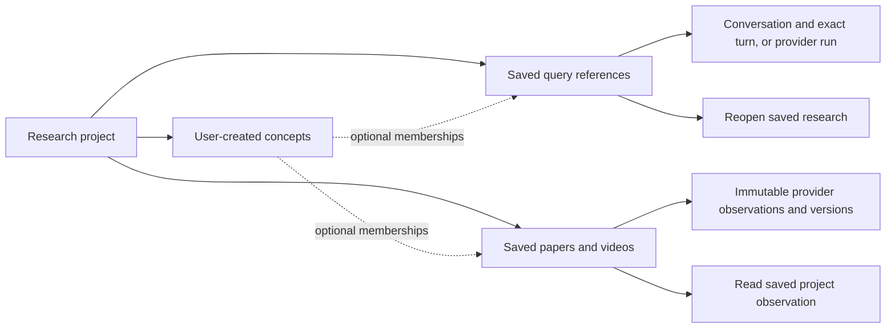

# Research projects and seamless resource reading

**November 11, 2026 · user-directed implementation.** This extends the [right-hand reader](right-panel-and-loading-2026-11-11.md) with automatic row inspection, inline content controls and a durable home for multiple queries and resources. Three parallel agents own result interactions, compact project UI, and the Python project API. The coordinator reviews version/race boundaries and integrates validation. The project-local system-design skill guides ownership and persistence choices.

## User journey and organization

A researcher creates a project for a goal, optionally creates concepts within it, selects the active project/concept and asks one or more questions. Each accepted main Search query links to that captured destination. Existing saved queries can also be added explicitly. Paper/video bookmark icons save resources to the selected project; with no project selected, the user chooses or creates a destination. Project membership is independent of the earlier three-resource run shortlist.

Concepts are project-local facets, not an automatically generated global taxonomy. Queries and resources may belong to more than one concept, and a resource may be saved in more than one project. Each project groups exact normalized DOI papers or stable provider/video identities while preserving separate source observations. Repeating an add is idempotent and can add concept membership without duplicating the resource. No project association is created by a model.

## Results and reading

On a desktop fine pointer, entering a result row schedules a short debounced saved-metadata preview. Leaving the row or changing search/tab/filter cancels pending hover intent. Keyboard row focus and Up/Down movement also update the reader. Explicit preview remains available for touch and direct action. Passive updates keep keyboard focus, the current metadata tab and page scroll; editing reader notes pauses passive replacement. Stale reads cannot overwrite newer intent.

The compact header combines page identity and research mode controls. A project context strip identifies the destination for subsequent questions. Papers/Videos retain their resource navigation, date/source filters, local text filter and abstract display action. The display toggle expands available text without bulk fetching. Per-card abstract/description actions expand inline, first reusing the saved record and requesting originating-provider details only when necessary and explicitly requested. Saving after richer content loads binds to that displayed source version.

Provider observations are independently attributable records that contributed to a canonical result, such as OpenAlex and Crossref records sharing a DOI. Compact icon/badge controls expose provider names, saved versions and an explicit record-preview action. They do not blend conflicting fields or imply scientific agreement. Preview and bookmark controls have distinct labels: **Preview details** reads; **Save to project** creates membership.

PDF previews use explicit provider-reported PDF locations or a validated arXiv identifier. An iframe is created only after the user requests a preview, with a direct Open PDF fallback. A publisher may block inline rendering. This is browser viewing; the application does not proxy arbitrary URLs or insert PDF text into model context. Automatic row inspection never fetches PDFs, captions or paid model work.

## Project API and persistence

| Endpoint | Effect |
| --- | --- |
| `GET /api/projects` | Read local projects. |
| `POST /api/projects` | Create/reuse a named project. |
| `GET /api/projects/{id}` | Read one project. |
| `POST /api/projects/{id}/concepts` | Add a named project concept. |
| `POST /api/projects/{id}/queries` | Link a saved conversation/turn or research run. |
| `POST /api/projects/{id}/resources` | Save an exact run/source/version with optional concept memberships. |

The Python core resolves submitted identifiers against saved server state. The client cannot supply substitute paper metadata. Query records retain the original question, turn/run identity and scope. Project queries reopen their exact turn through `?search=<conversation>&turn=<turn>`; reload and closing a reader preserve that choice. A missing requested turn does not silently substitute the latest query. Resources retain exact source versions and their provider observations; later detail loading does not rewrite these saved records. Reopening a project observation pins its saved version, while an explicit detail refresh can show newer provider data.

When a pinned project record predates the run's current source, run-shortlist, notes and citation mutations pause until that explicit refresh. This prevents an action against the latest run from being mistaken for a change to the historical record on screen. Project saving still accepts the displayed exact version. The reader's **Save version** action can retain a newer observation under an already saved resource without replacing earlier observations.

The implemented single-workspace storage remains atomic JSON under the configured state directory. A single process owns the project directory; in-process mutations serialize, write a candidate revision through a temporary file, fsync and atomically replace it. Failed writes preserve the previous in-memory revision. Project concepts and referenced contexts are validated before membership changes. The UI merges project responses by revision so delayed query/save/list responses cannot remove newer visible state.

Current bounds are 256 projects, 100 concepts, 200 queries and 500 resources per project, 100 observations per resource and 8 MiB per project file. Names and input references are bounded. Production database, authentication and multi-user workspace choices remain open. Provider services, retrieval eligibility, paid-call accounting and conservative unknown holds are unchanged.

## Validation

The [final receipt](../docs/validation/2026-11-11-project-workspace-final.json) records **301 backend cases, 88 unique browser cases across full/focused runs and 11 structural harness checks**, plus type checking, lint and a production build of an isolated copy of the final source. The full browser run passed 87 cases with no failures/skips/retries. A subsequent cached-live check found a return-to-active-row race; its new regression and 20 related cases covered the final correction. Two browser-page setup timeouts passed isolated reruns. Initial implementation runs also caught legacy badge selectors, a mobile composer CSS collision and a slider test acting before readiness; those were corrected before acceptance.

Actual fixture-backed acceptance creates a project/concept, attaches two queries, saves a resource, reloads and reopens earlier results without repeating retrieval. API tests cover restart persistence, single ownership, concurrent changes, exact query scope, source versions, normalized DOI grouping, invalid references and independence from the three-source shortlist. Fixture success establishes local behavior rather than live relevance quality.

The [final cached-live inspection](../docs/validation/2026-11-11-project-workspace-live-ui.json) passed at **1440, 1024, 900, 768, 390 and 320px** without horizontal overflow. Mouse and keyboard movement update metadata while preserving the Metadata tab and focus. Existing captions remain available. API mutations were blocked: zero POST requests/browser errors and unchanged provider/model usage during inspection. An active user search was subsequently detected and left running; the final build used an isolated source copy to avoid interrupting it. The configured live app remains at `http://127.0.0.1:3100/`.

Screenshots: [desktop workspace](../docs/validation/2026-11-11-project-workspace-1440.png), [mobile workspace](../docs/validation/2026-11-11-project-workspace-390.png). The configured key/token/contact scan found no exact values in git-visible working files; ignored state and env remain private. This scan does not cover Git history, unknown/encoded values or image OCR. Dated earlier validation reports remain preserved.
