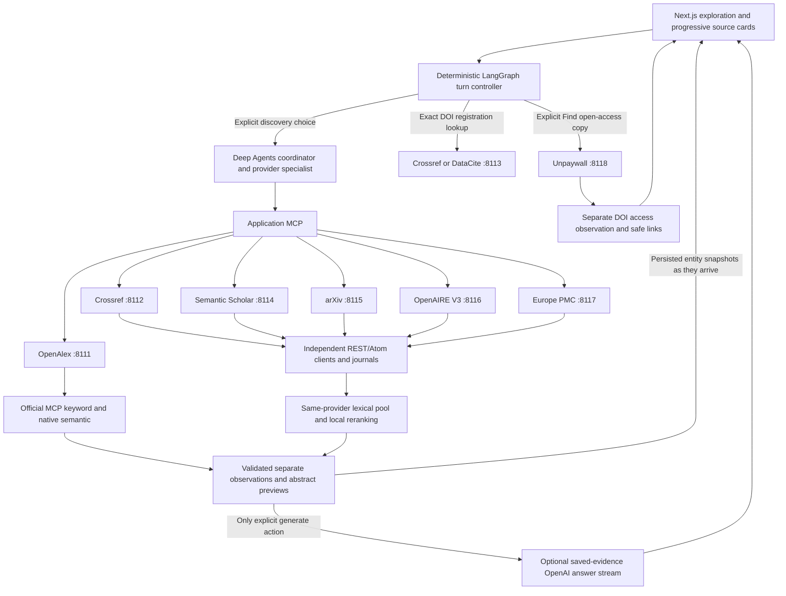

# Scholarly provider expansion and progressive abstracts

**November 9, 2026 · implemented and validated · new discovery routes and Unpaywall access live**

The user requested adding arXiv, OpenAIRE Graph and Europe PMC, fetching Crossref discovery/abstract data, and adding Unpaywall after checking its free-access limits. This supersedes the proposed-only state in the [source review](../discovery/research/free-scholarly-sources-review-2026-11-09.md) and [abstract correction](richer-sources-and-abstracts.md). The existing Python/Next.js/LangChain/LangGraph/Deep Agents stack and Dub-inspired UI remain selected.

## Service roles and access

| Provider | Local service | Adopted role |
| --- | --- | --- |
| OpenAlex | 8111 | Retained primary discovery through official OAuth MCP; native keyword/semantic branches and details. |
| Crossref | 8112 | Existing agency/DOI metadata plus new explicit publication discovery and details, including deposited abstracts where available. |
| DataCite | 8113 | Existing registration-aware exact DOI metadata; not general discovery in this change. |
| Semantic Scholar | 8114 | Existing optional discovery/details with same-provider local reranking; earlier anonymous search 429 remains dated proof. |
| arXiv | 8115 | New independent official Atom API provider: preprints, available abstracts, exact versioned identifiers and publication relationships. |
| OpenAIRE Graph | 8116 | New independent official Graph API V3 research-product discovery and details, including available descriptions. Graph traversal/funding analysis is outside this slice. A generic description is not automatically an abstract. |
| Europe PMC | 8117 | New independent official REST provider using `resultType=core`: biomedical/life-science metadata, available abstracts and identifiers. |
| Unpaywall | 8118 | New independent exact DOI open-access lookup; access locations/license/version observations, separate from scientific sources. No topic discovery, abstract inference or PDF acquisition. |

No payment, new account signup, bulk corpus download, model API call or production deployment is required by this change. A real contact email is required before live Unpaywall requests; optional OpenAIRE authentication improves its quota. These access facts do not establish that every provider/record has an abstract.

### Unpaywall's limit is not unlimited

The [current Unpaywall API policy](https://unpaywall.org/api) publishes **100,000 calls per day**, with a contact email on requests. It exposes `/v2/{doi}`; its search endpoint retired on September 18, 2026 and returns 410. The DOI interface has this published policy rather than OpenAlex search's dollar-denominated daily budget. Unpaywall and OpenAlex share their underlying database, but their API surfaces and operations differ. This is not an unlimited replacement for OpenAlex search. [Product relationship](https://help.openalex.org/access/unpaywall/).

OpenAlex currently offers $1/day free account usage, with operation-specific prices and rate limits. Single-entity metadata lookup is documented as free. Preserve its existing working MCP route rather than paying to retrieve abstracts already available in saved or singleton metadata. [Example costs](https://help.openalex.org/access/example-costs/), [authentication/rates](https://help.openalex.org/api/authentication/).

Current arXiv policy requires one connection and at most one request per three seconds across controlled machines. OpenAIRE publishes 60 anonymous or 7,200 authenticated requests/hour; the new client uses current V3 paths. Europe PMC's `core` metadata supplies available abstract text; no universal numeric rate ceiling was established in this review. Each service has its own conservative pacing, durable grant/cache/attempt records and explicit failures. [arXiv policy](https://info.arxiv.org/help/api/tou.html), [OpenAIRE terms](https://graph.openaire.eu/docs/apis/terms/), [Europe PMC API](https://dev.europepmc.org/RestfulWebService).

## Routing, ranking and progressive delivery

The default discovery provider remains OpenAlex. The user can explicitly select complementary providers; one turn admits at most two separate child runs under the existing single-active-run local controller. Provider failures do not trigger substitution, expand the grant, merge metadata fields or erase successful source observations.

For arXiv, OpenAIRE, Europe PMC and Crossref, lexical API retrieval supplies a bounded pool of at most twenty same-provider candidates. The semantic branch uses the configured local CPU encoder to rerank that pool; this is not a claim of provider-native vector search or discovery outside the candidate pool. Structured year/type filters and provider-scoped IDs/ranks survive validation and fusion. OpenAlex retains its native semantic route.

Source/abstract publication is **record progressive**: as soon as a provider page has been normalized and saved, its records and available abstract previews are published through the existing persisted snapshot/SSE path. Other branches, child runs and the final agent response can still be pending. These upstream APIs return pages, not model-style token streams; do not add an artificial typing animation to abstracts. Complete saved abstracts can be read while other work continues; extra detail requests remain subject to the originating run and allowance.

OpenAIRE descriptions, registry metadata, preprint status and missing content retain distinct labels. A linked paper observed in several services is not independent scientific corroboration. Full source observations and exact versions stay in saved run state; chat previews and optional answer inputs remain bounded. OpenAI is not invoked by these retrieval or access actions.

## Execution and acceptance

1. Extend provider/contracts/capability literals, source types and per-service configuration while retaining existing saved data compatibility and independent credential projection.
2. Add official REST/Atom adapters and fixtures, actual bounded local reranking, exact query/filter provenance, abstract normalization, rate/cooldown controls and durable replay-safe operations. Preserve the original OpenAlex MCP path.
3. Expose explicit discovery choices and DOI access action through the existing controller/application MCP/UI. Distinguish actual resource activity, abstracts, descriptions, partial results and OA access locations. Complete saved reading must not need another upstream call.
4. Run Python, lint, local encoder, context/harness, TypeScript/build and full fixture-browser tests; include early abstract visibility, safe access links, missing contact, errors, cancellation and no-replay checks.
5. Exercise bounded real searches through the actual application for the newly connected discovery providers and Crossref; prove Unpaywall only if the user supplies its required contact email. Record observed request counts, branch results, abstract coverage and remaining gates without any new OpenAI generation request.

## Implemented behavior and measured acceptance

All eight independently launched provider services now have loopback configuration and isolated credential projection. The six discovery choices are OpenAlex, Semantic Scholar, Crossref, arXiv, OpenAIRE Graph and Europe PMC. DataCite remains an exact registry route; Unpaywall is the separate **Next action → Find open-access copy** DOI action (`action=access`). OA observations include exact DOI, provider timestamp/version, reported OA status, safe HTTP(S) locations, license/version and truncation counts; they do not become scientific-source/abstract cards or download files.

The local CPU MiniLM cache is explicitly configured through nonsecret `SCOUT_LOCAL_ENCODER_*` settings. Each REST discovery provider owns its client, query/page normalization, lexical pool, local reranking, filters and journal. Known year bounds are pushed upstream where compatible and rechecked locally. Unknown resource types do not silently pass a type filter. arXiv query shaping is a versioned literal-term/stopword policy with exact executed arguments retained, not an LLM rewrite.

Fresh discovery operations may reuse normalized pools for 15 minutes, or 24 hours for arXiv's daily-updated search surface. Fresh Unpaywall access operations may reuse saved observations for 24 hours. Saved operation replay remains immutable and zero-call regardless of cache expiry. Provider UTC quota buckets persist across restart; these are local client controls, not a guarantee about consumption by other apps/accounts. No automatic retries or provider fallback were added.

The [actual live UI receipt](../docs/validation/2026-11-09-source-expansion-live-ui.json) and [corrected OpenAIRE acceptance](../docs/validation/2026-11-09-openaire-corrected-live-ui.json) capture real UI → LangGraph → Deep Agents → application MCP → independent live provider searches. Each used explicit 2024–2026 year bounds and one page of at most twenty candidates.

| Live application search | Final result | Available content | Progressive proof |
| --- | --- | --- | --- |
| arXiv: retrieval augmented generation | Succeeded; 20 records | 20 abstracts | First saved source snapshot at 1,305 ms; abstracts arrived before terminal status. |
| Europe PMC: retrieval augmented generation medicine | Succeeded; 20 records | 20 abstracts | First source snapshot at 1,156 ms; abstracts arrived before terminal status. |
| Crossref: retrieval augmented generation | Succeeded; 20 records | 3 deposited abstracts; missingness retained for the rest | First source snapshot at 1,042 ms; abstracts arrived before terminal status. |
| OpenAIRE V3: retrieval augmented generation | Succeeded; 20 records after correction | 2 descriptions; no author abstracts claimed | First source snapshot at 1,995 ms; records arrived before terminal status. |

OpenAIRE's first run was partial because the live V3 response used explicit `null` values for optional list fields. The adapter now treats absent/null repeated metadata as missing fields while retaining valid ID/title/year records. Six regressions and offline validation of the previously captured public records passed. The initial receipt remains preserved; the corrected run supplies its latest proof. No text was invented to fill the missing abstracts/descriptions.

Each of the four successful searches made one upstream research request and zero model HTTP requests. The initial partial OpenAIRE run adds one earlier research request: **five external research operations total** for this live acceptance, excluding local service/MCP control traffic and documentation browsing. Saved full-abstract reading and reload made zero additional research calls. [arXiv full abstract screenshot](../docs/validation/2026-11-09-arxiv-live-abstract.png).

Unpaywall's positive access flow passed through all actual fixture processes, and its live-profile missing-contact gate is [verified in UI and backend](../docs/validation/2026-11-09-unpaywall-live-gate.json), including zero upstream/model attempts and no fallback. At this initial checkpoint, live Unpaywall lookup was not yet proved because the real contact email had not been supplied; the subsequent activation below supersedes that configuration gate. Its API does not return abstracts and is not an unlimited search alternative. No synthetic address, account signup or external message was used.

Regression validation: [185 Python tests](../docs/validation/2026-11-09-source-expansion-python-final.xml), [27 distinct browser journeys](../docs/validation/2026-11-09-source-expansion-browser.json), and [11 structural harness evals](../docs/validation/2026-11-09-source-expansion-harness.json) passed. Ruff, TypeScript and production build passed. The browser record preserves the full-suite result plus the one targeted rerun after updating its old four-provider health assertion to eight; actual added-service/MCP/abstract/access fixture paths are included. The [closing source/runtime/security record](../docs/validation/2026-11-09-source-expansion-final.json) binds the final files/profile.

The app is left running at **http://127.0.0.1:3100/**. Earlier OpenAlex OAuth/native live proof, DataCite live lookup, Semantic Scholar details success/search 429 and the optional writer's one prior live demonstration remain dated evidence. These connections were not re-queried merely to refresh badges. No new OpenAI request was made during this expansion. Broader relevance, corpus recall, provider overlap and scientific claim support remain separate evaluation work; none follows from these operational acceptance examples.

## Subsequent Unpaywall live activation

The user supplied the required contact email. It was saved only in the ignored local `.env` with mode 0600 and is projected only to the Unpaywall process. It is absent from browser/core/sibling-provider environments, public receipts and local service logs. No account signup or external email message was sent.

The [actual live UI receipt](../docs/validation/2026-11-09-unpaywall-live-ui.json) records one explicit **Find open-access copy** request for DOI `10.1038/nature12373`: **SUCCEEDED**, reported OA status **bronze**, and **five provider-supplied access locations**. Versions and licenses are shown as supplied, including missing license values. The lookup creates an access observation, not an abstract or scientific evidence, and no linked file was downloaded. No other provider or hosted model was called.

Saved reload preserved the exact turn/access observation with zero additional requests. The actual UI passed at 1440, 390 and 320 px without horizontal overflow or browser errors. [Desktop](../docs/validation/2026-11-09-unpaywall-live-desktop.png), [mobile](../docs/validation/2026-11-09-unpaywall-live-mobile.png), [activation/runtime/security record](../docs/validation/2026-11-09-unpaywall-activation-final.json).

This environment-only activation uses the previously validated implementation; it did not require another full code test/build run. The prior 185 Python/27 browser/11 harness results remain their original code-check evidence. The earlier missing-contact receipt and initial closing fingerprint file retain their historical states. New external work in this activation was exactly **one Unpaywall request and zero OpenAI requests**.
