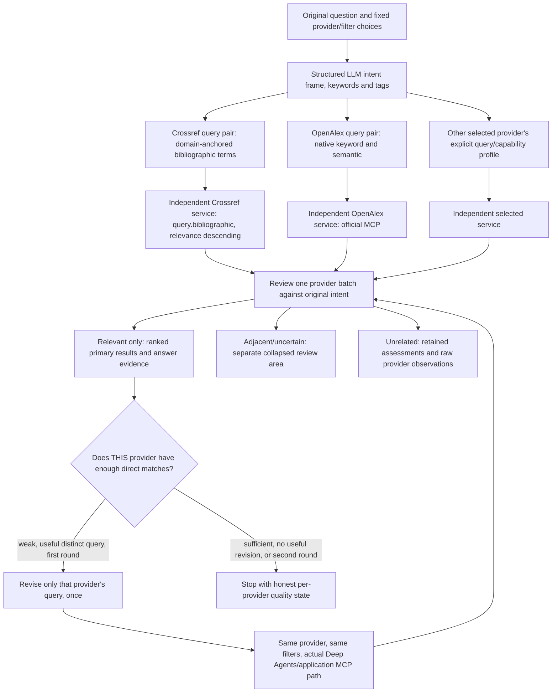

# Provider-specific search, intent preservation and visible query trace

**November 9, 2026 · implemented follow-up to the user's Crossref relevance report.** This checkpoint supersedes the shared-query, pooled stopping rule and mixed primary-result behavior of [agentic retrieval v1](agentic-retrieval-2026-11-09.md). Existing receipts and saved provider observations remain historical evidence.

## Why the first correction was insufficient

The user's original question is “What's the impact of how we improve the context model needs to have for better generation?” Its intended topic is improving context supplied to ML/LLM generation. The v1 agentic trial improved OpenAlex, but its Crossref child (`33efca0b2a9e47b6b94e77ac9ef30da5`) still used the shared `context modeling generation quality` query. Crossref's broad `query` search returned air-quality modeling, IoT context, front matter and other weak candidates. Local MiniLM reranking could only reorder that same page.

Three application issues made the remaining noise visible:

1. One shared query pair ignored provider retrieval differences. The planner could also misread “context a model needs” as a “context model” architecture.
2. The refinement stopping rule counted relevant observations across selected providers. Enough OpenAlex results could prevent a weak Crossref result set from receiving its own second query.
3. Primary results included `partial` and `unknown` judgments. Crossref's v1 batch displayed two directly relevant, four adjacent and two untitled uncertain records together. The legacy Search workspace also bypassed AI refinement entirely.

## Implemented correction

The planner must return exactly one bounded query entry for every selected provider, with no omissions, duplicates or extra providers. Each entry records lexical input, semantic input and a brief provider-specific rationale. Provider capability guidance distinguishes native OpenAlex semantic recall from local reranking of REST/Atom lexical pools. Domain anchors and method terms are requested explicitly; no adapter hardcodes an ML query or excludes medicine as a whole.

Intent remains shared across provider plans. The user's question, provider selection and structured filters are immutable. Provider-specific input queries and each revision are separately saved in query history with provider and round. Native/provider syntax transformations remain in provider provenance; the application does not claim a local reranking query is an independently executed semantic endpoint.

Crossref now uses `query.bibliographic` with `sort=relevance&order=desc`, one first page of at most 20 records, and the existing year filters. It does not use deprecated `query.title`, add automatic paging or silently switch providers. The current official [Swagger specification](https://api.crossref.org/swagger-docs), version 4.9.0 when checked, documents these parameters. [Crossref API guidance](https://www.crossref.org/documentation/retrieve-metadata/rest-api/tips-for-using-the-crossref-rest-api/) describes query/filter use and caching. Bibliographic scoping improves which metadata can match; it does not certify topical relevance.

The versioned `scout-crossref-bibliographic-v2` query policy is included in provenance and Crossref's candidate-pool cache key. Old broad-query cached pools cannot masquerade as new scoped results. Existing immutable operation replay remains zero-call and unchanged. Other providers retain their existing cache identities.

## Independent quality and publication

Each provider is assessed independently. A provider with fewer than five distinct admitted source references can receive one useful, distinct, review-proposed query revision. Another provider's successful results cannot suppress that opportunity. Only weak providers with an approved revision execute round two; sufficient providers are not queried again. The minimum of five remains an explicit heuristic policy, not a tuned or calibrated relevance threshold.

The existing maximum is unchanged: two selected providers, two rounds, at most four provider child runs and five model calls (one planner plus four possible batch reviews). Round-two ledger step identities retain the provider's original selection index even when only the second provider is retried. Research grants, the 24-attempt turn limit, shared $0.05 model reservation/$0.25 workspace ceiling, cancellation fencing, no hidden retries and no replay after restart remain in force.

Only `relevant` judgments enter primary `turn.sources`. `partial` and `unknown` observations enter `turn.related_sources`, with their exact source/run/version/round and review reasons. They remain available for explicit inspection but are not automatically supplied to the answer writer. `irrelevant` observations remain in assessment/raw-run history. A record with no title, abstract or description cannot become primary even if the model labels it relevant; the application marks its assessment uncertain.

### Exact-query follow-up and independent review: policy v3

The user rechecked the exact question and requested a separate investigator. The [independent subagent review](../docs/validation/2026-11-09-specific-query-review.json) inspected seven saved cases and proposed ten authored regression cases without any provider/model call. It identified title-only generic speech/context modeling and model-architecture work incorrectly promoted as direct matches, plus an explicitly context-selection/SLM application demoted for its manufacturing setting. These are agent-authored inspection judgments, not independently human-labeled ground truth.

The planner now returns a visible `intent_frame`: object of change, intervention (nullable for non-intervention questions), desired outcome and scope boundary. For this question the intended relationship is **improving context/evidence supplied to an existing generative model → improving its generated responses**. Changing model architecture, positional embeddings or generic context representations is adjacent unless it directly addresses that relationship. This is intent preservation; it does not turn every research query into an LLM question. Provider plans, facets and local ranking remain grounded in the user's specific object/intervention/outcome.

The reviewer receives that frame and must judge evidence for the requested mechanism and outcome. An application in medicine, manufacturing or software can be directly useful when its context intervention matches. Review instructions explicitly prohibit inflating grades to fill a quota; the count of five belongs only to application search-stopping logic, and is no longer supplied as a desired result quota to the judge.

Each proposed direct match includes a short exact supporting quotation from the supplied title/abstract/description excerpt. The application checks that quotation against the actual review input; an absent or invented quotation downgrades the record to uncertain. A title-only record missing required intent-facet evidence is kept as adjacent instead of being promoted through an inference about missing content. Exact text support establishes provenance, not causal truth or scientific entailment. Relevance labels and uncertainty remain inspectable.

### User-visible LLM and source request trace

The user also requested the final question sent to the LLM, the queries used at each source, and extracted keywords/tags. The refinement panel now exposes:

- Original question and interpreted intent frame.
- LLM-extracted keywords (`query_terms`) and topic tags. The planner uses these to formulate provider-specific queries; tags are not invented API filter parameters.
- Per-provider query plans and round history, including reasons for revisions.
- Actual LLM JSON request bodies: model, instructions, input text/context and requested output schema/limits. No authentication headers or credentials are included. Prepared requests and received responses have distinct audit states; the interface does not claim every prepared request necessarily reached the network.
- Provider request observations from the saved operation receipts: selected provider, run/round/branch, official MCP tool or REST/Atom arguments, query policy, status and cache reuse. Parameters use an explicit allowlist excluding credentials/contact configuration.
- Local semantic reranking labeled `local_encoder`, with its query input and bounded lexical-pool scope. It is not displayed as a native remote semantic query. OpenAlex's actual keyword/semantic MCP arguments remain separately visible.

The LLM request body is saved before dispatch and retained with the conversation, so reload/replay displays the same trace without another paid call. Schema/receipt data contributes to the existing 64-event/4 MiB replay window. Complete model output blocks remain private audit state; public relevance annotations include brief decisions and exact supporting text, never hidden reasoning.

Existing reviewed primary observation versions remain pinned. A later useful query can promote a previously adjacent record into primary results using its newly reviewed observation; historical assessments remain unchanged. An earlier admitted primary record is not silently replaced. Within-provider ranking and provider separation are preserved.

Legacy v1 mixed source arrays are grouped on read in the frontend. The saved-source and generation backend paths also filter older explicit non-relevant judgments, preventing a saved follow-up from promoting weak records into answer evidence. No historical provider observation or user shortlist is rewritten.

## User journey

Exploration displays the query and query history for each provider, which provider is currently executing, and that provider's direct-match count/quality status. Adjacent and uncertain records are collapsed separately. Empty or weak provider outcomes stay visible alongside successful providers.

The Search workspace now offers the same live-ready AI refinement control. An AI-enabled submission preserves its selected provider and year scope, creates/submits the existing bounded conversation workflow and opens reviewed results in Exploration chat. The control describes this handoff. Explicit opt-out and fixture defaults retain direct search. The handoff uses one stable request identity and does not automatically retry uncertain paid submissions.

Inspection from a chat card is scoped to that exact source and reader, with a saved URL pin. It provides a return to the reviewed conversation and an explicit action to view all raw provider candidates. Manual history/raw-run navigation remains available, while a missing pinned source never silently falls back to every raw candidate. Existing source details, notes, decisions and exports retain their originating run ownership.

## Validation evidence

Focused graph regression proves that five relevant OpenAlex records do not mask weak Crossref: the executed provider sequence is OpenAlex, Crossref, Crossref; the model steps are planner, OpenAlex review 1, Crossref review 1 and Crossref review 2. Separate cases cover provider-plan scope validation, primary/related grouping, legacy answer-evidence filtering and the existing finite-loop/cancellation/replay guarantees.

Provider contract tests verify exact bibliographic parameters, filters, missing abstracts, bounded first-page behavior, policy cache invalidation and zero-call historical replay. A five-record public REST probe returned RAG/LLM titles with one available abstract and several missing abstracts/front-matter records. That probe establishes endpoint compatibility and remaining review needs, not independent search-quality accuracy.

The closing [validation receipt](../docs/validation/2026-11-09-query-focus-trace-final.json) records final code fingerprints, privacy checks and validation scope.

## Live acceptance of the unchanged question

[Open the new Crossref trial](http://127.0.0.1:3100/?conversation=18525853da69447bbbabea29868a1443). The [live receipt](../docs/validation/2026-11-09-query-focus-trace-live-ui.json) records the Search workspace handoff, original question, LLM intent/keywords/tags, every executed provider argument set, assessments, timings and saved replay. No manual query rewrite or answer generation was used.

The LLM correctly identified the object as context supplied to a generative model, explicitly distinguishing model architecture. It extracted keywords `large language models`, `input context`, `text generation` and `generation quality`, with tags including context engineering/context quality. Crossref round one used `query.bibliographic=large language models input context text generation`. After reviewing weak coverage, the agent executed one revision: `LLM retrieval augmented generation context selection prompt engineering generation quality evaluation`. Both requests used relevance descending, 20 records and the same unchanged scope.

The two pages produced 40 candidate observations. Five model-reviewed primary matches have abstracts and exact supporting quotations; 32 adjacent/uncertain records remain separate and three observations were withheld as unrelated. Primary matches include *DemoCraft: Using In-Context Learning to Improve Code Generation in Large Language Models*, *PromptCraft-RAG: Context-based Prompt Enhancement of Refining Query for Retrieval Augmented Generation*, and studies of self-reflective RAG, prompt interventions and an applied RAG/prompting experiment in quantum-chemistry input generation. Applied subject matter alone is not a reason to discard a study of the intended context intervention.

The run used **two Crossref upstream requests and three model requests**, with no OpenAlex/other-provider fallback and no answer generation. Conservative model-cost estimate: $0.00206225, not invoice cost. First reviewed sources appeared at 22.402 seconds before final completion at 40.420 seconds. This is one reused diagnostic question, not an independent precision/recall benchmark.

Actual UI checks passed for keyword/tag visibility, saved original question in all LLM request bodies, bibliographic query arguments, local-encoder semantic labeling, primary/related separation, zero-call reload, exact source inspection/reload, and desktop/390/320 px layouts without browser errors or overflow. [Intent and terms](../docs/validation/2026-11-09-query-focus-trace-desktop.png), [ranked abstracts and review reasons](../docs/validation/2026-11-09-query-focus-trace-results.png), [executed source requests](../docs/validation/2026-11-09-query-focus-source-requests.png) preserve the visible state.

Validation: [234 Python tests](../docs/validation/2026-11-09-query-focus-trace-python.xml), [39 browser journeys](../docs/validation/2026-11-09-query-focus-trace-browser.json), [11 structural harness cases](../docs/validation/2026-11-09-query-focus-trace-harness.json), Ruff, TypeScript and production build passed. A subsequent ranking-diagnostic merge correction carries only review labels/reasons forward while recomputing cohort scores; all 19 focused retrieval cases passed afterward, including fresh-score parity across rounds. It changes diagnostic score freshness, not the admitted source identities or executed-query trace of the saved live trial. Six launcher checks also passed after clarifying startup status.

Broader independently judged relevance benchmarking remains open. Model labels and supporting text establish inspectable relevance/provenance, not scientific truth, quantified improvement or causal entailment. Historical searches retain their original observations and interpretations; the linked new run is the evidence for this correction.
