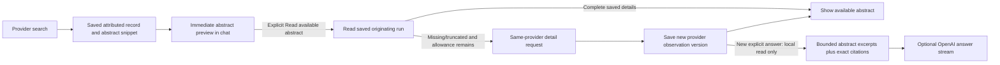

# Richer sources and visible abstracts

**November 9, 2026 · abstract UX/context fix implemented; additional provider integrations proposed**

**Subsequent approved implementation:** the [provider expansion](provider-expansion-2026-11-09.md) now activates arXiv, OpenAIRE, Europe PMC and Crossref discovery, plus Unpaywall's contact-gated access route. Its live proof supersedes the proposed-only adapter state below. The original abstract correction and its earlier receipts remain dated evidence.

The user's requests are to retrieve/show abstracts and revisit the substantial source research for richer no-payment data options. The [source review](../discovery/research/free-scholarly-sources-review-2026-11-09.md) records current evidence and recommended priorities. OpenAI remains an optional answer writer; direct scholarly discovery and abstract retrieval need no OpenAI calls.

## Implemented abstract path

The saved live OpenAlex example contained fourteen records: twelve search-list abstracts/snippets and two missing abstracts. The official MCP truncates abstract text in lists. Scout's conversation previews then capped those at 400 characters and the chat cards did not display them; the legacy inspector already displayed available provider abstracts. The UI omission and model-input shortening were separate problems.

- Chat source cards now show an **Abstract** section as soon as a record arrives, including a readable snippet, provider attribution and an explicit unavailable/excerpt state.
- **Read available abstract** first reads the saved run snapshot. A complete saved abstract requires no upstream request. Missing/truncated originating-provider details use the existing explicit details route and finite run allowance. A completed detail lookup is reused, including a confirmed missing abstract; failed lookups retain the visible snippet and offer an explicit retry.
- The expanded card reports saved reads versus new detail requests. These are review operations recorded in the originating run, not a new discovery/generation turn. Existing per-turn activity continues to describe that original turn.
- Full available abstract text stays in the saved provider observation; the chat can read it on demand without duplicating full records into every conversation snapshot. No field is generated or silently borrowed from another provider. Registry cards show their saved abstract/excerpt where supplied; they do not pretend to offer a discovery-provider detail lookup.
- Abstract truncation has its own flag, separate from shortened author lists/title previews. Source details can still be absent or provider-truncated after a successful request; missing text is not filled in.
- A new explicit answer resolves the latest eligible originating-provider record **locally**, preserving exact admitted source versions. It can use up to 1,200 abstract characters per admitted source within the existing six-source/12,000-byte envelope; longer abstracts are labeled excerpts. This replaces the accidental 400-character input limit, not the intentional overall context bound. Older source/answer/citation snapshots are unchanged. No upstream retrieval or automatic regeneration occurs during this local read.
- Existing allowances are unchanged: eight selected discovery-provider attempts per run and sixteen overall. Search consumed two in the live example; explicit details consume remaining allowance and exhaustion is visible. No new free allowance is minted by reopening/retrying. Broader batch hydration/allowance changes are separate future work.

## Provider direction

Retain OpenAlex as primary broad/native-semantic MCP discovery. Recommended additions are **arXiv first for current AI/preprint questions**, **OpenAIRE V3 as the broad graph alternative after coverage/auth validation**, and **Europe PMC for biomedical scope**. Expand Crossref metadata discovery and evaluate DOAJ next; DataCite/Zenodo belong to artifact discovery. Unpaywall supplies OA locations over the same OpenAlex database, not a new abstract corpus. CORE's applicable product-access conditions need verification before treating it as a free dependency.

These new providers are **not implemented** in the current service/router enums or UI. Direct endpoint probes are separately labeled in the research review. No automatic provider fanout, fallback on quota failure, field blending, new database or model choice is adopted by this document. Maintain independent service boundaries and explicit source/provider choices as capabilities are added.

## Measured evidence

[Three explicit OpenAlex MCP detail requests](../docs/validation/2026-11-09-abstract-provider-details.json) returned HTTP 200. One 494-character snippet became a 1,423-character complete available abstract; two missing abstracts remained missing. These consumed three research attempts and zero OpenAI calls. This confirms a real provider content gap as well as the display issue.

[Candidate API probes](../docs/validation/2026-11-09-free-source-probes.json) returned abstracts from arXiv and Europe PMC and metadata from OpenAIRE V3, each with one unauthenticated request. These are not deployed Scout connections.

Validation: [146 Python tests](../docs/validation/2026-11-09-abstracts-python.xml), [20 browser journeys](../docs/validation/2026-11-09-abstracts-browser.json) and [11/11 structural harness evals](../docs/validation/2026-11-09-abstracts-context-harness-evals.json) passed. Ruff, TypeScript and production build passed; 25 focused conversation/generation cases passed after the final local-read cache refinement. Browser tests include immediate snippets, complete saved reading, detail caching/reload, provider missingness, allowance failure and retained excerpts. Generation tests prove richer local context, unchanged earlier snapshots, exact updated citations, ineligible-detail rejection and zero retrieval while preparing a new answer.

The [actual live UI receipt](../docs/validation/2026-11-09-abstracts-live-ui.json), [desktop screenshot](../docs/validation/2026-11-09-abstracts-desktop.png), [mobile screenshot](../docs/validation/2026-11-09-abstracts-mobile.png) and [closing source/security receipt](../docs/validation/2026-11-09-abstracts-final.json) record the restored profile. New external research operations in this task were three OpenAlex MCP detail calls and one direct probe each for arXiv, Europe PMC and OpenAIRE (MCP session/control and any OAuth traffic are not included in these operation counts); **no new OpenAI call**. Saved UI review does not repeat those requests. The pre-change [streaming review](streaming-generation-2026-11-09.md) and its fingerprints remain historical evidence; they are not rewritten to claim these newer source/context/UI changes.
