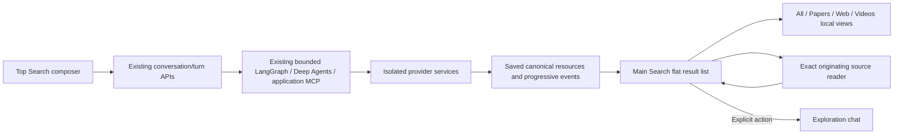

# Main Search workspace and readability

**November 11, 2026 · current user direction.** Restart the local app to reload keys. Keep top Search results in the main workspace, grouped under Papers, Web and Videos, and improve text size and contrast within the restored Dub layout. Exploration chat remains an explicit user choice. The rejected Material blue/preview-v2 redesign remains superseded.

**Later November 11 key update:** the user supplied the YouTube API key. The owned app was restarted and a [live video-only acceptance check passed](youtube-live-2026-11-11.md): 10 records, one YouTube request, zero model calls and no new requests on saved reload. This supersedes the earlier missing-key findings below; the shared AI allowance gate and deferred web search remain unchanged.

## Why Search used to switch to chat

The retrieval execution was already shared: automatic or AI-reviewed submissions create a saved conversation/turn, execute the existing bounded graph and publish progressive state. The frontend then called `openReviewedConversation()`, which changed the visible mode and URL to Exploration chat. That UI transition was independent of the retrieval requirements.

The new main Search view uses those same saved results and event streams directly. It changes the result presentation and navigation, not the provider graph or its quality/budget policies.

`?search=<conversation-id>` restores main Search; `?conversation=<conversation-id>` retains the explicit Exploration view. An exact source reader carries `from_search` attribution and a return-to-results action. Saved reads, history selection and category changes do not submit another research turn or model request. Only one visible view owns its conversation event stream.

## Results and categories

Canonical DOI grouping, whole provider observations, available abstracts/descriptions, automatic Unpaywall, source versions and relevance decisions remain intact. Flat result cards show their kind/provider/year, title, available authors/channel, content, provenance and inspection/original-link actions. Related/uncertain records remain separate from primary results and answer evidence.

The category tabs filter records already retrieved; their helper text explicitly states that changing tabs does not search again. Video questions can route to YouTube through the existing automatic planner/direct route. The video empty state distinguishes a missing connection, a source not queried and a source returning no results. No transcript or video-content acquisition is implied.

No general-web provider is currently registered. Web therefore exposes an explicit setup state and does not claim to have searched the web. Earlier user direction deferred that integration; the user confirmed on November 11 that web search is not needed now. No web provider is silently substituted.

## Readability

Retain the 218-pixel sidebar, split source reader and existing accent. Increase source/body text, metadata/help labels and controls; strengthen slate text, borders, focus and selected-state contrast. Make the main result category controls and source titles easier to scan. Preserve responsive wrapping and keyboard navigation. The new tablist supports arrow keys and Home/End as well as pointer selection.

## Restart and readiness findings

The owned local launcher was restarted from the project `.env`. No inherited shell key variables shadowed it. There were no active conversations at restart.

A single authenticated read-only OpenAI model-metadata request returned HTTP 200 for the configured `gpt-6-luna`. This establishes metadata access with the loaded credential; no Responses generation or research query was submitted. [Probe receipt](../docs/validation/2026-11-11-openai-key-metadata.json), [official endpoint](https://developers.openai.com/api/reference/resources/models/methods/retrieve).

`SCOUT_YOUTUBE_API_KEY` is still empty in the project `.env`; no alternate root/frontend environment file or YouTube variable was found. The app reports YouTube as needing API-key access. The user asked how to obtain the key; official Google Cloud / YouTube Data API v3 setup steps and the exact `.env` variable were provided. A key remains pending.

To configure public-video discovery:

1. Select or create a Google Cloud project and enable [YouTube Data API v3](https://console.cloud.google.com/apis/library/youtube.googleapis.com).
2. Open **APIs & Services → Credentials → Create credentials → API key**.
3. Restrict the key to **YouTube Data API v3**. This adapter calls Google from the Python backend; browser-referrer restrictions are unsuitable for these server requests. If applying an IP restriction, use the backend's actual public outbound IP.
4. Set `SCOUT_YOUTUBE_API_KEY=your_key` in the ignored root `.env`, then restart the owned launcher. Do not put the key in a `NEXT_PUBLIC_` variable or commit it.

Public search and video metadata use an API key; user-private account operations require OAuth and are outside this adapter. [Google authentication guide](https://developers.google.com/youtube/v3/guides/authentication). A supplied key still needs a bounded live acceptance check; fixture success does not establish that access.

AI refinement is separately blocked by the existing local shared demo allowance. The ledger contains nine completed entries with $0.016502125 in recorded cost estimates and four dispatched requests with unresolved usage, each retaining $0.05. Total counted cost/holds is $0.216502125 under a $0.25 ceiling; the next full turn reserves $0.05. No unresolved entry is provably undispatched. Restart and key replacement preserve this ledger. This work does not release holds, erase historical usage or raise the approved limit. Direct model-free searches and saved results remain available; the UI retains the explicit blocked reason.

## Validation

TypeScript and the production Next.js build passed. All **48 unique browser cases passed** across the initial full run and focused follow-ups, with no final skipped cases. Four initial failures came from tests expecting exposed advanced controls or the old chat wrapper; one follow-up adjusted status-label casing. Only those tests changed between runs. [Run history and per-case results](../docs/validation/2026-11-11-search-workspace-browser.json).

Actual isolated fixture services returned **16 provider observations → 12 canonical resources**, including **eight papers and four YouTube videos**, using the real application MCP/Deep Agents path. Progressive updates, DOI grouping, Unpaywall access and saved replay passed browser acceptance. The subsequent read-only inspection confirmed local category filters, video descriptions, exact-source inspection/return, explicit chat/return and unchanged saved usage. [Fixture inspection](../docs/validation/2026-11-11-search-workspace-fixture-ui.json).

After restoring the live launcher, the existing live result set opened **26 papers** from OpenAlex, arXiv and Crossref in main Search. Source inspection, category changes, explicit chat navigation and reload submitted **zero POST requests** and preserved saved usage. Browser errors and horizontal overflow were zero at **1440, 1024, 768, 390 and 320 pixels**. Body type is 15 px; result titles are 17 px on desktop and 16 px on mobile. [Live saved-result inspection](../docs/validation/2026-11-11-search-workspace-live-ui.json), [desktop](../docs/validation/2026-11-11-search-workspace-live-dashboard.png), [paper cards](../docs/validation/2026-11-11-search-workspace-live-cards-1440.png), [mobile](../docs/validation/2026-11-11-search-workspace-live-390.png).

Selected CSS contrast pairs measured 14.86:1 for body text on white, 7.81:1 for secondary text, 6.32:1 for muted text and 5.95:1 for the existing accent. These are selected palette checks, not a comprehensive accessibility audit.

The 14 backend/launcher source hashes match the November 10 checkpoint that passed 276 backend tests; those tests were not rerun for this UI-only change. An exact-value privacy scan covered 943 source, documentation, build and log files with zero configured secret/contact/OAuth matches. [Scope and limitations](../docs/validation/2026-11-11-search-workspace-privacy.json).

The live app is left running at **http://127.0.0.1:3100/** with all nine provider processes. Local readiness reports YouTube's missing key and the shared model-budget block; other services report configured access, which is not a new live search probe. [Readiness](../docs/validation/2026-11-11-search-workspace-readiness.json), [final receipt](../docs/validation/2026-11-11-search-workspace-final.json). Fixture records prove integration behavior; this work makes no new live search-quality or YouTube-access claim.
