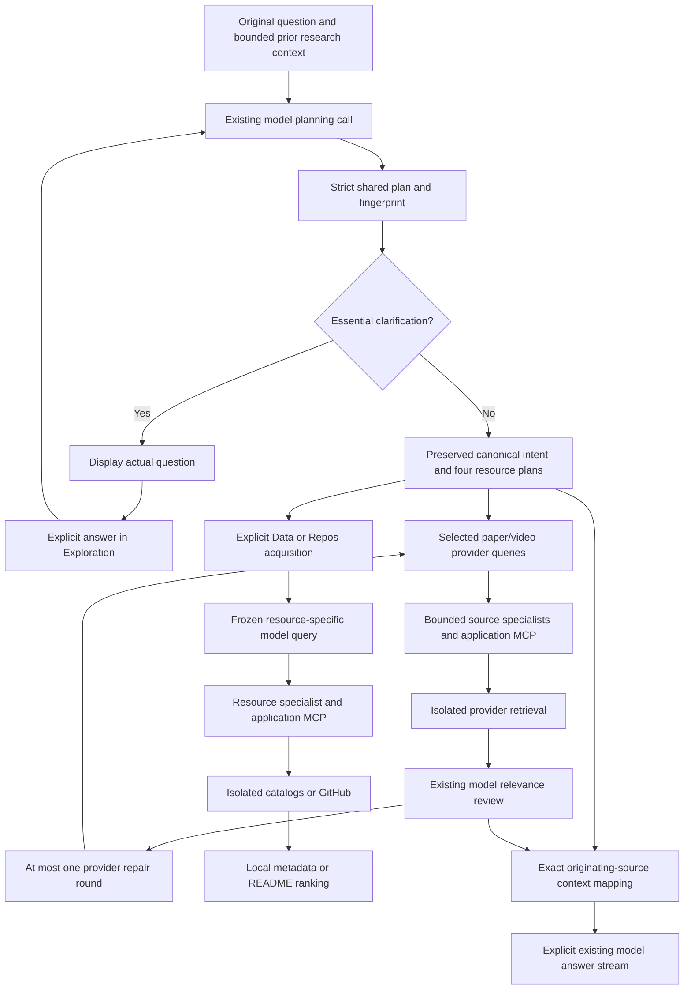

# Shared agentic query refinement across resources

November 14, 2026. The user requested that queries be refined by a model before resource retrieval, with extracted keywords and missing-context augmentation, using multiple subagents. Analysis audited the existing paths; Execution implemented the backend and regressions; the parent integrated the UI and complete validation. [Audit and findings](../discovery/research/ai-refinement-integration-audit-2026-11-14.md).

## Implemented change

Interactive topic Search and Exploration already required model planning and provider-specific relevance review. The audit found that progress updates replaced the shared query with the first/current literature provider’s query. Data and Repos then inherited that provider expression. Follow-ups lacked the prior structured interpretation/clarification question, generation lacked a source-bound shared intent, and main Search did not display its actual clarification question.

Policy **`scout-agentic-retrieval-v7`** fixes those gaps. The existing initial planning model call now produces a canonical research query plus separate Papers, Videos, Data and Repos plans. It identifies interpreted intent, domain, keywords, tags, assumptions and missing information before dispatch. Provider execution and repair retain separate current/provider/history fields rather than mutating canonical intent. This extends the existing LangChain Runnable/LangGraph/DeepAgents architecture; it does not change the stack, model, dependency versions, token ceiling, paid allowance or number of planning stages.

AI refinement remains required for new interactive topic searches. There is no optional raw-topic fallback. Exact DOI/access lookups, saved reads and explicitly preserved diagnostic contracts retain their existing roles; a record identifier must not be rewritten as a topic. Opening a tab, trace or saved search does not call a model or provider.

## One shared model plan

| Saved field | Meaning |
| --- | --- |
| `lexical_query`, `semantic_query` | Canonical research intent, preserved while providers run and repair. |
| `intent_frame`, `keywords`/`query_terms`, `tags`, `assumptions` | Model interpretation and disclosed planning terms, distinct from source facts. |
| `resource_queries.{papers,videos,datasets,repos}` | Model-authored lexical query, semantic intent,1–6 query terms and brief rationale for each resource lane. |
| `context_expansion` | Interpreted question; explicit/inferred/ambiguous domain basis; inferred context; optional versus essential missing-information questions. |
| `shared_plan` | Policy, `model_step:plan` and a fingerprint over canonical interpretation/resource fields. |
| `provider_queries`, `current_provider_query`, `query_history` | Per-provider planned/repair/execution progress, kept distinct from canonical/resource intent. |

The structured schema requires all four resource plans for an actionable response. During unresolved clarification, `resource_queries` may be null. Ambiguous domain or an essential gap requires clarification before retrieval. Optional gaps stay visible without inventing constraints. The model may infer likely terminology/domain from supplied context but must disclose assumptions; unknown dates, populations, dataset fields, access permissions, identifiers and results are not filled in as facts.

The same planner request now includes a bounded description of the last two prior research interpretations/intent frames and the actual clarification question, alongside user messages and fixed source/filter grants. A terse clarification answer can therefore retain its intended scope. The source grants remain authoritative; model output does not add removed providers or unsupported API filters.

The implementation retains strict Responses structured output and local business-rule validation. Completed output alone is not evidence of relevant retrieval; refusals, incomplete output and API failures remain failures without silent direct fallback or automatic retry. [Official OpenAI Structured Outputs guidance](https://developers.openai.com/api/docs/guides/structured-outputs?api-mode=responses).

## Routing and evidence boundaries

Papers/Videos retain their existing bounded model relevance/repair loop. Data/Repos consume their own model-planned lane queries, then use their established local metadata/README ranking; this slice does not claim new model-based result review for those lanes. Semantic intent text does not imply that every provider supports native vector search. Actual adapter expressions, filters and transport remain separately recorded.

Data/Repos admissions validate the shared policy/fingerprint and freeze their own query/terms, canonical query and expansion provenance. They no longer borrow a literature provider’s query. The same resource model plan is reusable without another hosted call on Find/Refresh. Existing accepted idempotency keys resolve before new plan checks; saved historical results and exact retries remain available. New acquisitions from older plans require a new AI-refined Search; historical expressions are not relabeled as current model resource plans.

Answer generation receives the exact current user request and, when available, background from the AI turn that supplied its admitted provider/run/source/version identities. The frame is labeled **task background, not citable evidence** and stays inside the existing12KB generation envelope. Assumptions cannot become scientific claims or new citations. Separate dataset/repository snapshots are not added as answer evidence in this slice; the existing admitted paper/video evidence and citation guards remain authoritative.

## UI and clarification journey

The compact header now opens **AI plan & query trace**. The overview exposes the original/canonical question, four resource queries, colored query terms, inferred versus explicit domain and missing information. Provider execution arguments and model request bodies remain distinct saved traces. Data/Repos show their pinned resource query; an older snapshot cannot borrow the current plan and call it its saved query.

Main Search displays the actual saved clarification question above the resource tabs, with **Answer in Exploration** opening the same conversation. Opening that continuation performs saved reads only; submitting the answer explicitly starts the next model-planned turn. Resource Find actions stay disabled while clarification is essential, the plan is incomplete or no validated lane plan exists. Historical results stay readable, with guidance to open collapsed saved details or run a new AI Search.

## Validation and operational status

[The combined receipt](../docs/validation/2026-11-14-ai-refinement-final.json) separates scripted planning/generation tests, actual local resource-agent/MCP fixture checks, production-build browser coverage, saved-live inspection and protected-state checks. Scripted model fixtures verify contracts, not live interpretation/relevance accuracy. [Desktop](../docs/validation/2026-11-14-ai-refinement-fixture-1440.png) and [mobile](../docs/validation/2026-11-14-ai-refinement-fixture-320.png) previews use explicitly authored plan outputs and synthetic resources.

The current live configuration enables AI retrieval but its existing shared model allowance is spent/held, so new paid topic planning remains blocked before admission. This work does not reset the ledger, release unresolved holds, increase the allowance or make a new live model request. Saved reads remain operational. Live model-quality acceptance therefore remains unproved; it requires resolving that existing operational gate separately.
