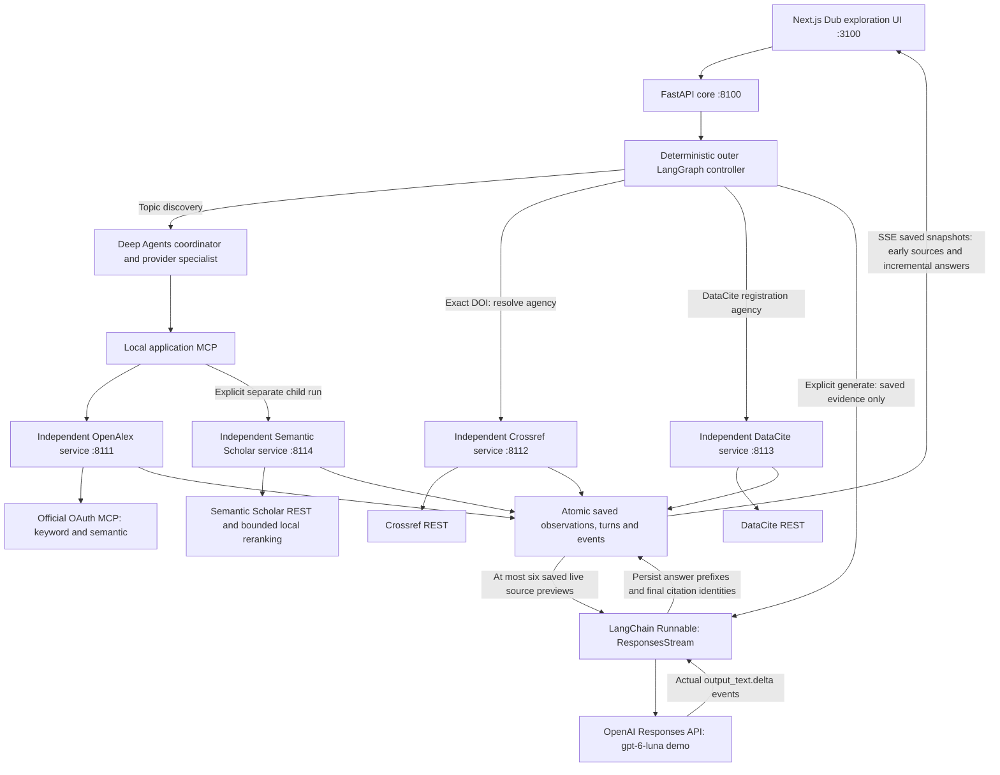

# Provider contributions and optional streaming answers

**November 9, 2026 · implemented local streaming demonstration**

The user requested an explanation of Crossref, DataCite and Semantic Scholar's actual contribution, and a demonstration of generation streaming. This explicitly reopens a bounded answer-writing slice after the earlier generation deferral. Production model selection, hosted retrieval-agent reasoning and bookmark-retention redesign remain separate decisions. The current Dub-inspired UI and Python/Next.js/LangChain/LangGraph/Deep Agents stack are retained.

## Which services actually run

**OpenAlex and OpenAI are independent services.** Before this change, Scout made no OpenAI requests for routing or answers. Default topic discovery went to OpenAlex's official MCP, using its OAuth connection and native keyword/semantic searches. An OpenAI API key does not authenticate OpenAlex.

| Service | Trigger and contribution in the current app | Measured readiness |
| --- | --- | --- |
| OpenAlex | Default discovery; separate lexical/native semantic branches with matching structured filters, followed by same-provider deduplication/RRF; source details. OpenAlex owns its semantic embeddings. | [Live OAuth, native branches, details and actual UI/MCP journey passed](openalex-connection-2026-11-09.md); fourteen saved live records in the measured discovery. |
| Semantic Scholar | Explicit complementary topic discovery in its own child run; source details. The installed local CPU MiniLM encoder reranks at most twenty same-provider lexical candidates. It does not add records outside that pool. | Live details passed. Anonymous search returned HTTP 429; keyed search remains unproved. Encoder tests do not prove live search access. |
| Crossref | Exact DOI registration-agency resolution, Crossref metadata when Crossref owns registration, and explicit selected-record checks. | Live public agency/metadata probes and actual DOI UI route passed. |
| DataCite | Exact DOI metadata when the registration-aware route selects DataCite; a distinct registry observation. | Live singleton probe and actual agency-routed DOI UI lookup passed. |
| OpenAI | New explicit **Stream answer · demo** action over saved live source previews. No search tools or provider credentials are passed to the model. | Live demonstration and validation are recorded below and in the linked machine-readable receipt. |

Crossref and DataCite currently contribute **no additional topic hits** to normal discovery. This is an implementation coverage gap: Crossref supports broader `/works` queries, filters and facets; DataCite supports `/dois?query=...`, field/Boolean queries and filters. Those routes are not exposed by Scout's current adapters. Their current contribution is identity, citation metadata and discrepancy inspection, not independent scientific corroboration. See [Crossref REST documentation](https://www.crossref.org/documentation/retrieve-metadata/rest-api/) and [DataCite queries](https://support.datacite.org/docs/api-queries). Semantic Scholar's broader API also includes capabilities outside this slice; see its [official tutorial](https://webflow.semanticscholar.org/product/api/tutorial).

The UI now displays **Resource activity** for every turn. It distinguishes actual operations/attempts and failures from **Not queried this turn**, with a separate **OpenAI · writer** row. An agency-resolution call is not a metadata result or a second literature search. Non-success registry responses now produce failed activity rather than a misleading completed label.

## Implemented routing and streaming architecture



The four scholarly integrations remain in separate service processes. The optional model client is an application answer-writer capability in the core; it does not combine their integrations into one scholarly provider backend. The existing Deep Agents retrieval graphs retain their deterministic scripted model and effective tool allowlist. The new LangChain Runnable streams Responses HTTP events inside an explicit outer LangGraph `generate` branch; there is no autonomous model tool-routing loop.

```mermaid
sequenceDiagram
    actor User
    participant UI as Exploration UI
    participant Core as LangGraph turn controller
    participant State as Atomic saved state and ledger
    participant Writer as LangChain ResponsesStream
    participant Model as OpenAI Responses API
    User->>UI: Choose Stream answer
    UI->>Core: Explicit generate turn
    Core->>State: Read most recent source-bearing turn
    Core->>State: Reserve one model attempt and allowance
    Core->>Writer: Question plus at most six source previews
    Writer->>Model: stream=true, store=false, no tools
    loop Actual text deltas arrive
        Model-->>Writer: response.output_text.delta
        Writer-->>Core: Text prefix
        Core->>State: Persist bounded answer update
        State-->>UI: SSE snapshot
        UI-->>User: Visible growing draft
    end
    Model-->>Writer: response.completed and token usage
    Core->>State: Settle estimate; validate citation identities
    State-->>UI: Completed draft and source links
    User->>UI: Reload or reconnect
    UI->>State: Saved snapshot/event replay
    Note over Core,Model: Reopening never dispatches a new model or research call
```

## Answer profile and boundaries

The temporary demo profile uses **gpt-6-luna**, the [documented Responses/streaming model](https://developers.openai.com/api/docs/models/gpt-6-luna), with `reasoning.effort=none`, `service_tier=default`, `stream=true`, `store=false`, no tools, no retry and no model fallback. The working authorized credential's model catalog was checked before generation. This does not select the eventual production model. [OpenAI's streaming guide](https://developers.openai.com/api/docs/guides/streaming-responses) describes the real text-delta/completion events used by the adapter.

- Explicit `action=generate` uses the most recent source-bearing **non-generation** turn, optionally restricted to a source/run. A previous answer's six-source crop does not shrink the underlying evidence pool for the next answer. It makes zero new scholarly requests.
- At most six live previews, a 12,000-byte instructions/evidence envelope, 800 output tokens and a 60-second overall deadline. Fixture evidence is rejected. Source previews can have truncated titles/authors/abstracts; an abstract is not reviewed full text.
- Citation labels bind exact provider, run, source reference and observation version. The final answer must use admitted labels; invalid citations leave an unaccepted draft. Identity validation does not certify that every statement is entailed by its citation.
- Real model prefixes become persisted `answer.delta` snapshots, flushed first, at 96 additional characters or after 80 ms. The UI renders those snapshots directly. It does not simulate token streaming with a typing animation.
- Sources, saved text and partial failures remain reviewable. A retry requires another explicit action. Cancellation fences block late publication and dispatch after a cancelled admission.
- The durable ledger reserves at most **$0.05 per turn** and **$0.25 across the local workspace's generation ledger**, including unresolved holds. Each turn admits one HTTP attempt. Restart/reconnect cannot replay that attempt; uncertain outcomes retain the reservation.
- Returned token counts produce a **conservative budget estimate**, not an invoice amount: all input is charged against the possible $0.125/million cache-write premium and output against $0.50/million. The documented base input price is $0.10/million. No account-wide provider spend claim is made.

Only the core receives the OpenAI credential when `SCOUT_GENERATION_ENABLED=true`; neither frontend nor scholarly provider processes receive it. Keys remain in ignored `.env`, not browser configuration. Public `/api/config` exposes readiness/model/limits only. `SCOUT_MODEL_MODE=disabled` still means deterministic retrieval-agent reasoning; the separate generation flag controls the optional writer. Explicit launcher `--mode fixture` forces generation off.

## Validation and review

The [Python receipt](../docs/validation/2026-11-09-streaming-python-final.xml) records **143 passing tests** with the real installed local encoder enabled. [Structural context/harness evals](../docs/validation/2026-11-09-streaming-context-harness-evals.json) passed **11/11**. Frontend TypeScript and the production build passed. The [full browser receipt](../docs/validation/2026-11-09-streaming-browser-final.json) records **18/18 passing journeys**, including actual fixture backend/MCP/SSE and isolated mocked generation streams. These tests do not make live model or scholarly calls.

After that full browser suite, [three focused generation/formatting/deep-link cases](../docs/validation/2026-11-09-streaming-anchor-final.json) passed following the saved-answer fragment-preservation fix; TypeScript and production build passed again. The [final saved UI review](../docs/validation/2026-11-09-streaming-saved-ui-final.json), [running profile](../docs/validation/2026-11-09-streaming-runtime-final.json), [credential-literal check](../docs/validation/2026-11-09-streaming-secret-check.json) and [final source fingerprints](../docs/validation/2026-11-09-streaming-source-final.json) bind the closing state. Saved UI review and health checks made no external calls; the durable generation ledger still contains exactly one model attempt.

Generation regressions cover genuine early prefixes, zero retrieval, repeated answers preserving the full original evidence pool and omitted count, exact/invalid citations, retained unknown-cost holds across restart/conversations, cancellation before dispatch and after a prefix, late-result fences, overall timeout, raw Responses SSE parsing and fixture/context guards. The final core/settings/launcher focused rerun passed 40/40 with loopback permitted; an initial sandbox-only launcher socket attempt was environment-blocked rather than a product failure. Ruff passed. The answer UI uses a small React-only paragraph/list/bold/italic renderer with citation links, stable turn anchors and escaped HTML; partial Markdown remains readable rather than being interpreted as HTML.

The actual paid streaming acceptance used the fourteen previously saved live OpenAlex records, without repeating discovery. Its [live receipt](../docs/validation/2026-11-09-live-generation.json) records:

| Measurement | Observed outcome |
| --- | --- |
| Generation requests / scholarly requests | 1 / 0 |
| Admitted previews / omitted records | 6 / 8, explicitly disclosed in the UI |
| First visible answer prefix | 2,260 ms after clicking Stream answer |
| Completion | 20,358 ms after clicking Stream answer |
| Raw OpenAI text delta events | 286 |
| Distinct rendered partial prefixes before completion | 7, from 3 through 616 characters |
| Token usage | 1,233 input / 290 output |
| Conservative cost estimate | $0.000299125; not invoice cost |
| Final citation identities | All six admitted sources, with exact provider/run/ref/version |
| Reload/review | Zero new calls; saved usage and turn identity unchanged |
| Viewports / browser errors | 1440, 390 and 320 px without horizontal overflow / none |

The [desktop screenshot](../docs/validation/2026-11-09-streaming-desktop.png) and [mobile screenshot](../docs/validation/2026-11-09-streaming-mobile.png) show the saved result, coverage disclosure and resource activity. Saved review was repeated with reduced motion to avoid capturing a responsive-sidebar transition; it made no model or scholarly calls. The two earlier model-catalog credential checks are separate from the one generation request: the previously staged credential returned 401; an authorized HabitQuest credential returned 200 and exposed the demo model. No credential or response body is included in public receipts.

A qualitative review compared the answer with its six supplied previews: it identifies missing abstracts for S1/S4, warns that the other excerpts are partial, and avoids claiming comparative experimental effectiveness. Citation identity checks passed. This is one bounded metadata-level example, not a claim-level support benchmark. Broader relevance, citation entailment, search recall, prompt-injection resilience and production model selection remain separate eval work.

To review in the running app, [open the saved answer](http://127.0.0.1:3100/?conversation=e872132dac1c4071bb7909daac55be4f#turn-534ff8cc0e1240b6bb82303054f53173). Its final text and source links are already saved. To see another actual stream, choose **Next action → Stream answer · demo**, add an optional answer request and press **Stream answer**; this intentionally starts another bounded model request. Ordinary provider discovery remains separately selectable.
