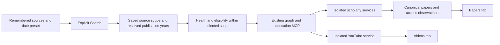

# Resource tabs and remembered search defaults

**November 11, 2026 · implemented user request.** Use the source-type tabs and compact filter toolbar from [research-scout-mockup.html](../discovery/ux/research-scout-design-handoff/research-scout-mockup.html) within the current Dub-inspired app. The earlier combined All view is superseded. General web search stays deferred.

## Search experience

Main Search has separate **Papers** and **Videos** tabs. Papers is the initial view; the last-used tab is remembered on this browser. Tabs filter existing progressive records without issuing another query. Paper cards retain abstracts, exact provider observations, canonical DOI grouping and Unpaywall access; video cards retain descriptions and original YouTube links. No transcript acquisition is implied. Other scholarly/registry record types remain visible in the Papers lane with their original metadata; dataset records are labeled explicitly.

The shared toolbar beneath the tabs contains source selection and publication ranges. **OpenAlex, Crossref, arXiv and YouTube** are selected initially. Users can remove any discovery source and select another from the available seven providers. The existing limit of **four discovery sources per search** remains explicit. Unpaywall access checks remain automatic for discovered paper DOIs and are separate from topic discovery. DataCite retains its registry role.

Selected sources, date preset/custom years and the last result tab persist in local browser storage, including across reloads and **New research**. These are browser preferences, not account-wide settings. Reading saved results or opening a source reader does not overwrite next-search preferences. Existing saved results retain their original filters and route; changing the toolbar prepares the next explicit Search.

## Adaptive publication ranges

The presets are **1 year, 2 years, 3 years, 5 years and Custom range**. Five years is the first-use default. Presets represent publication-calendar-year windows including the current year, which the toolbar states explicitly; provider filtering currently has year granularity. In 2026, the windows are 2026, 2025–2026, 2024–2026 and 2022–2026. They are not exact trailing 12/24/36/60-month intervals.

Store the preset, rather than its resolved dates, and recompute bounds at submission. A remembered three-year preset becomes 2025–2027 in 2027. Custom years remain literal. Whole-year validation, range ordering and the existing 1500–2200 bounds remain enforced. An empty source selection persists but prevents submission; it does not silently restore default providers.

## Source scope through the agent pipeline

`ConversationRequest` and `TurnRequest` accept optional `source_scope`, a unique list of one to four discovery providers for automatic routing. This is separate from legacy one/two-provider manual routing. Main Search sends the selected scope on conversation creation and on the turn. It is saved with the conversation and turn; overrides become the subsequent conversation scope.

The core intersects this scope with local provider health, access, resource-type and model-mode eligibility. It records excluded/unavailable sources in the existing source plan and never replaces removed providers with other services. The default scoped route includes eligible YouTube even without explicit video words, so one normal question can supply both tabs. Old clients and saved conversations without a scope retain their prior automatic routing behavior.

Agentic retrieval policy **v6** sends the eligible selected providers as a fixed set to the LLM and rejects plans that add or drop one. Per-provider query refinement, model/research allowances, provider isolation and canonical DOI provenance remain intact. Saved legacy idempotency identities omit absent scope fields; changing scope with an existing send key is rejected.

## Validation and runtime

**281 backend tests, 51 unique browser cases and 11 context/tool harness cases passed**, with zero final failures or skips; lint, TypeScript and production build passed. The full browser run passed 50 cases, then nine focused cases passed after adding scholarly registry-record preservation (one new case). [Browser run history](../docs/validation/2026-11-11-tabs-preferences-browser.json), [backend results](../docs/validation/2026-11-11-tabs-preferences-final-python.xml), [harness](../docs/validation/2026-11-11-tabs-preferences-final-harness.json), [final receipt](../docs/validation/2026-11-11-tabs-preferences-final.json).

Tests cover source exclusions/inheritance, fixed agentic scope, unchanged send-key replay, presets across a simulated year change, custom ranges, saved history, source inspection/return, zero-source prevention and separate tab replay. Actual isolated fixture services produced eight papers and four videos in one saved search. Read-only visual inspection checked those records and the existing 26 live papers / 10 live YouTube videos without new research/model requests. Saved filters and usage were unchanged; browser errors and horizontal overflow were zero at 1440, 1024, 768, 390 and 320 pixels, including the expanded source picker.

[Fixture inspection](../docs/validation/2026-11-11-tabs-preferences-fixture-ui.json), [saved live inspection](../docs/validation/2026-11-11-tabs-preferences-live-ui.json), [desktop toolbar](../docs/validation/2026-11-11-tabs-preferences-live-papers.png), [mobile toolbar](../docs/validation/2026-11-11-tabs-preferences-live-390.png), [live video cards](../docs/validation/2026-11-11-tabs-preferences-live-live-youtube.png). Fixture evidence establishes integration behavior, not live search quality. Earlier live YouTube acceptance remains valid evidence for the configured connection.

AI refinement and optional answer generation remain blocked by the existing shared model-cost/hold ledger, unchanged at $0.21650213. This work does not change that allowance or release unresolved holds. The live launcher is restored with all nine services and the configured YouTube key; the app is left running at **http://127.0.0.1:3100/**. [Credential scan scope](../docs/validation/2026-11-11-tabs-preferences-privacy.json).
