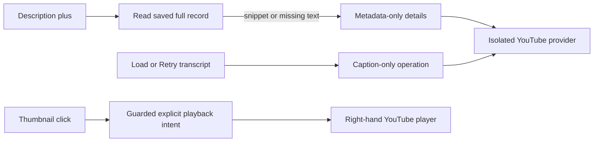

# Working video descriptions, metadata, transcripts and preview intent

November 12, 2026. Three agents traced description recovery, reader actions and playback intent in parallel; the root agent implemented and validated the separate backend operations. This fixes behavior without changing the existing UI direction or technology stack.

The failures had several concrete causes. Search descriptions were identified as `youtube_search_snippet` but could be treated as complete, so the plus icon only expanded the same short text. The shared component also explicitly excluded YouTube from provider detail recovery. The reader inherited a three-line CSS clamp even after expansion. A thumbnail opened saved metadata without a playback intent, making it appear inert when the reader was already visible. Finally, metadata and captions shared one backend operation and `details_loaded` gate, preventing failed/missing captions from being retried.

Read-only inspection of six saved YouTube runs found 60 videos: four had available captions and 56 had never fetched captions. The old combined operation reserved four provider requests; a run with five requests already used could not admit a second combined action under the existing eight-request allowance. Its conflict response was also presented as an unrelated editing conflict. This was not evidence that all 56 videos lacked captions.

Descriptions now recover through an explicit saved read and, when needed, a metadata-only `POST /api/research-runs/{run_id}/papers/{source_ref}/details`. Short search snippets and legacy `details_loaded` flags no longer prevent recovery. Newly fetched metadata uses `youtube_video_details`. Latest known whole records win over public previews; explicit historical project pins remain local until the user chooses current details. Expanded text clears the inherited clamp and height limits on both sides. Complete returned descriptions expand locally without caption/model work.

Caption loading uses its own `POST /api/research-runs/{run_id}/papers/{source_ref}/transcript`, busy state and timer. The core calls the isolated YouTube service at `/operations/transcript`; metadata uses `/operations/details`. Metadata requests reserve one attempt and caption requests reserve at most three, within the unchanged provider/run and overall allowances. Metadata loading does not start captions, and caption loading does not re-fetch metadata. The core serializes both observations for a source, preserves captions across metadata refresh and delayed discovery events, and retains exact saved selection snapshots.

The provider’s metadata-only cache has a new protocol key so earlier combined results cannot masquerade as complete metadata. Metadata cache lifetime is one day. Provider caption results are cached for one day when available and five minutes for failed/unavailable/blocked outcomes. Explicit retries respect the cooldown and durable request grants. A cached failure returns the remaining wait with zero upstream calls; an exhausted grant returns 429, not a revision conflict. Only selection conflicts use the editing-conflict message. Existing available run captions remain saved evidence and are reused without fetching again.

The reader distinguishes unfetched, available, unavailable, blocked and error states. Retry transcript is explicit; no hover, row selection, metadata read or description expansion fetches captions. The official YouTube captions download API requires permission to edit the video, so a Data API key does not grant arbitrary transcript access. Current public-caption retrieval uses the installed transcript library with bounded calls and honest failure outcomes; it does not use account cookies or proxy workarounds. [Google captions download documentation](https://developers.google.com/youtube/v3/docs/captions/download), [caption library](https://github.com/jdepoix/youtube-transcript-api).

Thumbnail clicks now carry a separate playback intent through the guarded saved read to the reader. The request is scoped to the run, source and current selection sequence. It opens the validated YouTube embed on Overview, including when the same metadata is already visible. Eye/title/row selection stays metadata-only, stale reads cannot start playback, and returning to a source does not replay an earlier intent. An existing iframe remains mounted through caption updates.

The [combined receipt](../docs/validation/2026-11-12-video-recovery-final.json) records mocked UI, backend/protocol, harness, build and actual saved-video verification. The live UI recovered full descriptions on both sides, independently fetched 133 caption segments, opened the player from the left thumbnail and reopened the eye preview without playback. It used four new provider attempts, no new search/model work, and passed six widths. The owned idle launcher was restarted; the core, nine providers and frontend were checked, with the model ledger preserved. No budget increase, state deletion, dependency change, commit or push was performed.
