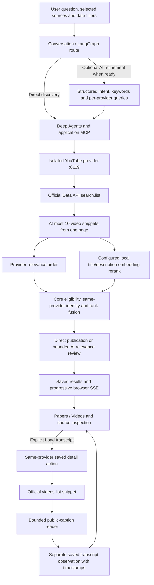

# YouTube retrieval, transcripts and relevance review

**November 11, 2026 · repository inspection and current primary-source research.** This record answers the user's questions about the existing video integration and separates that implementation from the proposed next relevance slice. No keyed provider request, transcript fetch, model call, package installation or external MCP connection was performed for this review. The existing [live video acceptance](youtube-live-2026-11-11.md) and [live caption acceptance](preview-stability-and-video-2026-11-11.md#validation) remain the measured access evidence.

The project-local [system-design skill](../.agents/skills/system-design/SKILL.md), including its AI/evaluation reference, informed this bounded review. The earlier [resource guide](../discovery/research/project-research-resource-guide.md) and [research reconciliation](research-inputs.md) distinguish discovery metadata, content acquisition and substantive evidence; those distinctions apply to video as well as papers.

## What currently happens

Main Search retains the selected provider set and date filters. Its conversation graph delegates discovery through the existing Deep Agents/application MCP path to the independent YouTube service on port **8119**. The provider service then calls Google's official REST API; no external YouTube MCP server is connected.

The official search request is `GET https://www.googleapis.com/youtube/v3/search` with `q=<provider lexical query>`, `part=snippet`, `type=video`, `order=relevance`, `maxResults<=10` and `safeSearch=moderate`. Selected publication years become `publishedAfter`/`publishedBefore` bounds and are rechecked against normalized metadata locally. There is one bounded page and no automatic paging. The server supplies the ignored local `SCOUT_YOUTUBE_API_KEY` in the `X-Goog-Api-Key` header; keys never belong in browser state or saved query arguments. Implementation: [REST request shaping](../src/research_scout/providers/rest_discovery.py), [transport and ranking](../src/research_scout/providers/adapters.py), [normalization](../src/research_scout/providers/normalization.py).

Search produces titles, channels, publication dates, thumbnails and available snippet descriptions. These are **descriptions, not transcripts or paper abstracts**. An explicit detail action calls `videos.list(part=snippet,id=<saved video ID>)` before trying public captions; that can supply a richer description. The current detail route does not request duration/statistics and normalization does not retain tags. Google's [video resource lookup](https://developers.google.com/youtube/data/reference/rest/v3/videos/list) documents those additional parts and fields.

The semantic branch embeds the query and the fetched videos' `title + description` with the configured compatible local encoder, computes cosine similarities and reorders that same pool. The core then uses the branch ranks. This **cannot retrieve a video absent from the REST page** and does not inspect spoken content. Encoder readiness remains a separate capability; without it, lexical discovery can still succeed. See [adapter semantic branch](../src/research_scout/providers/adapters.py) and [provider encoder loading](../src/research_scout/providers/__main__.py).

## What “refining” means

Optional AI refinement is a LangGraph loop in [retrieval.py](../src/research_scout/retrieval.py), policy `scout-agentic-retrieval-v6`. It interprets the original question into domain, intent frame, keywords/tags, required facets and separate provider queries. It retrieves and reviews each selected provider independently, classifying candidates as relevant, partial, irrelevant or unknown. Direct matches enter primary results; adjacent/uncertain matches stay separate. A weak first batch can cause **one** revised query for that same provider, within the existing attempt and model allowance.

The exact plan, query history and provider request arguments are saved. The review sees bounded titles and abstract/description excerpts, and direct relevance needs an exact supporting quote from those supplied excerpts. It does not watch the video or automatically use saved captions. “Refining” is therefore query/relevance work, distinct from the local embedding rerank and from answer generation. When the shared model allowance is blocked, the UI must disclose that and keep direct discovery available; a spinner is not proof of an active model request. This review did not reset or increase that allowance.

For the earlier ambiguous question about improving context for better generation, a useful **proposed, unevaluated** YouTube lexical query is `large language models retrieval augmented generation context engineering evaluation tutorial`; its local semantic query could be `How does selecting and organizing retrieved context improve factual accuracy and answer quality in large language models?`. Retain the original question and disclose the inferred ML/LLM domain. Avoid generic `context model generation`, whose words are shared with unrelated fields. These examples illustrate query shaping, not measured relevance improvement.

## Can the official API return arbitrary video transcripts?

The Data API has captions endpoints, but an API key does not grant general transcript access. `captions.list` requires an authorized scope and lists tracks without caption text. `captions.download` requires the caller to have permission to edit that video. Signing into an ordinary viewer account would not confer that edit permission. See Google's [caption listing](https://developers.google.com/youtube/data/reference/rest/v3/captions/list) and [caption download](https://developers.google.com/youtube/data/reference/rest/v3/captions/download).

Research Scout already has a separate public-caption path using `youtube-transcript-api`, not official `captions.download`. It prefers available English tracks, otherwise an available track, retains language/generated status and timestamped text, and explicitly reports unavailable, blocked or error outcomes. The library maintainer documents [public-track access and IP-blocking limitations](https://github.com/jdepoix/youtube-transcript-api). A public caption indicator therefore does not guarantee successful download from this runtime.

Current bounds are one official metadata request plus at most three public-caption HTTP attempts, no account cookies/proxy configuration, up to 600 retained segments, 2,000 characters per segment and 60,000 characters overall. Cancellation fences stop subsequent dispatch and await already admitted work before closing the journal. Successful provider detail outcomes are cached for 24 hours; failed/unavailable caption outcomes for five minutes. The inspected run preserves its saved observation, so reopening does not silently redispatch or replace the citation version. See [caption reader](../src/research_scout/providers/youtube_captions.py) and [service detail cache](../src/research_scout/providers/service.py). The prior live acceptance obtained 92 English segments from one saved video; that proves that case, not universal availability.

## Is there a YouTube MCP server?

Community implementations exist. No first-party YouTube MCP endpoint was verified in Google's current [supported products catalog](https://docs.cloud.google.com/mcp/supported-products) or [Google-maintained MCP repository](https://github.com/google/mcp). This is a dated verification result, not a proof that no such service can exist.

| Option | Evidence reviewed | Consequence for Research Scout |
| --- | --- | --- |
| Existing isolated REST adapter | Working local implementation and earlier live acceptance. | Retain the current bounded, journaled route while improving relevance. |
| [ZubeidHendricks/youtube-mcp-server](https://github.com/ZubeidHendricks/youtube-mcp-server) | Maintainer repository exposes video search/detail and transcript tools; metadata uses a Data API key and transcript support is a separate package. Not installed or runtime tested here. | A possible future adapter inside the same isolated provider. MCP itself adds neither transcript rights nor corpus semantic search. |
| First-party Google YouTube MCP | No endpoint verified in the official catalogs above. | Do not claim an official connection or replace the working route based on a directory entry. |

A community MCP adoption would need a pinned implementation, a read-only tool allowlist, runtime schema/transport tests and preserved admission/cache/provenance controls. Loading a broad external tool catalog into the coordinator would undermine the bounded provider boundary without improving search evidence. The current application MCP already gives agents a tool interface; using an external MCP is worthwhile only if its capabilities or operational behavior improve the product.

## What similarity search is possible?

The documented [YouTube search interface](https://developers.google.com/youtube/data/reference/rest/v3/search/list) accepts text queries and filters, including optional caption, duration, language and channel controls. It does not document query embeddings, a vector similarity endpoint or transcript passage search. This is an inference from the public API surface; Google's internal relevance algorithm is opaque and may itself use semantic signals. Research Scout labels its API candidate path lexical because it supplies query terms, not vectors.

For more relevant video context, the recommended next slice is:

1. **Improve candidate recall without delaying first results.** Preserve the user's intent and create short YouTube-specific domain/method queries. Keep current primary results visible during an explicitly admitted second query. Save every query and distinguish added recall from reranking.
2. **Enrich retrieved IDs in one bounded batch.** Consider `videos.list(part=snippet,contentDetails,id=<up to 10 IDs>)` for richer descriptions, tags, language and duration. Publish those fields as new provider observations. Do not silently fetch every result's transcript. Google's [video list reference](https://developers.google.com/youtube/data/reference/rest/v3/videos/list) documents ID-based lookup and a one-unit cost.
3. **Use caption context when it actually exists.** Reuse saved captions first; explicitly acquire a bounded selected set otherwise. Split by contiguous timestamped passages, embed query and passages in the same pinned local space, and rank matched passages within each video before ranking videos. Show a source excerpt and time link, language, truncation and “metadata-only” fallback. Do not penalize an uncaptioned video as irrelevant solely because its transcript is unavailable.
4. **Keep a later vector index scoped to acquired content.** A provider-owned cache/index over saved caption chunks could support local semantic recall, keyed by video ID, transcript observation/language, chunk boundaries and encoder revision. It would search only that acquired corpus. It is not YouTube-wide vector search and is not implemented now.
5. **Evaluate before changing defaults.** Use a small labeled set including the exact ambiguous-context question, unrelated word overlaps, missing/blocked captions, non-English videos, stale observations and partial failures. Compare original provider order, existing metadata rerank and caption-passage rerank with relevance@5/nDCG@10, query attempts, first-result latency and caption coverage reported separately. Fix the candidate set for reranker comparisons; quality and latency improvements remain unproved until measured.

These are recommendations for a bounded follow-up, not backend changes or a new database commitment in this UI iteration. No new external MCP, automatic bulk transcript ingestion or transcript-based ranking is enabled by this document.

## Quotas and operational boundary

The current official [quota calculator](https://developers.google.com/youtube/data/determine_quota_cost) describes a default separate allowance of **100 `search.list` calls/day** and **10,000 units/day for other endpoints**, with a separate upload allowance and reset at midnight Pacific time. Additional pages spend additional search calls. This supersedes the common older “100 units per search out of 10,000” wording; actual configured project limits must be checked in its console. Caption listing/download are documented as 50/200 units respectively, though Research Scout's current public-caption reader does not call those official endpoints. [Caption list](https://developers.google.com/youtube/data/reference/rest/v3/captions/list), [download](https://developers.google.com/youtube/data/reference/rest/v3/captions/download).

The local provider journal currently has a conservative 100-attempt fixed Unix-day fence named `search-daily`; **it counts search, metadata and public-caption dispatches together**. It is not Google's separate search bucket, does not reset on the same timezone boundary, and does not observe other apps sharing the project key. Keep that distinction visible in operational reporting. A later quota-accounting improvement should separate official search calls, other Data API units and public-caption attempts while preserving existing uncertain holds; it must not reset saved usage to obtain fresh allowance. No quota or ledger policy changed in this review.
